# TYPA 管理者マニュアル

権限が Admin の人（人事・総務の管理担当者）向けの説明書です。社員ごとの権限・等級・評価者の設定、招待コードの発行、評価期間と評価の基準の設定、全社の進み具合の確認、導入時のデータ取込、通常の手順では直せないシートの修正・状態変更・削除（遡及処理）を説明します。

自分の評価シートの書き方は「利用者マニュアル」、部下の評価のしかたは「評価者マニュアル」を見てください。

## 管理者ができること

| 画面                         | Admin だけができること                                                                                                                             |
| ---------------------------- | -------------------------------------------------------------------------------------------------------------------------------------------------- |
| 評価シート                   | 全社の評価シートの進み具合と最終評価を一覧で見る。行からシートを開いて中身を見る（読み取り専用）。一覧を PDF に出力する                            |
| 社員マスタ                   | 権限・ログイン保持・等級・一次評価者・二次評価者の変更。招待コードの発行、登録の取り消し、利用の停止・再開                                         |
| 設定（ユーザーメニュー）     | 評価期間の追加（通年・半期・四半期に分ける）・開始・締め、評価点の配点、チャレンジ目標の数、評価の依頼の知らせ方（アプリ内通知・メール）           |
| 導入処理（ユーザーメニュー） | 社員の仮登録（初期ユーザ）。実施中の評価期間へ、目標・共通評価・点数を CSV でまとめて取り込む                                                      |
| 遡及処理（ユーザーメニュー） | シートの値を理由を残して直す（締めた評価期間だけ）。どの評価期間のシートも、通知なしで状態変更・削除できる。当期のシートは作成時の等級を変えられる |

次のことは Admin にもできません。

- 実施中の評価期間で、自分が本人・評価者でない評価シートの中身を変えること（全社の一覧から開いたシートは見るだけです）。
- 締めた評価期間をもう一度開始すること。締めた後に直す必要があるときは、[遡及処理](#9-遡及処理締め後修正状態変更削除)で項目ごとに直します。
- 氏名・社員番号の変更、等級や共通評価項目の追加・変更。これらは画面がなく、システム担当者がデータベースで行います（社員の追加は[導入処理の「初期ユーザ」](#初期ユーザ社員の仮登録)でできます）。

## 1. 1期の運用の流れ

評価は「評価期間」ごとに進みます。期（年度）を通年のまま評価するときは1期に1回、半期制なら上期と下期に1回ずつ、四半期制なら4回、同じ流れをくり返します。

```
評価期間の初め：期間を開始 → 社員が作成・記入
評価期間の終わり：社員が達成状況を書いて一次評価を依頼 → 一次評価 → 二次評価
締め：全員の評価確定を確認 → 次の評価期間を開始
```

| 時期               | 管理者の作業                                                           | 参照                                                   |
| ------------------ | ---------------------------------------------------------------------- | ------------------------------------------------------ |
| 期の前             | 次の期を追加する（通年・半期・四半期に分ける）                         | [6](#6-評価期間)                                       |
| 評価期間の初めの前 | 昇級などの等級の変更、評価者の付け替えを済ませる                       | [2](#2-社員マスタ)                                     |
| 評価期間の初め     | 次の評価期間を開始する（今の評価期間は同時に締められる）               | [6](#6-評価期間)                                       |
| 期中               | 新しい社員を仮登録し、招待コードを渡す。登録や利用停止の相談に対応する | [3](#3-招待コード)・[4](#4-登録とアカウントのトラブル) |
| 評価期間の終わり   | 全社の一覧で、送信・依頼・評価が止まっている人を確認し、声をかける     | [5](#5-全社の評価シート)                               |
| 締めた後           | 評価の誤りが見つかったら、遡及処理で直す                               | [9](#9-遡及処理締め後修正状態変更削除)                 |

システムを使い始めるときは、[導入処理](#8-導入処理データ取込)で、実施中の評価期間へそれまでの目標などを取り込めます。

## 2. 社員マスタ

上部の「社員マスタ」を開きます。上段は自分の情報、下段が社員一覧です。一覧の値は、選ぶとその場で保存されます。

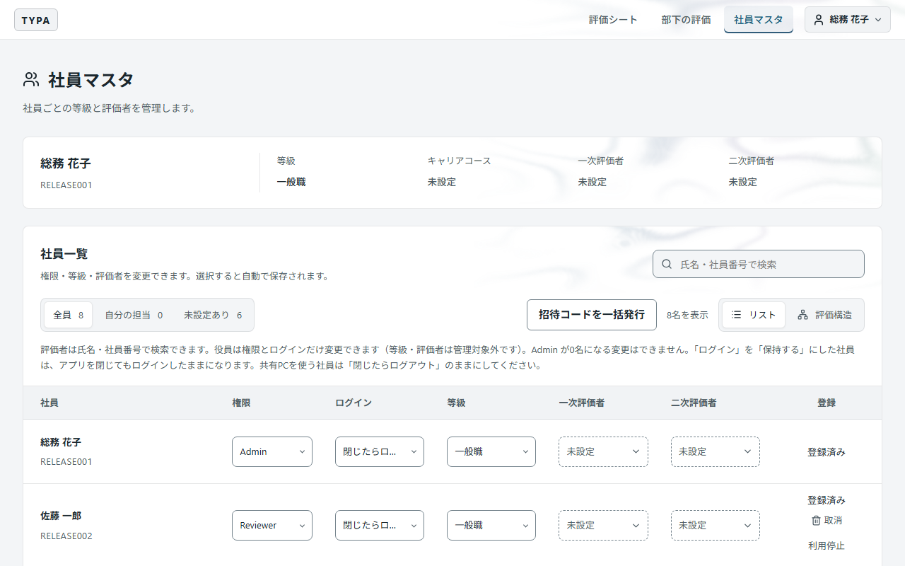

一覧の上の「全員」「自分の担当」「未設定あり」で表示を切り替えられます。期初には「未設定あり」で、等級や評価者の設定漏れがないか確認してください。

### 権限

| 権限     | できること                                                         |
| -------- | ------------------------------------------------------------------ |
| Admin    | すべての管理操作（このマニュアルの内容）                           |
| Reviewer | 社員マスタで全社員の等級・評価者と評価構造を見る（変更はできない） |
| Employee | 社員マスタでは自分の情報だけを見る                                 |

評価者に選べるのは Admin と Reviewer、およびキャリアコースが「役員」の社員です。それ以外の Employee の社員には「部下の評価」は表示されません。

利用できる登録済みの Admin が0人になる変更（最後の Admin の権限変更・利用停止）はできません。引き継ぐときは、先に後任を Admin にし、その人がログインできることを確かめてから変更してください。

### ログイン

| 値                           | 意味                                                                   |
| ---------------------------- | ---------------------------------------------------------------------- |
| 閉じたらログアウト（初期値） | アプリを閉じるとログアウトする。共有PCを使う社員はこのまま             |
| 保持する                     | アプリを閉じてもログインしたまま。自分専用のPCを使う社員だけに設定する |

### 等級

等級によって、評価シートの共通評価の項目が決まります。変更した等級は**これから作るシート**に使われ、作成済みのシートの等級・評価項目は変わりません。昇級は、社員が次の期間のシートを作る前に済ませてください。

### 一次評価者・二次評価者

氏名・社員番号で検索して選びます。二次評価者には次の2つの「空」があり、意味が違います。

| 二次評価者                 | 意味                                                             |
| -------------------------- | ---------------------------------------------------------------- |
| 未設定                     | まだ決めていない。二次評価をする人がいないので、評価が完了しない |
| なし（一次評価が最終評価） | 二次評価をしない。一次評価者が最終評価ランクを決め、確定する     |

評価者の付け替えは、実施中の期間の**未確定のシート**に反映されます。評価確定のシートは、評価した人のまま残ります。

### 役員

コース区分が「役員」の社員は、権限とログインだけを変更できます（等級・評価者は管理しません）。評価構造では、評価する側としてだけ表示されます。

## 3. 招待コード

社員が新規登録するには、管理者が発行する招待コードが必要です。コードは自動で作られるので、自分で考える必要はありません。

### まとめて発行する（導入時・期初）

一覧の上の「招待コードを一括発行」を押すと、期限内のコードを持っていない未登録の社員全員に発行されます。表示された一覧を「一覧をコピー」で表計算ソフトに貼り付け、印刷するなどして**本人に個別に**渡してください。

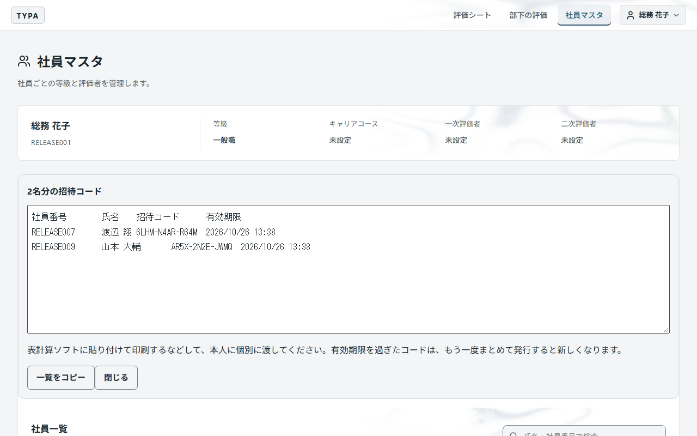

### 1人に発行する（再発行）

未登録の社員の行の「招待コード」を押すと、その人のコードが表示されます。

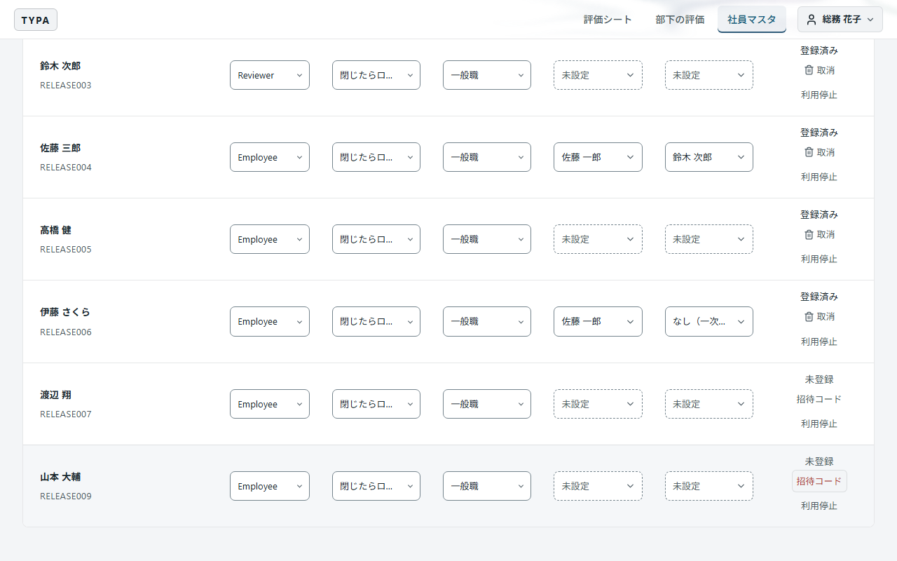

| 決まり         | 内容                                                                       |
| -------------- | -------------------------------------------------------------------------- |
| 有効期限       | 発行から7日間。過ぎたら発行し直す                                          |
| 使える回数     | 1回。登録が済むと使えなくなる                                              |
| 再発行         | 前のコードは使えなくなる                                                   |
| 表示を閉じたら | 二度と表示できない。閉じる前にコピー・控えを済ませる。なくしたら再発行する |

## 4. 登録とアカウントのトラブル

社員一覧の右端「登録」の列で、登録の状態（未登録・登録済み・利用停止中）を確認し、操作します。

| 相談                             | 操作                                                                                                     |
| -------------------------------- | -------------------------------------------------------------------------------------------------------- |
| パスワードを忘れた               | 「取消」で登録を取り消し、招待コードを発行して渡す。本人が新規登録をやり直す（評価データは残る）         |
| 退職・休職で使わせたくない       | 「利用停止」。ログイン中でも閲覧・保存ができなくなり、新規登録もできない（評価データとアカウントは残る） |
| 休職から戻った                   | 「利用再開」。以前の社員番号とパスワードでログインできる。未登録だった人には招待コードを発行する         |
| 招待コードが使えない             | 期限切れ・使用済み・再発行済みの可能性。発行し直す                                                       |
| 共有PCで前の人のログインが残る   | その社員の「ログイン」を「閉じたらログアウト」にする                                                     |
| 社員番号が見つからないと言われる | 社員マスタに出ていなければ、導入処理の「初期ユーザ」で仮登録してから招待コードを渡す                     |

「取消」と「利用停止」の使い分け：登録をやり直させたいときは「取消」、使わせたくないときは「利用停止」です。どちらも評価データは消えません。利用停止を解除しても、ログイン保持の設定は元に戻らないので、必要なら設定し直してください。

## 5. 全社の評価シート

「評価シート」の一覧の下に、Admin だけに「全社の評価シート」が表示されます。上部の帯は、選んだ評価期間のシートがどの段階に何枚あるかを表し、下の件数を押すとその段階だけに絞り込めます（もう一度押すと解除）。

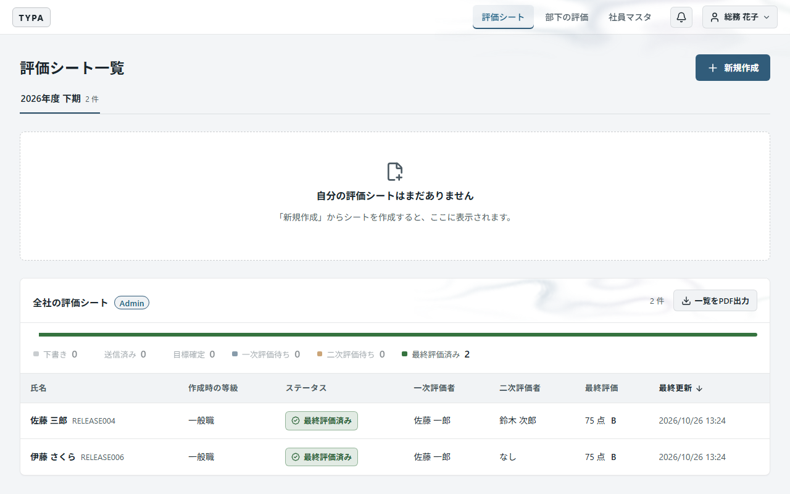

- 一次評価者・二次評価者・最終評価（点数とランク）を一覧で確認できます。
- 行を押すと、そのシートを開きます。下書きを含むどの段階でも、目標・一次評価・二次評価・総評をすべて見られます。見るだけで、入力・送信・確定はできません（画面に「Admin として閲覧しています」と出ます）。
- 自分が本人・評価者のシートは、Admin であってもその立場で見えます（自分のシートの確定前の点数は見えません）。
- 行ごとの PDF 出力はありません。まとめて見るときは「一覧をPDF出力」を使います。PDF には、段階ごとのランクと総評も載ります。
- 締めた後に遡及処理で直したシートは、本人・評価者のシートと PDF に「締め後修正」として赤字で示されます。
- まだシートを作っていない社員はこの一覧に出ません。作成漏れは、評価者の「部下の評価」画面（状態が「未作成」）で確認できます。

### 評価構造

社員マスタの「評価構造」に切り替えると、左から「二次評価者（最終評価）→ 一次評価者 → 評価される社員」の順に、評価の流れが図で表示されます。点線の枠は未設定です。社員名を押すと、リストでその社員の設定を開きます。

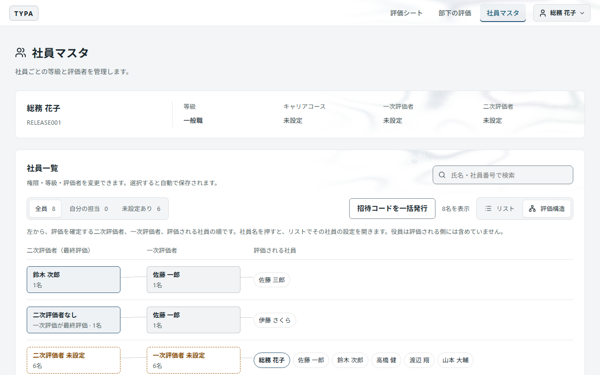

## 6. 評価期間

右上のユーザーメニュー →「設定」を開きます。設定は Admin だけが表示・変更できます。

### 期と評価期間

**期**は「26期」のような年度です。期は、通年のまま1つの**評価期間**にするか、半期（上期・下期）や四半期に分けて複数の評価期間にします。分けた評価期間はそれぞれ独立していて、シートの作成・評価・締めは評価期間ごとに行います。上期と下期の点数をまとめて期の点数にすることはありません。

| 言葉         | 意味                                                                                             |
| ------------ | ------------------------------------------------------------------------------------------------ |
| 当期         | 実施中の評価期間が属する期の、すべての評価期間（半期制なら上期と下期の両方）                     |
| 前の評価期間 | その評価期間が始まる前に終わった、いちばん新しい評価期間。下期なら当期の上期、上期なら前期の下期 |

評価期間の状態は「未開始 → 実施中 → 締め済み」の順に進み、戻りません。**実施中の評価期間は常に1つ**で、評価シートの作成・記入・評価・確定ができるのは実施中の評価期間だけです。締めた評価期間のシートは、閲覧と PDF 出力だけになります。

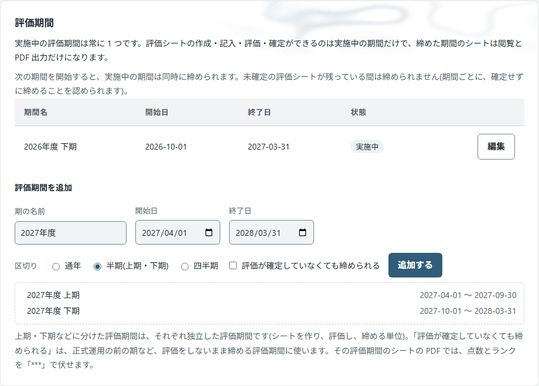

### 期を追加する

1. 「期の名前」（例: 26期）、開始日、終了日を入れます。
2. 「区切り」で、通年・半期（上期・下期）・四半期を選びます。下に、追加される評価期間の名前と日付が表示されます。
3. 必要なら「評価が確定していなくても締められる」をオンにします（下の[締めのあいまいさ](#評価が確定していなくても締められる評価期間)）。
4. 「追加する」を押します。

評価期間の日付は、開始日から6か月（四半期は3か月）ずつ区切り、最後の評価期間を終了日までとして決まります。3/23 始まりの期なら、上期は 3/23〜9/22、下期は 9/23〜終了日です。カレンダーで区切りの日を調べる必要はありません。期間が短すぎて分けられないときは、その旨が表示されます。

| 操作 | 方法・条件                                                                             |
| ---- | -------------------------------------------------------------------------------------- |
| 変更 | 行の「編集」。期の名前・日付・締め方を変えられる。上期・下期などの区切りは変えられない |
| 削除 | 評価シートが1件もない評価期間だけ「削除」できる。元に戻せない                          |
| 開始 | 未開始の評価期間の「この期間を開始する」。実施中の評価期間は同時に締められる           |

### 期間を切り替える

「この期間を開始する」を押すと、確認画面に注意点が表示されます。内容を読んでから「締めて、次の期間を開始する」を押してください。

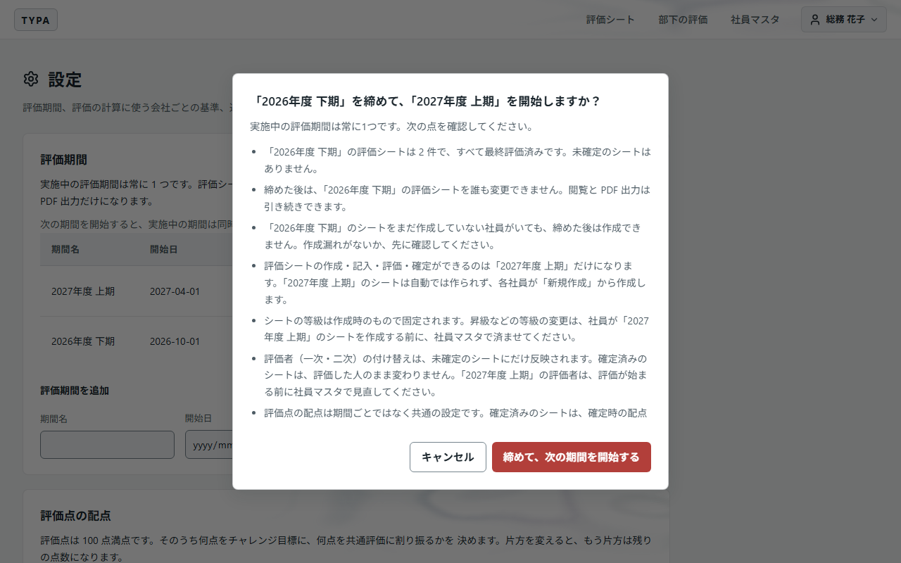

- 実施中の評価期間に**未確定のシートが残っていると締められません**（下の設定をした評価期間を除く）。全社の一覧で、すべて「評価確定」か確認してください。
- 締めた後は、その評価期間のシートを誰も変更できず、まだ作っていない社員も作れなくなります。
- **締めた評価期間は、もう一度開始することはできません。** 締める前に、確認画面の内容を確かめてください。締めた後に直す必要が出たときは、[遡及処理](#9-遡及処理締め後修正状態変更削除)で項目ごとに直します。
- 次の評価期間のシートは自動では作られません。社員が各自「新規作成」から作ります。
- 等級の変更と評価者の見直しは、社員がシートを作る前に済ませてください。
- 利用中の社員の画面には、画面を開き直したときに反映されます。

### 評価が確定していなくても締められる評価期間

「評価が確定していなくても締められる」をオンにした評価期間は、未確定のシートが残っていても締められます。正式運用の前の評価期間に目標だけを取り込み、評価をしないまま締める、といった使い方をします。

- 締めたシートは、その時点の状態（下書きなど）のまま残ります。
- 評価者は、締めた後のシートを下書きのままでも閲覧できます。
- その評価期間のシートは、確定していなくても PDF に出力できます。PDF の点数・ランク・評価者のコメントは「`***`」で伏せます。

## 7. 評価の基準

### 評価点の配点

評価点は 100 点満点です。そのうち何点をチャレンジ目標に、何点を共通評価に割り振るかを決めます。片方を変えると、もう片方は残りの点数になります。「配点を保存する」で保存します。

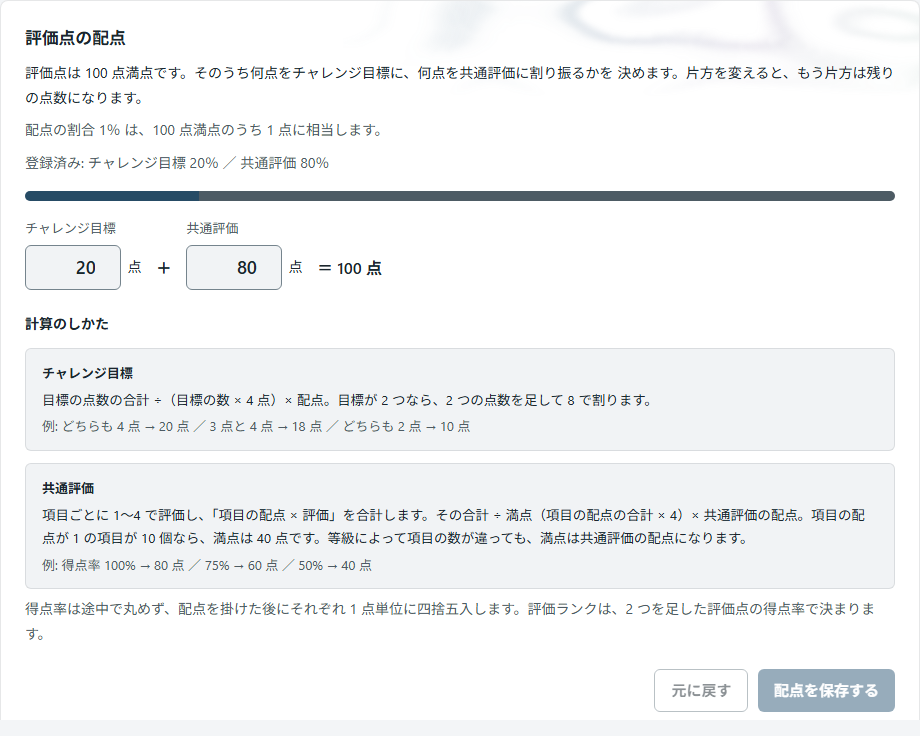

- 変更は**未確定の評価シート**の評価点と見込みランクに反映されます。確定済みのシートと、確定した一次評価ランクは変わりません。
- 配点は期間ごとではなく、全期間で共通の設定です。期の途中で変えると評価者の見込みが変わるので、期初に決めて動かさないのが安全です。

評価ランクは、評価点（100点満点）から自動で決まります：95点以上 S ／ 90点以上 A ／ 80点以上 B+ ／ 60点以上 B ／ 50点以上 B- ／ 40点以上 C ／ それ未満 D。

### チャレンジ目標の数

1枚の評価シートに置ける目標の数の上限です。目標は最低1件必要です。上限を下げると、それより多い目標を持つ未確定のシートは、目標を減らすまで送信・確定できなくなります。

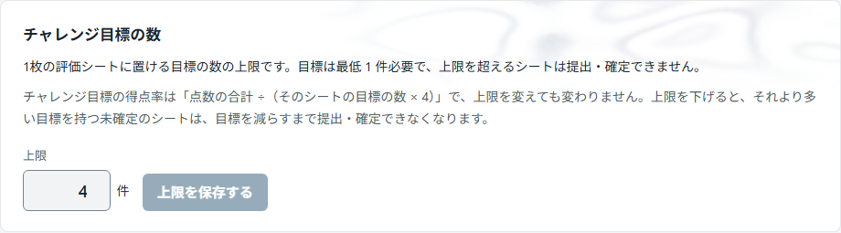

### 通知

目標の送信時と一次評価依頼時は一次評価者へ、目標確定・要修正時は本人へ、一次評価の確定時は二次評価者へ知らせます。知らせ方は **アプリ内通知** と **メール** のどちらか一方です。

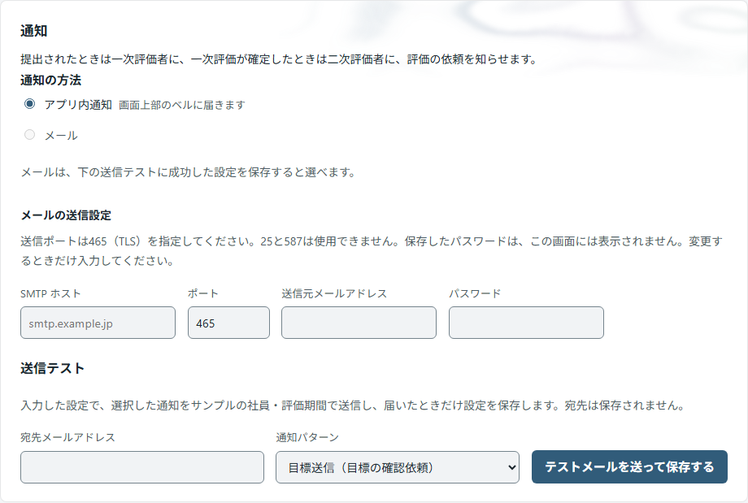

#### 通知の方法

| 方法                 | 届く場所                                       | 選べる条件                                             |
| -------------------- | ---------------------------------------------- | ------------------------------------------------------ |
| アプリ内通知（既定） | 画面上部のベル。未読の数が表示される           | いつでも                                               |
| メール               | 評価者が新規登録のときに確認したメールアドレス | 下の「メールの送信設定」で送信テストに成功しているとき |

選ぶとすぐに切り替わります。アプリ内通知は状態の変更と同時に記録されるので、送信の失敗や再送はありません。評価が次の段階に進んだ依頼は自動で既読になり、一次評価者が要修正として戻した依頼は取り下げられます。異動で評価者が替わったときは、待っている依頼が新しい評価者に届きます。

#### メールの送信設定

メールで知らせるときに使うメールサーバーと送信元です。**送信テストに成功したときだけ保存されます。** 届くことを確かめていない設定で、メールを選ぶことはできません。

| 項目                 | 内容                                                                                          |
| -------------------- | --------------------------------------------------------------------------------------------- |
| SMTP ホスト          | 送信に使うメールサーバー                                                                      |
| ポート               | **465（TLS）**を指定する。587 と 25 は使えない                                                |
| 送信元メールアドレス | 通知メールの差出人                                                                            |
| パスワード           | 保存後は表示されない。変更するときだけ入力する。SMTP ホストか送信元を変えるときは、入力し直す |
| 宛先メールアドレス   | 送信テストの送り先。保存されない                                                              |
| 通知パターン         | 送信テストに使う文面。目標送信・目標確定・目標の差し戻し・一次評価依頼・一次評価確定の5種類   |
1. 各項目を入力し、「テストメールを送って保存する」を押します。
2. 入力した設定で、通常の通知と同じ文面のテストメール（件名に「送信テスト」）を、サンプルの社員・評価期間で送ります。
3. 届いたら設定が保存され、「送信テスト済み（日時）」と表示されます。ここで初めて「メール」を選べるようになります。

送信できなかったときは、メールサーバーの応答が「（詳細: …）」として表示され、設定は保存されません（パスワードは表示されません）。たとえば `HandshakeFailure` は、メールサーバーの暗号化方式が古く、接続できないことを表します。

メールのとき「送信済みなのに届かない」と相談されたら、迷惑メールフォルダーや共有メールの受信箱を確認してもらい、それでも見つからなければメールサーバー側の配送記録を確認してください。

## 8. 導入処理（データ取込）

右上のユーザーメニュー →「導入処理」を開きます。システムを使い始めるときに行う処理がまとまっていて、Admin だけが使えます。

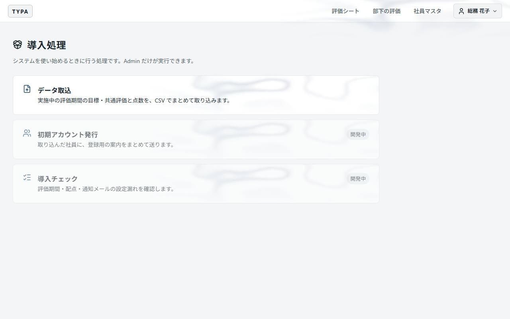

### 初期ユーザ（社員の仮登録）

新しい社員を社員マスタに足します。ここで登録した社員は、まだログインできません（未登録）。

1. 「初期ユーザ」を開き、社員番号・氏名・キャリアコース・等級を入力します。一次・二次評価者は任意で、後から社員マスタで決められます。キャリアコースが「役員」のときは評価者を選びません。
2. 「仮登録する」を押し、確認画面の内容を見てもう一度「仮登録する」を押します。**社員番号と氏名は後から画面で変えられない**ので、ここでよく確かめてください。
3. 社員マスタで、その社員に[招待コード](#3-招待コード)を発行して渡します。

社員番号はログインIDになるため、半角英数字・ハイフン・アンダースコアだけが使えます（全角で入力しても半角になります）。大文字・小文字だけが違う番号は、同じ番号として登録できません。権限は Employee で始まります。

### データ取込

「データ取込」では、**実施中の評価期間**へ、目標・共通評価・点数を CSV でまとめて取り込みます。取り込んだシートは下書きのまま作られ、通知メールは送られません。

1. 「目標のテンプレート」「共通評価のテンプレート」を保存します。テンプレートには、取り込める社員の社員番号・氏名と、目標番号・共通評価の項目が入っています。目標を送信済みの社員は載りません。
2. Excel などで本文と点数を記入して保存します。「CSV UTF-8」「CSV」のどちらで保存しても読めます。
3. 「目標」「共通評価」の欄にファイルを選び、「内容を確認」を押します。片方だけでも取り込めます。この段階では何も書き込みません。
4. 確認の結果を見て「取り込む」を押し、確認画面でもう一度「取り込む」を押します。

| 記入の決まり       | 内容                                                                                                                                                |
| ------------------ | --------------------------------------------------------------------------------------------------------------------------------------------------- |
| 変えない列         | 社員番号・目標番号・項目ID。氏名と項目名は、取り違えていないかの確認に使う                                                                          |
| 点数               | 1〜4 の数字か空欄                                                                                                                                   |
| 期中目標が2件以上  | 同じ社員番号・目標番号の行を足し、1行に1件ずつ書く（4件まで、ファイルの順）。チャレンジ目標・点数は最初の行に書き、続きの行では空欄か同じ内容にする |
| 期中目標が無い目標 | 「達成状況」の列は、チャレンジ目標に対する達成状況になる。期中目標がある目標では、達成状況は期中目標の行ごとに書く                                  |
| 何も書いていない行 | 取り込まない                                                                                                                                        |
| 1行でも書いた社員  | 実施中の評価期間の目標（または共通評価）が、ファイルの内容に置き換わる                                                                              |

**誤りが1件でもあると、何も取り込みません。** 誤りは、ファイル・行（Excel の行番号。見出しが1行目）・内容の表で表示されます。ファイルを直して選び直し、もう一度確認してください。

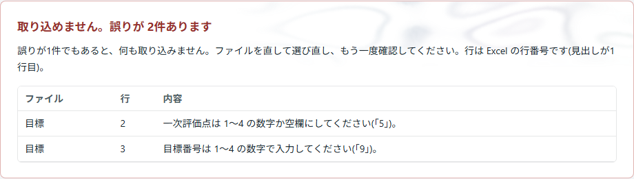

誤りがなければ、対象の社員の数、新しく作るシートと内容を置き換えるシートの枚数、目標と共通評価の件数が表示されます。


## 9. 遡及処理（締め後修正・状態変更・削除）

右上のユーザーメニュー →「遡及処理」を開きます。通常の手順では直せないシートを、理由を残して直します。Admin だけが使えます。

1. 左の「評価期間」で期間を選びます。期間の名前の後ろに（実施中）（締め済み）などが付きます。社員番号・氏名で絞り込めます。
2. 一覧からシートを選ぶと、右にそのシートが開きます。
3. 上の切り替えで、行う操作を選びます。

| 操作         | できる評価期間 | 内容                                                                                                                 |
| ------------ | -------------- | -------------------------------------------------------------------------------------------------------------------- |
| 値を直す     | 締め済みだけ   | 目標・点数・コメントを直す。本人と評価者のシートに「締め後修正」として赤字で表示される                               |
| 状態を変える | すべて         | 承認や通常の進行条件を省略して、どの状態へも移す。通知は送らない                                                     |
| 等級を変える | 実施中だけ     | シートを作成したときの等級を変える。共通評価の入力（点数・コメント）はすべて削除される。取り消せない。通知は送らない |
| 削除する     | すべて         | シートと、その目標・評価・修正の記録を削除する。取り消せない。通知は送らない                                         |
4. 画面の下の「理由」（必須・500 文字まで）を書き、確認のボタンを押します。
5. 確認画面で対象と内容を確かめて実行します。

選んだシートに書きかけの内容があるまま別のシート・期間・操作へ移ろうとすると、破棄してよいか確認します。

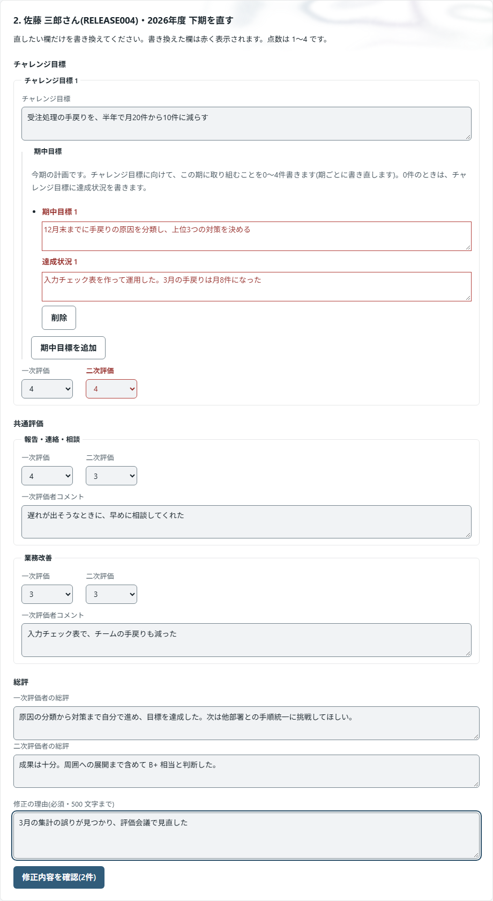

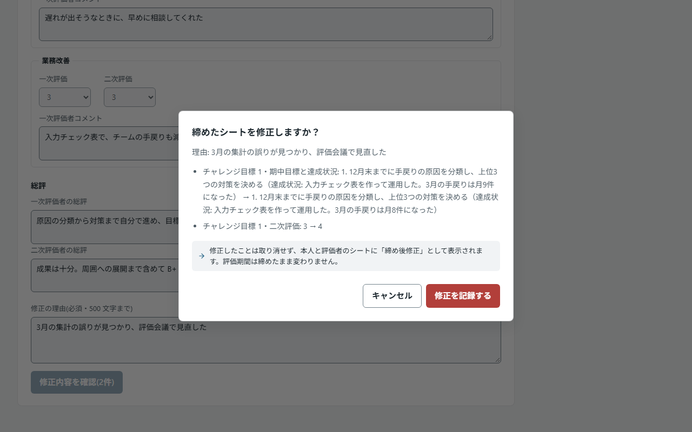

### 値を直す

| 直せる項目     | 内容                                                   |
| -------------- | ------------------------------------------------------ |
| チャレンジ目標 | チャレンジ目標・期中目標・達成状況・一次評価・二次評価 |
| 共通評価       | 一次評価・二次評価・一次評価者コメント                 |
| 総評           | 一次評価者の総評・二次評価者の総評                     |
- 締める前の評価期間のシートの値は、本人と評価者がシートで直します。「値を直す」は選べません。
- 書き換えた欄は赤く表示されます。点数は 1〜4 です。二次評価者を置かないシートには、二次評価はありません。
- 評価確定のシートの点数を直すと、評価点とランクは確定したときの配点で計算し直されます。
- 今と同じ内容には直せません。直した内容は、修正前後の値・理由・日時とともに記録され、取り消せません。画面の下の「このシートの修正の記録」で確認できます。
- 本人と評価者のシート、PDF には「締め後修正」として赤字で示されます。直した項目を見られる人にだけ見えます（評価の内容が見える範囲と同じです）。

### 等級を変える

人事発令の登録漏れなどで、シートを作成したときの等級が違っていたときに使います。

- 変えられるのは、実施中の評価期間のシートで、一次評価が確定する前（一次評価待ちまで）だけです。一次評価が確定したシートは、先に「状態を変える」で一次評価待ちまでに戻します。
- 等級で変わるのは共通評価の項目だけです。そのため、**共通評価で入力済みの点数とコメントはすべて削除され、取り消せません。** 評価者には、新しい等級の項目で共通評価をやり直してもらいます。
- チャレンジ目標・期中目標・達成状況・点数・総評・状態・評価者は変わりません。
- 社員マスタの等級は変わりません。次の期のシートにも新しい等級を使うときは、社員マスタの等級も変えてください。
- 通知は送りません。前後の等級・削除した点数とコメント・理由は監査ログに記録されます。

### 状態を変える・削除する

- 状態は進む順に並び、今の状態は選べません。記入済みの内容や点数はそのままで、確定した評価点とランクは解除されます。評価確定へ移したときは、その時点で計算し直します。
- アプリ内通知もメールも送りません。操作者・対象・前後の状態・理由は監査ログに記録され、削除したときは目標・評価・修正の記録も削除前の内容が監査ログに残ります。
- 確認している間にシートの状態が変わった場合は実行されません。読み直してから操作してください。

## 10. よくある質問

| 質問                                                       | 答え                                                                                                                                                                                             |
| ---------------------------------------------------------- | ------------------------------------------------------------------------------------------------------------------------------------------------------------------------------------------------ |
| 発行した招待コードをもう一度見たい                         | 閉じたコードは再表示できません。「招待コード」で再発行してください。前のコードは無効になります                                                                                                   |
| Reviewer が評価者を変更できないと言う                      | 評価者・等級・権限の変更は Admin だけです                                                                                                                                                        |
| 確定した評価を訂正したい                                   | 評価期間を締めた後に、[遡及処理](#9-遡及処理締め後修正状態変更削除)で項目ごとに直します。直したことは理由とともに記録され、本人と評価者に見えます                                                |
| 間違えて評価期間を締めた                                   | 締めた評価期間はもう一度開始できません。締めたシートを直す必要があれば遡及処理で直し、記入や評価は次の評価期間で進めます                                                                         |
| 次の評価期間を始められない                                 | 実施中の評価期間に未確定のシートが残っています。全社の一覧で「評価確定」以外を絞り込んで確認してください。評価しないまま締める評価期間なら、「評価が確定していなくても締められる」をオンにします |
| 上期と下期の点数を合わせて期の評価にしたい                 | 分けた評価期間はそれぞれ独立していて、合算や平均はしません                                                                                                                                       |
| データ取込で「目標を送信済みのため、取り込めません」と出る | 実施中の評価期間で目標を送信済みのシートは、取込で上書きしません。テンプレートにもその社員は載りません                                                                                           |
| 等級を変えたのにシートの評価項目が変わらない               | 作成済みのシートは作成時の等級のままです。変更は次に作るシートから反映されます                                                                                                                   |
| 二次評価者を置かない社員がいる                             | 二次評価者を「なし（一次評価が最終評価）」にします。「未設定」のままだと評価が止まります                                                                                                         |
| 社員の氏名や社員番号を変えたい                             | 画面からはできません。システム担当者に依頼してください                                                                                                                                           |
