# TYPA 評価者マニュアル

本マニュアルは、部下の評価を担当する一次評価者・二次評価者を対象としています。評価対象者の検索、採点と総評の入力、評価の確定、結果の確認までの操作を、画面に沿って説明します。

自身の評価シートの記入方法およびログイン方法については、「利用者マニュアル」を参照してください。

## 評価者の役割

一次評価者・二次評価者は、管理者が社員マスタで設定します。評価対象者1名につき、一次評価者と二次評価者をそれぞれ1名設定します。二次評価を実施しない場合は、二次評価者を「なし」に設定します。

```
本人：目標を送信 → 一次評価者：目標を確定（または要修正として下書きに差し戻し）
→ 本人：達成状況を記入・一次評価を依頼 → 一次評価者：採点と総評の入力後、一次評価を確定
→ 二次評価者：採点と総評の入力後、二次評価を確定（最終評価）
```

| 役割                                     | 主な業務                                                                 | 確定ボタン             |
| ---------------------------------------- | ------------------------------------------------------------------------ | ---------------------- |
| 一次評価者                               | チャレンジ目標と共通評価を採点し、項目ごとのコメントと総評を入力します   | 「一次評価を確定する」 |
| 二次評価者                               | 一次評価の内容を確認したうえで採点し、総評を入力して最終評価を確定します | 「二次評価を確定する」 |
| 一次評価者（二次評価者が「なし」の場合） | 一次評価を最終評価として確定します                                       | 「評価を確定する」     |

**確定した評価は、本人・評価者ともに変更できません。** 確定前に、入力内容を必ず確認してください。評価期間の締め後に誤りが判明した場合は、管理担当者が修正理由を記録したうえで修正します（[締め後修正](#締め後修正)）。

期（年度）を上期・下期などに分割して運用する場合は、評価期間ごとに評価を実施します。半期制の場合、同じ評価対象者に対して上期と下期に1回ずつ評価を行います。

## 1. 部下の評価画面

画面上部の「部下の評価」を開くと、自身が評価者として設定されている社員が一覧で表示されます。

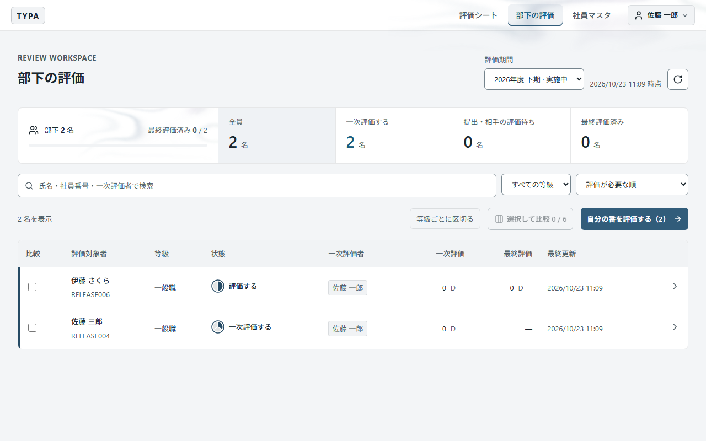

| 項目                     | 内容                                                                                                                                           |
| ------------------------ | ---------------------------------------------------------------------------------------------------------------------------------------------- |
| 評価期間                 | 表示する評価期間を選択します。通常は「実施中」の期間を選択します                                                                               |
| 再読み込み（右上の矢印） | 最新の情報を取得します。左側には最終取得時刻が表示されます                                                                                     |
| 件数のタイル             | 自身の対応が必要な「目標を確認する」「一次評価する」「二次評価する」のシート件数を表示します。クリックすると、該当する状態で一覧を絞り込みます |
| 検索・絞り込み           | 氏名・社員番号・一次評価者による検索、等級による絞り込み、並び順の変更ができます                                                               |
| 自分の番を評価する       | 自身の対応が必要なシートを、一覧の表示順に開きます                                                                                             |

一覧の「状態」には、進捗状況を示す円形の図と状態名が表示されます。円は「目標送信 → 目標確定 → 一次評価依頼 → 一次評価 → 二次評価」の各段階に分かれ、完了した段階が塗りつぶされます。外周に輪が表示されている行は、自身の対応が必要なシートです。

| 状態                   | 内容                                                               | 閲覧・操作の可否                                             |
| ---------------------- | ------------------------------------------------------------------ | ------------------------------------------------------------ |
| 未作成                 | 本人がシートを作成していません                                     | 閲覧不可                                                     |
| 目標の送信待ち         | 本人が下書きを作成中です                                           | 閲覧不可。ただし、締め済みの評価期間では下書きも閲覧できます |
| 目標を確認する         | 自身が一次評価者として目標を確認する段階です                       | 閲覧・目標確認の操作が可能                                   |
| 目標確認待ち           | 一次評価者が目標を確認中です                                       | 閲覧のみ可能                                                 |
| 本人の振り返り待ち     | 目標確定後、本人による達成状況の記入と一次評価の依頼を待つ段階です | 閲覧のみ可能                                                 |
| 一次評価する／評価する | 自身が一次評価を行う段階です                                       | 閲覧・採点が可能                                             |
| 一次評価待ち           | 一次評価者による確定待ちです（自身が二次評価者の場合）             | 閲覧のみ可能                                                 |
| 二次評価する           | 自身が二次評価を行う段階です                                       | 閲覧・採点が可能                                             |
| 二次評価待ち           | 二次評価者による確定待ちです（自身が一次評価者の場合）             | 閲覧のみ可能                                                 |
| 評価確定               | 評価が完了しています                                               | 閲覧のみ可能                                                 |

「一次評価」「最終評価」の列には、評価点と評価ランクが表示されます。確定前のランクは見込みランクとして、薄い色で表示されます。

## 目標を確認する

本人が目標を送信すると、状態が「目標を確認する」に変わります。一次評価者はシートを開いて内容を確認し、次のいずれかを選択します。

- 「要修正として下書きに戻す」：差し戻し理由（必須・200文字以内）を入力し、下書きに戻します。理由は本人のシートに入力どおりに表示され、通知メールを送信する場合はメール本文にも記載されます。本人は目標を修正し、再送信します。差し戻し後の下書き本文は、評価者から閲覧できなくなります。
- 「目標を確定する」：目標の内容、期中目標の件数と順序を確定し、状態を「振り返り待ち」に変更します。以降、本人が記入できるのは達成状況のみです。

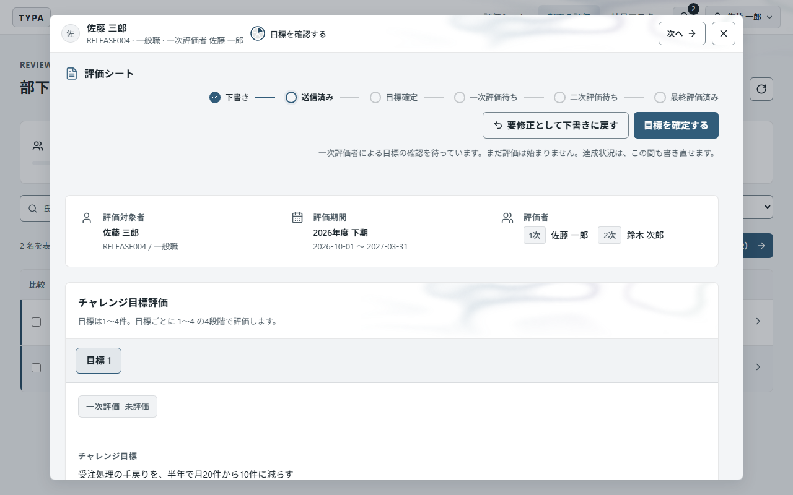

期中目標は、チャレンジ目標ごとに0〜4件設定できます。0件の場合は、チャレンジ目標に対して達成状況を記入します。「目標確認待ち」「振り返り待ち」の間は採点できません。本人が「一次評価を依頼する」をクリックし、状態が「一次評価待ち」に変わった後に、一次評価を開始します。

## 2. 一次評価をする

### シートを開く

一覧の行をクリックすると、評価シートがダイアログで開きます。ダイアログ上部には評価対象者の氏名と状態、右上には「次へ」（次の対応対象のシートに移動）と「×」（閉じる）が表示されます。

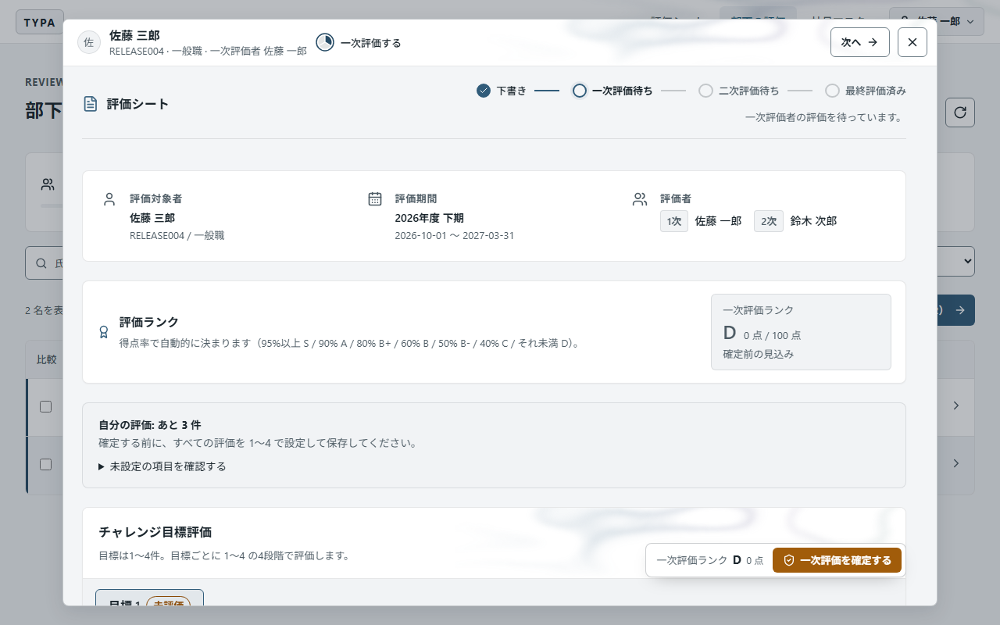

- 「評価ランク」には、現在入力している点数から算出した見込みランクが表示されます。
- 「自分の評価: あと〇件」は、未採点の項目数です。「未設定の項目を確認する」から、該当項目へ移動できます。
- 右下のバーには、現在の一次評価ランクと「一次評価を確定する」ボタンが常に表示されます。
- 前の評価期間のシートがある場合は、「前期のチャレンジ目標」に、前期の目標と今期への引き継ぎ状況（据え置き・更新・引き継がない）が表示されます。クリックすると詳細を確認できます。今期の目標にも「前期から据え置き」「前期から更新」と表示され、更新した目標には前期の文言が併記されます。期中目標は評価期間ごとの計画であるため、引き継がれません。

### チャレンジ目標を採点する

目標のタブごとに、本人が記入したチャレンジ目標・期中目標・達成状況を確認します。「評価を入力」をクリックして1〜4の評価を選択し、「評価を保存」をクリックします。未採点の目標のタブには「未評価」と表示されます。目標が複数ある場合は、すべてのタブで採点してください。

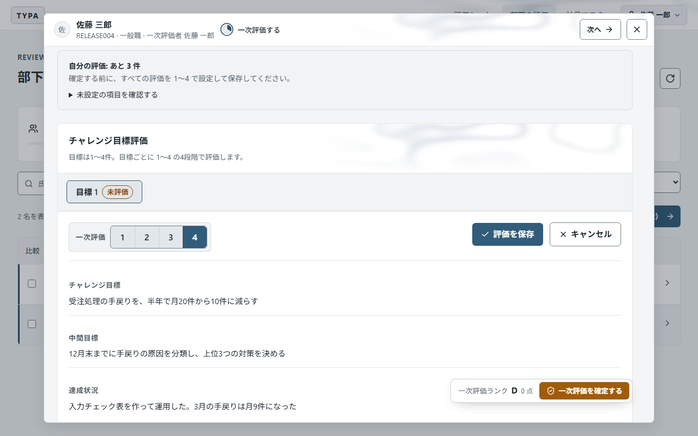

### 共通評価を採点する

共通評価の「評価を入力」をクリックし、項目ごとに1〜4の評価を選択します。必要に応じて「一次評価者コメント」を入力し、最後に「評価を保存」をクリックします。保存ボタンは表の上部と下部に表示されます。

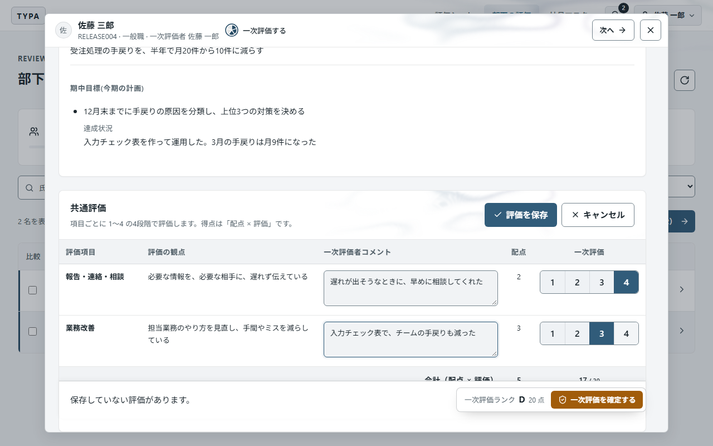

各項目には配点が設定されており、得点は「配点 × 評価」で算出されます。表の下部の「合計」で、保存前に結果を確認できます。共通評価の項目は、等級ごとに設定されています。

### 総評を入力する

「一次評価者の総評」に評価の理由や今後への期待を入力し、「総評を保存」をクリックします。「保存済み」と表示されると、保存は完了です。

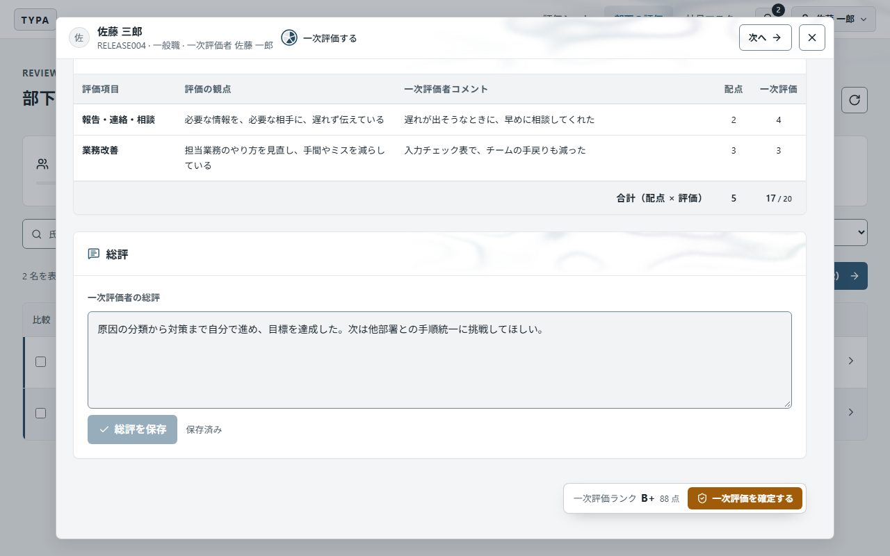

> 点数・コメント・総評は、それぞれの入力欄で保存します。未保存の入力内容がある状態で別の評価対象者のシートを開こうとすると、確認メッセージが表示されます。

### 確定する

すべての項目を採点した後、右下の「一次評価を確定する」をクリックします。確認画面には、一次評価ランクと評価点、および確定後に開く次の評価対象者が表示されます。

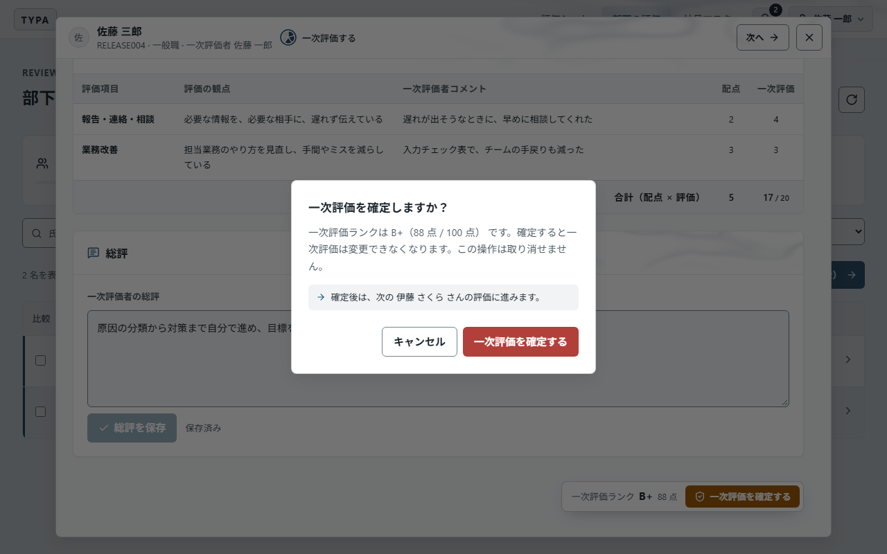

- 確定すると、二次評価者に評価依頼が通知されます（[8. 通知](#8-通知)）。通知方法がメールの場合は、確認画面の「二次評価者（〇〇）に通知メールを送る」で、送信の有無を選択できます。
- 確定後は一覧が更新され、自身の対応が必要な次の評価対象者のシートが自動で開きます。対応対象がなくなると、「この一覧で自分の番のシートはすべて確定しました」と表示されます。
- 未採点の項目が残っている場合は確定できません。「自分の評価: あと〇件」の一覧から該当項目へ移動し、採点してください。

## 3. 二次評価を実施しない場合

社員マスタで二次評価者が「なし」に設定されている場合、状態は「評価する」、確定ボタンは「評価を確定する」と表示されます。操作手順は一次評価と同じです。確定すると、一次評価が最終評価となり、状態が「評価確定」に変わります。

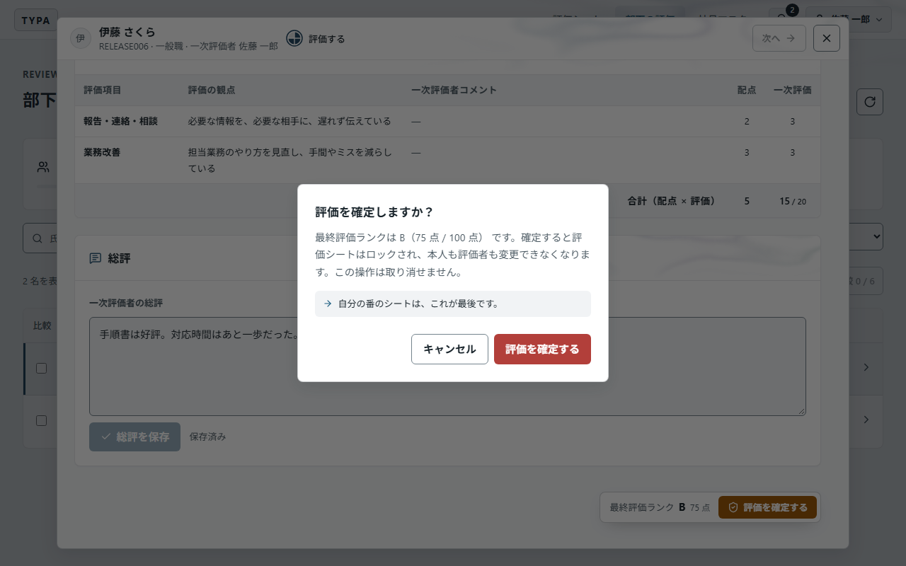

二次評価者が「未設定」の場合は、二次評価を省略する設定にはなりません。「未設定」のため評価が進行できない場合は、管理者に設定を依頼してください。

## 4. 二次評価をする

一次評価者が評価を確定すると、二次評価者の一覧では状態が「二次評価する」に変わります。

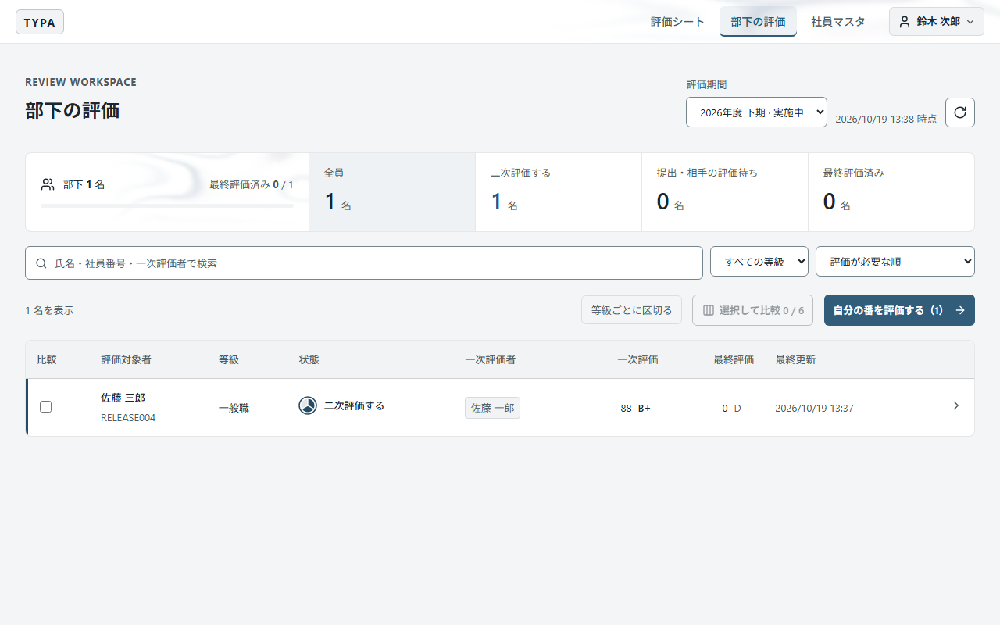

シートを開き、一次評価の点数と一次評価者のコメント・総評を確認します。そのうえで、チャレンジ目標と共通評価を「二次評価」の欄で採点し、「二次評価者の総評」を入力して保存します。

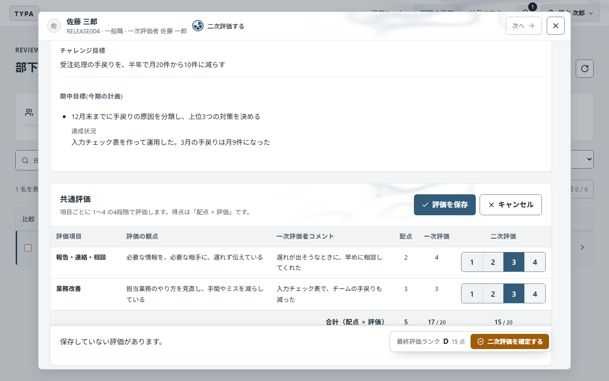

最後に、右下の「二次評価を確定する」をクリックします。確認画面には最終評価ランクが表示されます。

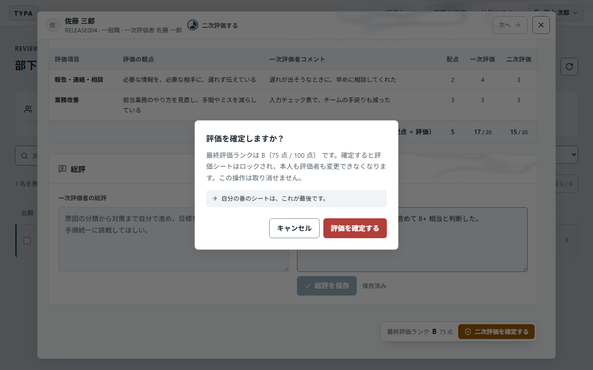

確定すると評価シートがロックされ、状態が「評価確定」に変わります。最終評価の確定時には、通知は送信されません。

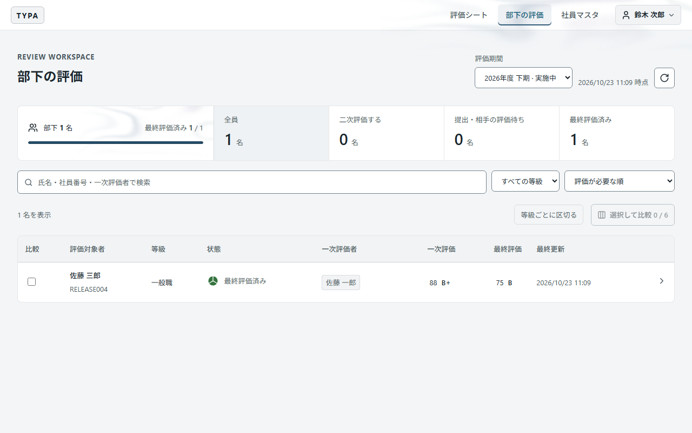

> 一次評価が確定するまで、二次評価者はシートの閲覧のみ可能です。採点はできません。

## 5. 評価点と評価ランクの仕組み

評価点は、チャレンジ目標と共通評価の点数に基づき、100点満点で自動計算されます。評価ランクも評価点に応じて自動判定され、手動では変更できません。

| 区分           | 計算式                                                                |
| -------------- | --------------------------------------------------------------------- |
| チャレンジ目標 | 目標の点数の合計 ÷（目標の数 × 4）× チャレンジ目標の配点              |
| 共通評価       | 「項目の配点 × 評価」の合計 ÷（項目の配点の合計 × 4）× 共通評価の配点 |

チャレンジ目標と共通評価の配点（合計100点）は、管理者が設定します。各区分の計算結果をそれぞれ1点単位に四捨五入し、合計した値を評価点とします。

| 評価点   | ランク |
| -------- | ------ |
| 95点以上 | S      |
| 90点以上 | A      |
| 80点以上 | B+     |
| 60点以上 | B      |
| 50点以上 | B-     |
| 40点以上 | C      |
| 40点未満 | D      |

計算例：チャレンジ目標の配点が20点、共通評価の配点が80点の場合、目標1件の評価が4、共通評価が20点満点中17点であれば、20 × 4/4 ＋ 80 × 17/20 ＝ 20 ＋ 68 ＝ **88点（B+）**となります。

## 6. 評価対象者を比較して評価を調整する

一覧の「比較」列で対象者を選択し（最大6名）、「選択して比較」をクリックすると、選択した対象者の点数・ランク・目標・達成状況・コメントが横並びで表示されます。比較結果は等級ごとに表示されます。氏名をクリックすると、対象者のシートを開くことができます。

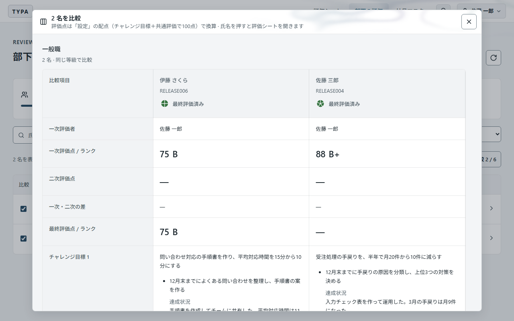

次の機能でも、評価のばらつきを確認できます。

- 「等級ごとに区切る」：一覧を等級ごとに分けて表示します。
- 並び順「一次・二次の差が大きい順」：二次評価者が、一次評価との差が大きい対象者から確認できます。
- 一次評価者の氏名をクリックすると、その一次評価者が担当する社員に絞り込めます（二次評価者向け）。

## 7. 確定した評価シートを PDF に出力する

「評価シート」の一覧の下部に「部下の評価シート」が表示されます。評価確定済みのシートは、「PDF出力」からPDF形式で保存できます。出力できるのは本人・一次評価者・二次評価者で、いずれが出力した場合も内容は同じです。

評価を実施せずに締める設定の評価期間では、未確定のシートもPDFに出力できます。この場合、点数・ランク・評価者コメントの欄は `***` と表示されます。

### 締め後修正

評価期間の締め後に、管理担当者が記入内容や評価を修正する場合があります。修正がある場合は、シート上部とPDFに「締め後修正」として、修正項目・日時・理由・変更内容が赤字で表示されます。表示対象は、自身に閲覧権限がある項目の修正に限られます。たとえば、評価確定前の二次評価の修正は、二次評価の点数と同様に一次評価者には表示されません。


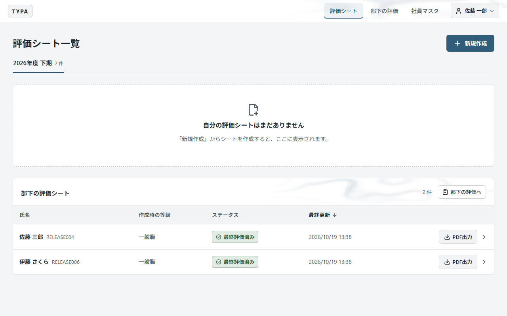

## 8. 通知

| 通知の契機                                   | 通知先     |
| -------------------------------------------- | ---------- |
| 本人が目標を送信したとき                     | 一次評価者 |
| 目標を確定、または要修正として差し戻したとき | 本人       |
| 本人が一次評価を依頼したとき                 | 一次評価者 |
| 一次評価者が評価を確定したとき               | 二次評価者 |

通知方法は、管理者が設定した次のいずれか一方です。

- **アプリ内通知（既定）**：画面上部のベルに未読件数が表示されます。ベルをクリックすると依頼の一覧が開き、依頼を選択すると対象のシートが開いて既読になります。「すべて既読にする」で一括して既読にすることもできます。評価が次の段階に進んだ依頼は自動で既読になり、一次評価者が要修正として差し戻した依頼は取り下げられます。異動などで評価者が変更された場合は、新しい評価者に通知されます。
- **メール**：新規登録時に確認したメールアドレスに送信されます。「二次評価待ち」のシートでは、一次評価を確定した一次評価者が、シート上部の「通知を再送」を利用できます。再送する場合は、送信失敗後は1分以上、送信中または送信結果が不明な場合は5分以上の間隔を空けてください。送信回数の上限に関するメッセージが表示された場合は、管理者に相談してください。メールが届かない場合でも、評価の確定処理は完了しています。

## 9. Reviewer 権限で利用できる機能

Reviewer権限の利用者は、「社員マスタ」で全社員の等級と評価者を確認できます。一覧は一次評価者の社員番号 → 二次評価者の社員番号 → 本人の社員番号の順に表示され、評価者が未設定の社員は各グループの末尾に表示されます。「自分の担当」で、自身が評価者として設定されている社員に絞り込めます。「評価構造」に切り替えると、各社員の評価を確定する評価者を図で確認できます。評価者の変更は、Admin権限の管理者が行います。

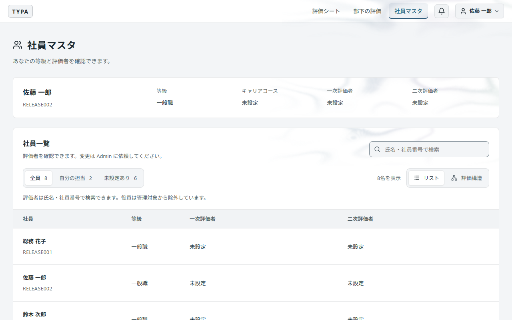

## 10. よくある質問

| 質問                                                         | 回答                                                                                                                                                     |
| ------------------------------------------------------------ | -------------------------------------------------------------------------------------------------------------------------------------------------------- |
| 部下のシートを開けません                                     | 実施中の評価期間では、本人が目標を送信していないシート（未作成・目標の送信待ち）は開けません。本人に目標の送信を依頼してください                         |
| 確定ボタンをクリックしても確定できません                     | 未採点の項目があります。「自分の評価: あと〇件」から該当項目へ移動し、採点・保存してください                                                             |
| 二次評価を入力できません                                     | 一次評価者による確定待ちの可能性があります。一覧の状態が「一次評価待ち」になっていないか確認してください                                                 |
| 一次評価者は二次評価の点数を確認できますか                   | 評価確定前は確認できません。二次評価の締め後修正についても同様です                                                                                       |
| 確定した点数を修正するにはどうすればよいですか               | 本人・評価者による修正はできません。評価期間の締め後に、管理者が理由を記録して修正します（締め後修正）。入力に誤りがある場合は、管理者に相談してください |
| 上期と下期の評価は合算されますか                             | 合算されません。分割した評価期間はそれぞれ独立しており、期間ごとに評価が完結します                                                                       |
| 部下が一覧に表示されません                                   | 自身が評価者として設定されていない可能性があります。社員マスタで設定を確認し、管理者に設定変更を依頼してください                                         |
| 過去の評価期間の部下の評価を確認するにはどうすればよいですか | 画面右上の「評価期間」で対象の期間に切り替えてください                                                                                                   |
