# TYPA 評価者マニュアル

部下の評価シートを評価する人（一次評価者・二次評価者）向けの説明書です。評価する部下の探し方、採点と総評、確定、結果の確認までを、画面に沿って説明します。

あなた自身の評価シートの書き方とログインの方法は「利用者マニュアル」を見てください。

## 評価者の役割

誰が誰の評価者になるかは、管理者が社員マスタで決めます。1人の部下に、一次評価者と二次評価者が1人ずつ付きます。

```
本人：目標を送信 → 一次評価者：目標を確定（または要修正で下書きへ）
→ 本人：達成状況を記入・一次評価を依頼 → 一次評価者：採点・総評・確定
→ 二次評価者：採点・総評・確定（最終評価）
```

| 役割 | すること | 確定ボタン |
| --- | --- | --- |
| 一次評価者 | 目標と共通評価を採点し、項目ごとのコメントと総評を書く | 「一次評価を確定する」 |
| 二次評価者 | 一次評価を見たうえで採点し直し、総評を書く。ここで最終評価が決まる | 「二次評価を確定する」 |
| 一次評価者（二次評価者が「なし」の部下） | 一次評価がそのまま最終評価になる | 「評価を確定する」 |

**確定した評価は、本人も評価者も変更できません。** 確定の前に必ず見直してください。評価期間を締めた後に誤りが見つかったときは、管理担当者が理由を残して直します（[締め後修正](#7-確定した評価シートを-pdf-にする)）。

会社が期（年度）を上期・下期などに分けているときは、評価期間ごとに評価します。半期制なら、同じ部下を上期と下期に1回ずつ評価します。

## 1. 部下の評価画面

上部の「部下の評価」を開くと、あなたが評価者になっている部下が一覧で表示されます。

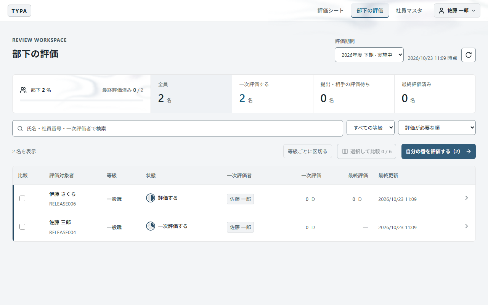

| 場所 | 内容 |
| --- | --- |
| 評価期間 | 表示する期間を選びます。ふだんは「実施中」の期間のままでかまいません |
| 再読み込み（右上の矢印） | 最新の状態に取り直します。左に取得した時刻が出ます |
| 件数のタイル | 「目標を確認する」「一次評価する」「二次評価する」が**あなたの番**のシートの数です。押すと一覧がその状態に絞り込まれます |
| 検索・絞り込み | 氏名・社員番号・一次評価者で検索、等級で絞り込み、並び順の変更ができます |
| 自分の番を評価する | あなたの番のシートを、一覧の順に開きます |

一覧の「状態」には、円の図と言葉で進み具合が出ます。円は「目標送信 → 目標確定 → 一次評価依頼 → 一次評価 → 二次評価」の段階で区切られ、済んだ段階が塗られます。外側に輪が付いている行が、あなたの番です。

| 状態 | 意味 | 開けるか |
| --- | --- | --- |
| 未作成 | 本人がまだシートを作っていない | × |
| 目標の送信待ち | 本人が下書き中 | ×（下書きは評価者に見えません。締めた評価期間のシートは、下書きのままでも見るだけできます） |
| 目標を確認する | あなたが一次評価者として目標を確認する番 | ○ |
| 目標確認待ち | 一次評価者が目標を確認中 | ○（見るだけ） |
| 本人の振り返り待ち | 目標確定後、本人が達成状況を書いて一次評価を依頼するのを待っている | ○（見るだけ） |
| 一次評価する／評価する | あなたが一次評価する番 | ○ |
| 一次評価待ち | 一次評価者の確定待ち（あなたは二次評価者） | ○（見るだけ） |
| 二次評価する | あなたが二次評価する番 | ○ |
| 二次評価待ち | 二次評価者の確定待ち（あなたは一次評価者） | ○（見るだけ） |
| 評価確定 | 完了 | ○（見るだけ） |

「一次評価」「最終評価」の列には、評価点とランクが出ます。確定前のランクは見込みで、薄く表示されます。

## 目標を確認する

本人が目標を送信すると「目標を確認する」になります。一次評価者がシートを開いて内容を確認し、次のいずれかを選びます。

- 「要修正として下書きに戻す」: 差し戻しの理由（必須・200 文字まで）を書いて戻します。理由は本人のシートに書いたとおりに表示され、通知メールを送るときはメールの本文にも載ります。本人が目標を直し、再び送信します。下書きの本文は評価者から見えなくなります。
- 「目標を確定する」: 目標の内容・期中目標の件数と順序を固定し、本人が達成状況だけを書ける「振り返り待ち」にします。

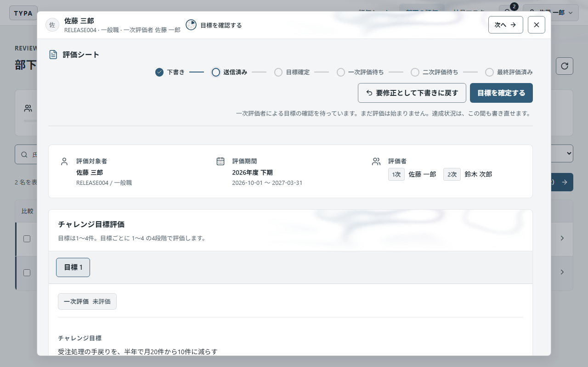

期中目標はチャレンジ目標ごとに0〜4件です。0件の場合、達成状況はチャレンジ目標に対して記入します。「目標確認待ち」「振り返り待ち」の間は採点できません。本人が「一次評価を依頼する」で「一次評価待ち」に進めてから、一次評価を始めます。

## 2. 一次評価をする

### シートを開く

一覧の行を押すと、評価シートが一覧の上に窓で開きます。窓の上部には部下の名前と状態、右上に「次へ」（次の自分の番へ移る）と「×」（閉じる）があります。

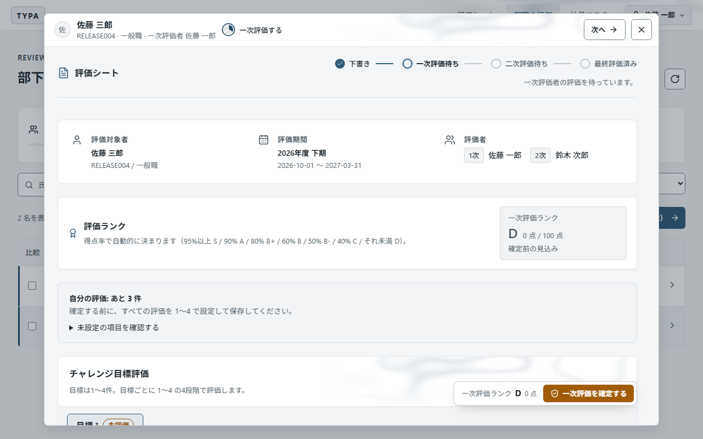

- 「評価ランク」には、いま入力している点数から計算した見込みが出ます。
- 「自分の評価: あと〇件」は、まだ点数を付けていない項目の数です。「未設定の項目を確認する」を開くと、その項目へ移動できます。
- 右下のバーに、現在の一次評価ランクと「一次評価を確定する」ボタンが常に表示されます。
- 部下に前の評価期間のシートがあるときは、「前期のチャレンジ目標」に前期の目標と、今期へどう引き継いだか（据え置き・更新・引き継がない）が表示されます。押すと開きます。今期の目標にも「前期から据え置き」「前期から更新」と表示され、更新した目標には前期の文言が添えられます。期中目標は期ごとの計画なので引き継がれません。

### チャレンジ目標を採点する

目標のタブごとに、本人が書いたチャレンジ目標・期中目標・達成状況を読み、「評価を入力」→ 1〜4 を選ぶ →「評価を保存」を押します。まだ採点していない目標のタブには「未評価」と出ます。目標が複数あるときは、すべてのタブを採点してください。

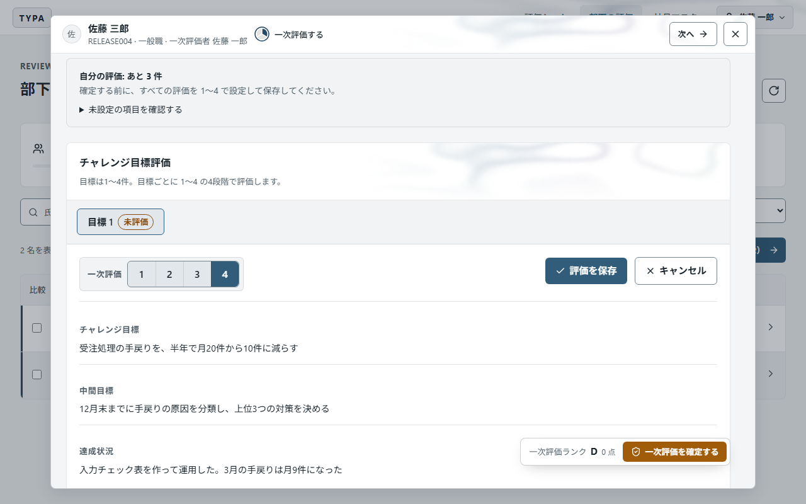

### 共通評価を採点する

共通評価の「評価を入力」を押し、項目ごとに 1〜4 を選び、必要に応じて「一次評価者コメント」を書きます。最後に「評価を保存」を押します。保存ボタンは表の上と下の両方にあります。

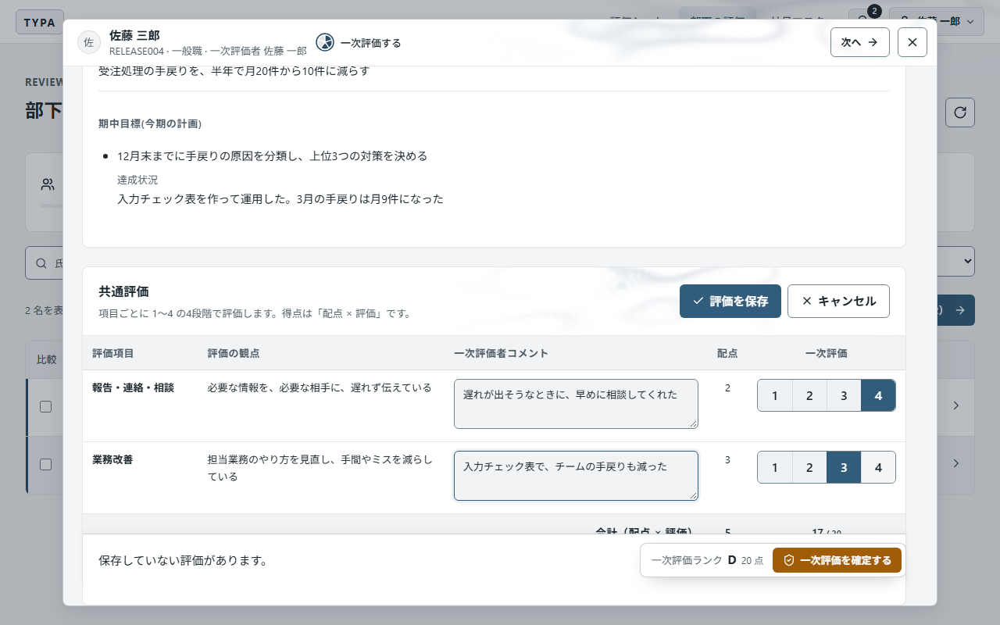

項目には「配点」があり、得点は「配点 × 評価」です。表の下の「合計」で、保存前に結果を確かめられます。共通評価の項目は等級ごとに決まっています。

### 総評を書く

「一次評価者の総評」に評価の理由や今後への期待を書き、「総評を保存」を押します。「保存済み」と出れば保存されています。

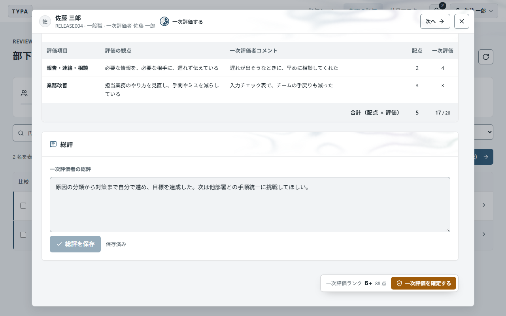

> 点数・コメント・総評は、欄ごとに保存します。保存していない入力があるまま別の部下を開こうとすると、確認が出ます。

### 確定する

すべての項目を採点したら、右下の「一次評価を確定する」を押します。確認画面に一次評価ランクと点数、確定後に開く次の部下が表示されます。

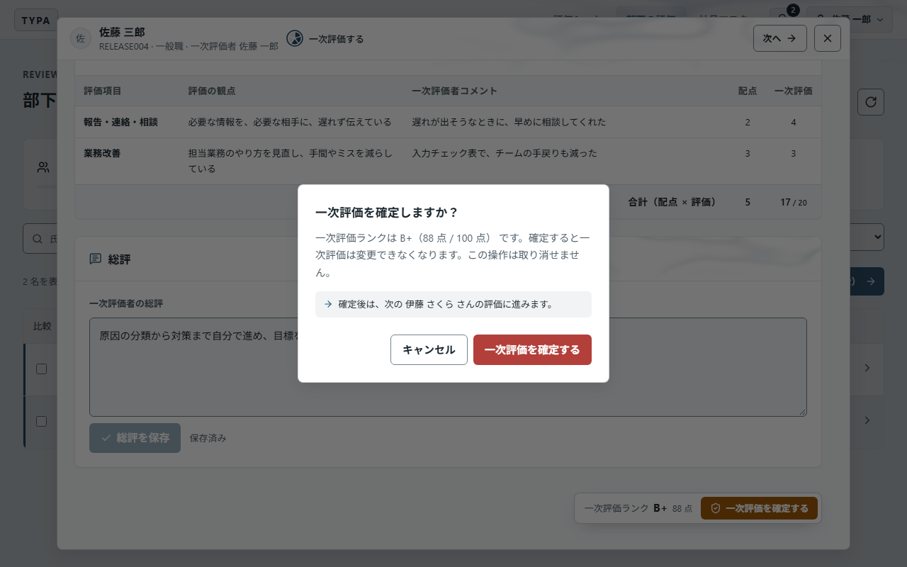

- 確定すると、二次評価者に評価の依頼が届きます（[8. 通知](#8-通知)）。通知の方法がメールのときは、確認画面の「二次評価者（〇〇）に通知メールを送る」で送るかどうかを選べます。
- 確定すると、一覧が更新され、次の「自分の番」の部下のシートが自動で開きます。自分の番がなくなると「この一覧で自分の番のシートはすべて確定しました」と出ます。
- 未採点の項目が残っていると確定できません。「自分の評価: あと〇件」の一覧から移動して採点してください。

## 3. 二次評価者が「なし」の部下

二次評価者を置かない部下（社員マスタで「なし」）は、状態が「評価する」と表示され、確定ボタンが「評価を確定する」になります。手順は一次評価と同じで、確定するとそのまま評価確定になります。

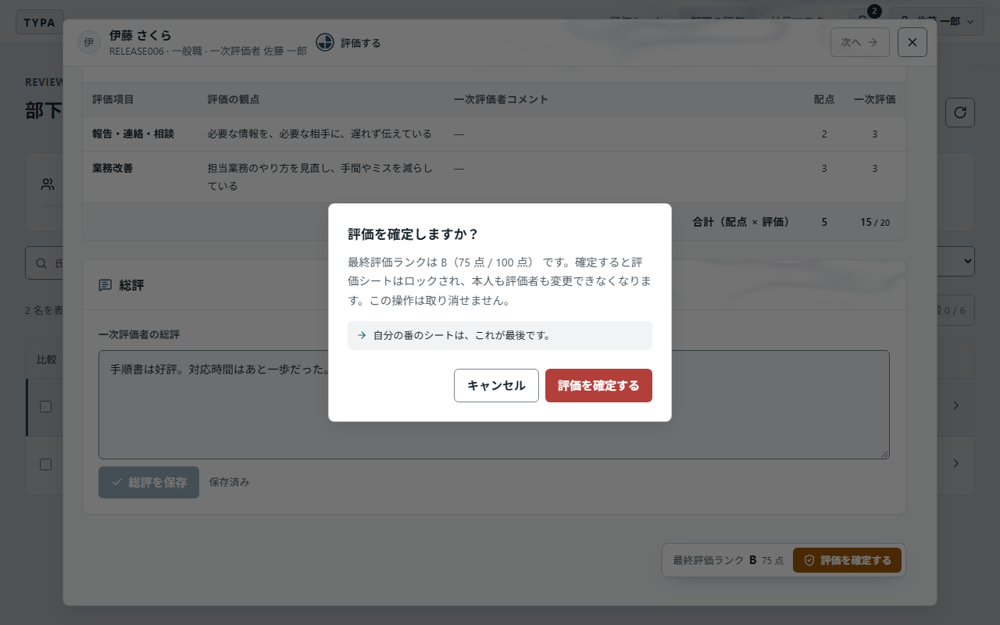

二次評価者が「未設定」の部下とは別です。「未設定」のまま評価が止まっている部下がいたら、管理者に設定を依頼してください。

## 4. 二次評価をする

一次評価者が確定すると、二次評価者の一覧で「二次評価する」に変わります。

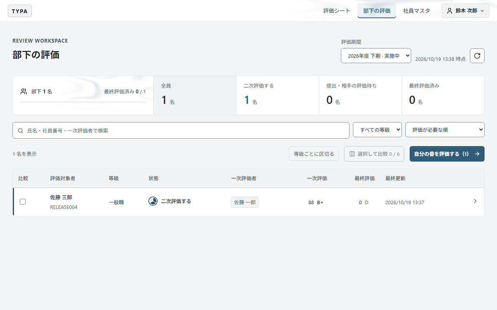

シートを開くと、一次評価の点数と一次評価者のコメント・総評が表示されています。それを見たうえで、チャレンジ目標と共通評価を「二次評価」の欄で採点し、「二次評価者の総評」を書いて保存します。

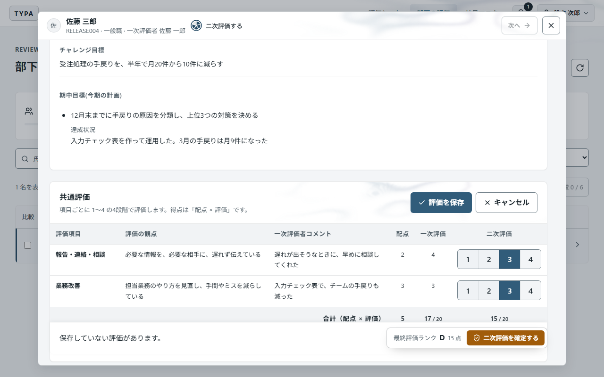

最後に右下の「二次評価を確定する」を押します。確認画面に最終評価ランクが表示されます。

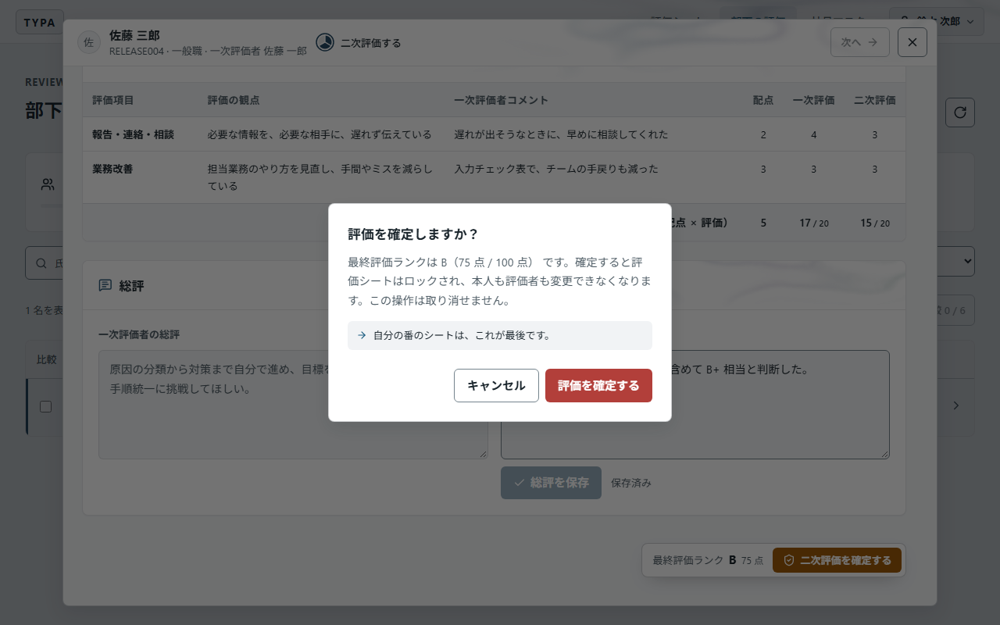

確定すると評価シートはロックされ、評価確定になります。最終評価の確定では、誰にも通知されません。

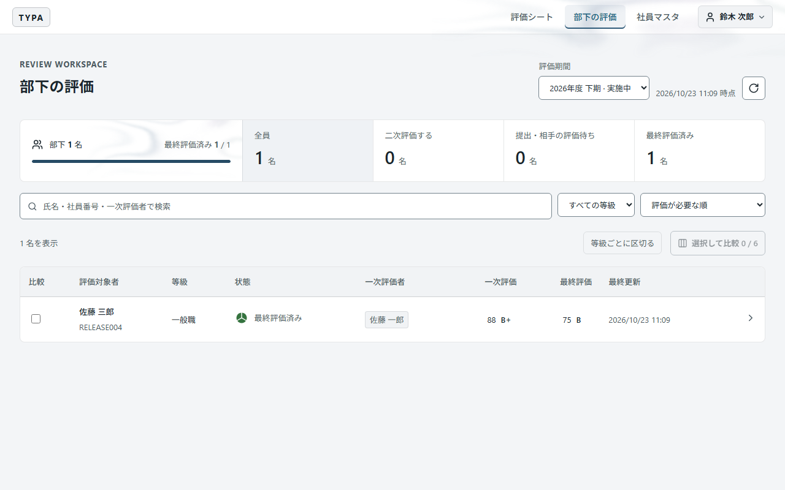

> 一次評価が確定するまでは、二次評価者はシートを見ることはできますが、採点はできません。

## 5. 評価点と評価ランクのしくみ

評価点は、チャレンジ目標と共通評価の点数から 100 点満点で自動計算されます。ランクも評価点から自動で決まり、手で変えることはできません。

| 部分 | 計算 |
| --- | --- |
| チャレンジ目標 | 目標の点数の合計 ÷（目標の数 × 4）× チャレンジ目標の配点 |
| 共通評価 | 「項目の配点 × 評価」の合計 ÷（項目の配点の合計 × 4）× 共通評価の配点 |

チャレンジ目標と共通評価の配点（合計 100 点）は管理者が設定します。それぞれ配点を掛けた後に 1 点単位に四捨五入し、足したものが評価点です。

| 評価点 | ランク |
| --- | --- |
| 95点以上 | S |
| 90点以上 | A |
| 80点以上 | B+ |
| 60点以上 | B |
| 50点以上 | B- |
| 40点以上 | C |
| 40点未満 | D |

例（配点がチャレンジ目標 20 点・共通評価 80 点のとき）：目標1つを 4、共通評価が 20 点満点中 17 点なら、20 × 4/4 ＋ 80 × 17/20 ＝ 20 ＋ 68 ＝ **88 点（B+）**。

## 6. 部下を比べて評価をそろえる

一覧の「比較」の列にチェックを入れ（最大6名）、「選択して比較」を押すと、選んだ部下の点数・ランク・目標・達成状況・コメントが横に並びます。比較は同じ等級ごとに分かれます。名前を押すと、その人のシートを開けます。

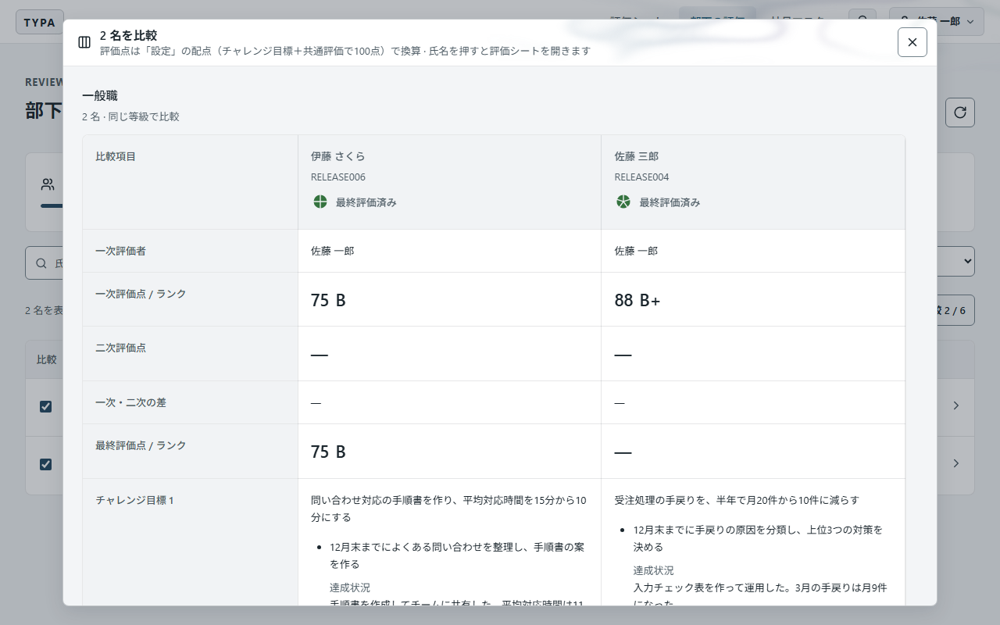

ほかにも、次の機能で評価のばらつきを見直せます。

- 「等級ごとに区切る」：一覧を等級ごとに分けて表示します。
- 並び順「一次・二次の差が大きい順」：二次評価者が、一次評価と大きく違う部下を先に確認できます。
- 一次評価者の名前を押すと、その一次評価者の部下だけに絞り込みます（二次評価者向け）。

## 7. 確定した評価シートを PDF にする

「評価シート」の一覧の下に「部下の評価シート」が表示されます。評価確定のシートは「PDF出力」で PDF に保存できます。出力できるのは本人・一次評価者・二次評価者で、誰が出力しても同じ内容です。

会社が「評価をしないまま締める」とした評価期間のシートは、評価確定でなくても PDF に出力できます。その PDF では、点数・ランク・評価者のコメントの欄に `***` と表示されます。

### 締め後修正

評価期間を締めた後に、管理担当者が記入内容や評価を直すことがあります。直された項目があると、シートの上部と PDF に「締め後修正」として赤字で、どの項目が・いつ・どんな理由で・どう変わったかが表示されます。表示されるのは、あなたが見られる項目の修正だけです。たとえば一次評価者には、評価が確定するまでは二次評価の修正は表示されません（二次評価の点数と同じです）。

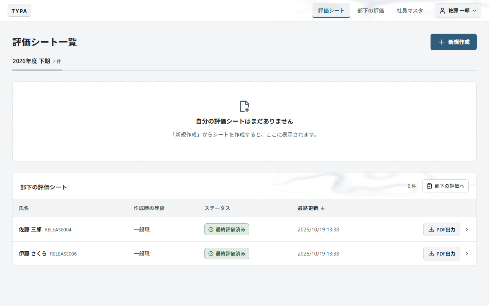

## 8. 通知

| いつ | 誰に届くか |
| --- | --- |
| 本人が目標を送信したとき | 一次評価者（あなた） |
| 目標を確定、または要修正として戻したとき | 本人 |
| 本人が一次評価を依頼したとき | 一次評価者（あなた） |
| 一次評価者が確定したとき | 二次評価者 |

知らせ方は、管理者が設定で選んだ一方です。

- **アプリ内通知（既定）**: 画面上部のベルに未読の数が出ます。ベルを押すと依頼の一覧が開き、選ぶとそのシートが開いて既読になります。「すべて既読にする」もあります。評価が次の段階に進んだ依頼は自動で既読になり、一次評価者が要修正として戻した依頼は取り下げられます。異動で評価者が替わったときは、新しい評価者に届きます。
- **メール**: 新規登録のときに確認したメールアドレスに届きます。「二次評価待ち」のシートでは、一次評価を確定した一次評価者がシート上部の「通知を再送」を使えます。失敗した後は1分以上、送信中や結果が分からないときは5分以上あけてから押してください。回数の上限が表示されたら管理者に相談します。メールが届かなくても、確定は済んでいます。

## 9. Reviewer 権限の人ができること

権限が Reviewer の人は、「社員マスタ」で全社員の等級と評価者を確認できます。「自分の担当」で自分が評価者になっている社員だけに絞り込めます。「評価構造」に切り替えると、誰の評価を誰が確定するかを図で見られます。評価者の変更は Admin（管理者）が行います。

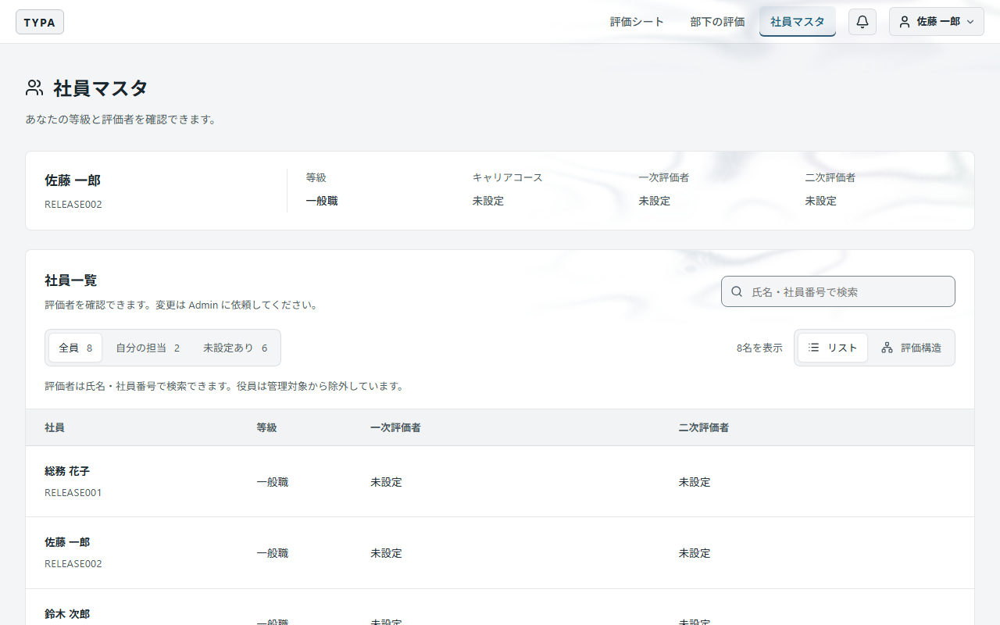

## 10. よくある質問

| 質問 | 答え |
| --- | --- |
| 部下のシートを開けない | 本人が目標を送信していないシート（未作成・目標の送信待ち）は開けません。本人に送信を促してください |
| 確定ボタンを押すと止まる | 点数が入っていない項目があります。「自分の評価: あと〇件」から未設定の項目へ移って採点・保存してください |
| 二次評価を入力できない | 一次評価者の確定を待っています。一覧で「一次評価待ち」になっていないか確認してください |
| 一次評価者に二次評価の点数は見える？ | 確定するまでは見えません。二次評価の締め後修正も同じです |
| 確定した点数を直したい | 本人も評価者も直せません。評価期間を締めた後に、管理者が理由を残して直します（締め後修正）。入力に誤りがあった場合は管理者に相談してください |
| 上期と下期の評価を合わせて期の評価にする？ | しません。分けた評価期間はそれぞれ独立していて、それぞれで評価が完結します |
| 部下が一覧に出てこない | あなたが評価者に設定されていない可能性があります。社員マスタで確認し、管理者に依頼してください |
| 前の期間の部下の評価を見たい | 画面右上の「評価期間」で期間を切り替えます |
