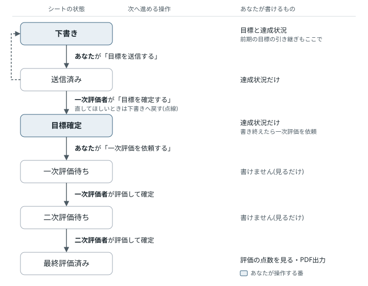
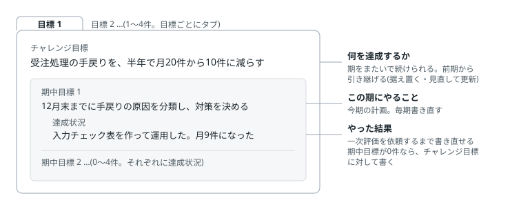
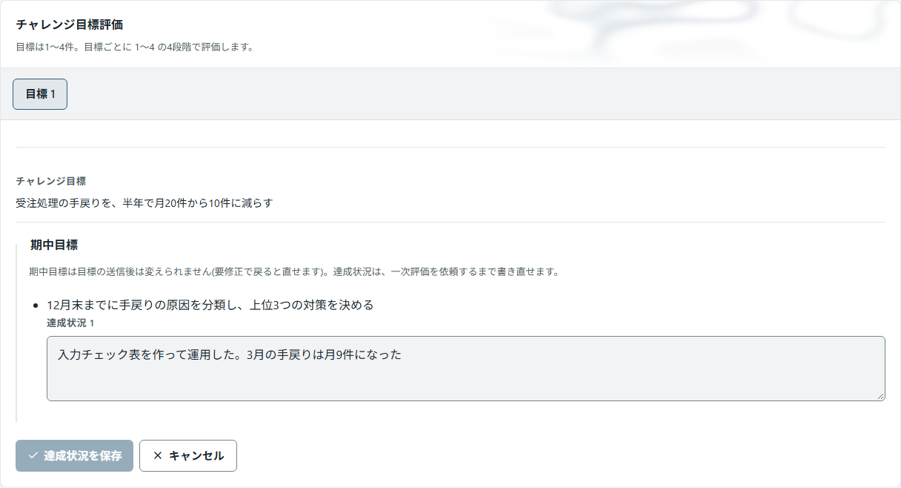
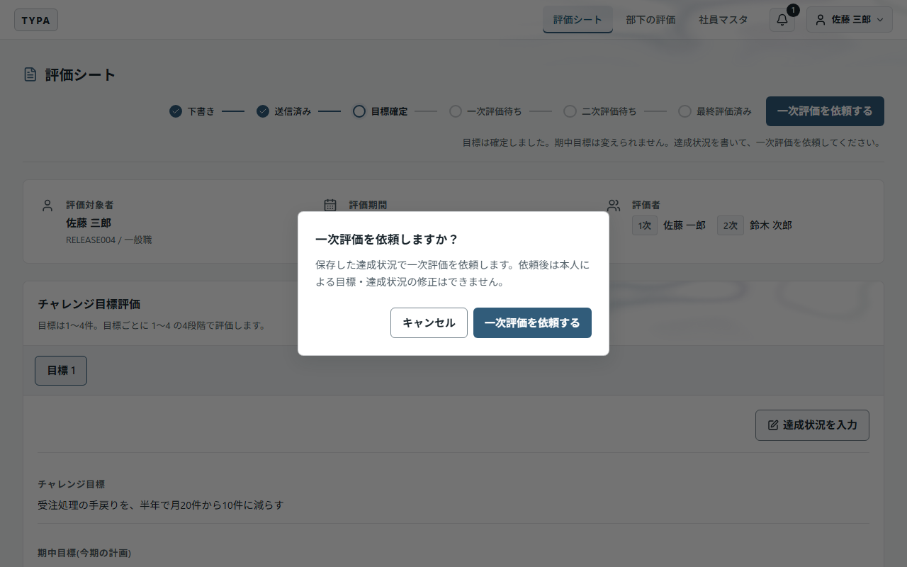

# TYPA 利用者マニュアル

評価を受ける社員の方向けの取扱説明書です。評価シートを作り、目標を書いて送り、結果を受け取るまでを、作業の順に説明します。評価者としての操作は[評価者マニュアル](evaluator.md)、管理者の操作は[管理者マニュアル](admin.md)を見てください。

> 初めての方は「1. 全体の流れ」と「2. 新規登録」から読んでください。その後は、期初に 5〜6、期中と期末に 7、結果が出たら 8 を見れば足ります。困ったときは「11. 困ったとき」を見てください。

## 1. 全体の流れ

評価シートは、評価期間ごとに1人1枚作ります。上期・下期に分かれているときは、期間ごとに作ります。シートは次の順に進み、いまの状態はシートの上部に表示されます。

| 時期         | あなたがすること                     | 見る章  |
| ------------ | ------------------------------------ | ------- |
| 期初         | シートを作り、目標を書いて送信する   | 5・6・7 |
| 期中         | 達成状況を書き足す                   | 7       |
| 期末         | 達成状況を仕上げ、一次評価を依頼する | 7       |
| 結果が出たら | 点数を確かめ、PDF に保存する         | 8       |
- 保存しただけでは次へ進みません。「目標を送信する」「一次評価を依頼する」を押して、初めて相手に回ります。
- 下書きの間は、評価者にもシートは見えません。
- 二次評価者が「なし」の場合は、一次評価者が確定した時点で「評価確定」になります。

## 2. 新規登録（初回だけ）

### 用意するもの

| 項目           | 内容                                                                 |
| -------------- | -------------------------------------------------------------------- |
| 社員番号       | 管理者から受け取ります。ログインにも使います                         |
| 招待コード     | 管理者が社員ごとに発行します。有効期限は7日間、使えるのは1回だけです |
| メールアドレス | 会社の指定ドメインのアドレス。共有メールも使えます                   |
| パスワード     | 6文字以上で、大文字・小文字・数字をすべて含めます                    |

### 手順

1. ログイン画面の「新規登録」を押します。
2. メールアドレスを入力し、「認証コードを受け取る」を押します。
3. メールに届いた認証コードと、社員番号・招待コード・パスワード（確認用も）を入力します。
4. 「登録する」を押します。
5. 社員番号の確認画面で番号を控え、「覚えました」を押します。評価シート一覧が開きます。

> 「認証コード」はメールで届くコード、「招待コード」は管理者から受け取るコードです。登録には両方が必要です。

### 登録でエラーが出たとき

| 表示                                                             | どうするか                                                                                   |
| ---------------------------------------------------------------- | -------------------------------------------------------------------------------------------- |
| 社員番号または招待コードが正しくないか、招待の期限が切れています | 社員番号と招待コードを見直します。それでも通らなければ、管理者に招待コードの再発行を頼みます |
| 認証コードが正しくないか、有効期限が切れています                 | 「認証コードを再送する」で新しいコードを受け取ります                                         |
| この社員番号は既に登録されています                               | 登録は済んでいます。社員番号とパスワードでログインします。覚えがなければ管理者に連絡します   |
| この社員番号は登録の途中で止まっています                         | 登録時と同じパスワードを入力します。通らなければ管理者に連絡します                           |

## 3. ログイン・ログアウト

社員番号とパスワードを入力し、「ログイン」を押します。メールアドレスではログインしません。

終えるときは、右上のユーザーメニュー（自分の名前）から「ログアウト」を押します。共有PCでは必ずログアウトしてください。アプリを閉じた後もログインを残すかどうかは、管理者が社員ごとに決めています。

## 4. 画面の見かた

| 画面上部のメニュー             | 内容                                                      |
| ------------------------------ | --------------------------------------------------------- |
| 評価シート                     | 自分の評価シートの作成・閲覧、評価期間の切り替え、PDF出力 |
| 部下の評価                     | 評価者を務める方が使う画面です                            |
| 社員マスタ                     | 自分の等級・一次評価者・二次評価者の確認                  |
| ユーザーメニュー（自分の名前） | 画面の明るさの切り替え、ヘルプ、ログアウト                |

## 5. 評価シートを作る

1. 「評価シート」を開き、「新規作成」を押します。
2. 「評価対象期間」を選び、「評価シートを作成」を押します。

- 作れるのは、いま実施中の評価期間のシートだけです。
- すでに作ってあると「新規作成」は押せず、横に「今期の評価シートは作成済みです」と出ます。一覧からシートを開いてください。
- シートの等級と評価項目は、作った時点で決まります。等級を変える必要があるときは、作る前に管理者に頼んでください。

## 6. 目標を書く

1つの目標は「チャレンジ目標」「期中目標」「達成状況」の3段でできています。

| 欄             | 書くこと                                                                    | 必須 |
| -------------- | --------------------------------------------------------------------------- | ---- |
| チャレンジ目標 | この評価期間に達成すること。数値や期限を入れて書きます                      | 必須 |
| 期中目標       | チャレンジ目標に向けて、この期に取り組むこと。0〜4件の箇条書きです          | 任意 |
| 達成状況       | 期中目標ごとの実績や結果。期中目標が0件なら、チャレンジ目標に対して書きます | 任意 |

### 書き方

1. シートの「目標を編集」を押します。
2. 各欄を入力します。期中目標は「期中目標を追加」で1件ずつ増やします。
3. 「目標を保存」を押します。保存は目標ごとです。

> チャレンジ目標と期中目標を直せるのは、下書きの間だけです。達成状況は、一次評価者が目標を確定してから、一次評価を依頼するまでの間に書きます。

### 目標を増やす・減らす

- 「目標を追加」でタブが増えます。上限は、画面の「目標は1〜〇件」で確かめられます。
- 不要なタブは「この目標を削除」で消します。目標は最低1件必要です。
- どのタブにもチャレンジ目標が必要です。空のタブが残っていると送信できません。
- 保存していない入力があるまま別の画面へ移ろうとすると、確認画面が出ます。

### 前期のチャレンジ目標を引き継ぐ

チャレンジ目標は、期をまたいで続けられます。前の評価期間にシートがあれば、下書きの間はシートに「前期のチャレンジ目標」が並び、目標ごとにどうするかを選べます。

| ボタン       | 今期の目標はどうなるか                   | 次にすること                       |
| ------------ | ---------------------------------------- | ---------------------------------- |
| 据え置く     | 前期の文言のまま入ります                 | 今期の期中目標を書きます           |
| 見直して更新 | 前期の文言が入り、書き直す画面が開きます | 今期に合わせて書き換え、保存します |
- 前期と同じ番号の目標に入ります（前期の目標2は、今期も目標2）。その番号を今期の別の目標が使っているときは、何も書いていない目標か、空いている番号に入ります。
- 引き継ぐのはチャレンジ目標の文言だけです。期中目標は毎期書き直します。前期の期中目標と達成状況は「前期の期中目標と達成状況」を開くと読めます。
- 引き継いだ目標には「前期から据え置き」か「前期から更新」が付き、評価者にも見えます。どちらになるかは今の文言で決まり、前期と同じなら「据え置き」、書き換えて保存すると「更新」です。「見直して更新」を押しても、書き換えて保存するまでは「据え置き」のままです。
- 書き換えた後でも、「前期のまま据え置く」で前期の文言に戻せます。
- 選ばなかった前期の目標は、今期には入りません。今期の新しい目標は「目標を追加」から書きます。引き継いだ目標を削除すると、また選べます。

## 7. 目標を送信し、評価を依頼する

### 目標を送信する（期初）

1. すべての目標を保存します。
2. シート上部の「目標を送信する」を押します。
3. 確認画面で「目標を送信する」を押します。

状態が「目標確認待ち」になり、一次評価者が目標を確かめます。まだ評価は始まりません。

- 一次評価者が直してほしいと判断すると、シートが「下書き」に戻ってきます。シートの上部に、一次評価者が書いた差し戻しの理由が出ます。直して保存し、もう一度送信してください（送信すると理由の表示は消えます）。
- 一次評価者が「目標を確定する」を押すと、「振り返り待ち」になり、あなたの番に戻ります（画面の「いまの担当」に出ます）。
- 達成状況は、一次評価者が目標を確定するまで書けません（下書き・目標確認待ちの間は欄が出ません）。

### 達成状況を書く（期中・期末）

目標が確定した後（振り返り待ち）は、目標の文言と件数は変えられません。書けるのは達成状況だけです。

1. 「達成状況を入力」を押します。
2. 期中目標ごとに達成状況を書きます。期中目標が0件なら、チャレンジ目標の「達成状況」に書きます。
3. 「達成状況を保存」を押します。

### 一次評価を依頼する（期末）

1. 達成状況を書き終えたら、シート上部の「一次評価を依頼する」を押します。
2. 確認画面で「一次評価を依頼する」を押します。

> 依頼すると「一次評価待ち」になり、その後はあなたは目標も達成状況も直せません。依頼の前に見直してください。

## 8. 結果を見る・PDF に保存する

評価の点数は、「評価確定」になるまであなたには表示されません。評価確定になると、シートに目標ごとの一次評価の点数（1〜4）が表示されます。共通評価・総評・評価点・評価ランクは PDF で確かめます。

1. 「評価シート一覧」で評価期間を選びます。
2. 「自分の評価シート」の「PDF出力」を押します。
3. 保存先を選びます。

PDF には、目標・共通評価・総評・評価点・評価ランクが載ります。評価確定になる前は、ボタンの代わりに「確定後に PDF 出力」と出ます。

評価ランクは、100点満点の評価点で自動的に決まります。

| 評価点           | ランク |
| ---------------- | ------ |
| 95点以上         | S      |
| 90点以上95点未満 | A      |
| 80点以上90点未満 | B+     |
| 60点以上80点未満 | B      |
| 50点以上60点未満 | B-     |
| 40点以上50点未満 | C      |
| 40点未満         | D      |

### 締め済みの評価期間

一覧上部のタブで評価期間を切り替えると、過去のシートを見られます。締め済みのシートは見るだけで、書き込み・送信・依頼はできません。

評価が確定しないまま締められた期間のシートも、PDF に保存できます。この場合、点数・ランク・評価コメントは「***」と表示されます。

### 締め後修正

管理者が締めた後にシートを直したときは、シート上部に「締め後修正があります」と出ます。直した項目、変更前後の内容、日時、理由が読めます。PDF にも載ります。

## 9. 自分の評価者を確かめる

「社員マスタ」で、自分の等級・一次評価者・二次評価者を確かめられます。空いている・間違っているときは、管理者に直してもらってください。

| 二次評価者の表示 | 意味                                                   |
| ---------------- | ------------------------------------------------------ |
| なし             | 二次評価を置かず、一次評価者が最終評価をする設定です   |
| 未設定           | 評価者がまだ決まっていません。管理者に連絡してください |

## 10. 通知

シートが次の人へ回ると、その人に知らせが届きます。

| こうしたとき                                     | 届く相手   |
| ------------------------------------------------ | ---------- |
| あなたが目標を送信した                           | 一次評価者 |
| 一次評価者が目標を確定した、または下書きに戻した | あなた     |
| あなたが一次評価を依頼した                       | 一次評価者 |
| 一次評価者が評価を確定した                       | 二次評価者 |

最終評価の確定は通知しません。知らせ方は、管理者が次のどちらかに決めています。

- **アプリ内通知（標準）**: 画面上部のベルに届きます。状態が変わると同時に届くので、届かない・送り直す、ということはありません。下書きに戻すと、届いていた依頼は取り下げられます。
- **メール**: 新規登録のときに確かめたメールアドレスに届きます。送信・依頼の確認画面で、相手にメールを送るかどうかを選べます。

## 11. 困ったとき

| こんなとき                                                 | どうするか                                                                                                                                                                                                                       |
| ---------------------------------------------------------- | -------------------------------------------------------------------------------------------------------------------------------------------------------------------------------------------------------------------------------- |
| パスワードを忘れた                                         | 管理者に登録の取り消しと招待コードの発行を頼み、新規登録をやり直します。評価シートはそのまま残ります                                                                                                                             |
| 「利用が停止されています」と出る                           | 管理者に利用の再開を頼みます                                                                                                                                                                                                     |
| 「ログインできるかを確かめられませんでした」と出る         | 通信が途切れています。ネットワークにつながっているかを確かめて、もう一度ログインします。新規登録をやり直す必要はありません                                                                                                       |
| 社員番号が分からない                                       | 管理者に確かめます                                                                                                                                                                                                               |
| 「新規作成」が押せない                                     | 今期のシートはもう作ってあります。一覧から開きます                                                                                                                                                                               |
| 「チャレンジ目標が空欄の目標は送信・確定できません」と出る | 空のタブにチャレンジ目標を書いて保存するか、そのタブを削除します                                                                                                                                                                 |
| 送信した後で目標を直したい                                 | 一次評価者に、下書きに戻してもらうよう頼みます                                                                                                                                                                                   |
| 一次評価を依頼した後で直したい                             | あなたも評価者も戻せません。どうしても必要なときは管理者に相談します                                                                                                                                                             |
| 前期の目標が別の番号に入った                               | 同じ番号を今期の別の目標が使っていたためです。番号が違っても、前期とのつながりは残ります                                                                                                                                         |
| 自分の点数が見えない                                       | 評価確定になるまで表示されません                                                                                                                                                                                                 |
| 通知メールが届かない                                       | 迷惑メールフォルダーと共有メールの受信箱を確かめます。目標確認待ち・一次評価待ちの間は、シート上部の「通知を再送」で送り直せます。待ち時間や回数の上限が出たら画面の案内に従い、それでも届かなければ管理者に宛先の確認を頼みます |

## 12. アプリの更新とヘルプ

更新のお知らせが出たら、入力を保存してから「今すぐ更新」を押します。更新が済むと、アプリが自動で開き直します（PCは再起動しません）。作業を続けたいときは「あとで」を選びます。保存していない入力があると、更新の前に確認画面が出ます。

操作の手順は、ユーザーメニューの「ヘルプ」でも確かめられます。ヘルプの画像は押すと拡大でき、「閉じる」か Esc キーで閉じます。

