# TYPA 利用者マニュアル

登録・ログイン、評価シートの記入・提出、評価結果の確認手順です。評価者の操作は[評価者マニュアル](evaluator.md)、管理者の操作は[管理者マニュアル](admin.md)を参照してください。

## 評価の流れ

評価シートは、評価期間ごとに1人1枚作成します。上期・下期などに分かれている場合は、期間ごとに作成・提出します。

下書き → 一次評価待ち → 二次評価待ち → 最終評価済み

| 状態 | 本人ができること |
| --- | --- |
| 下書き | 目標の記入・修正・保存、提出 |
| 一次評価待ち | 内容の確認、下書きへの差し戻し、通知の再送 |
| 二次評価待ち | 内容の確認 |
| 最終評価済み | 内容・目標の一次評価点の確認、PDF出力 |

二次評価者が「なし」の場合は、一次評価者の確定で「最終評価済み」になります。締め済みの評価期間では、記入・提出・差し戻し・通知の再送はできません。

## 1. 新規登録

### 用意するもの

| 項目 | 内容 |
| --- | --- |
| 社員番号 | 管理者から受け取る番号。ログインにも使います |
| 招待コード | 管理者が社員ごとに発行します。有効期限は7日間、使用は1回限りです |
| メールアドレス | 会社の指定ドメインのアドレス。共有メールも使用できます |
| パスワード | 6文字以上で、大文字・小文字・数字をすべて含めます |

### 登録手順

1. ログイン画面の「新規登録」を押します。
2. メールアドレスを入力し、「認証コードを受け取る」を押します。指定ドメイン以外のアドレスでは送信できません。

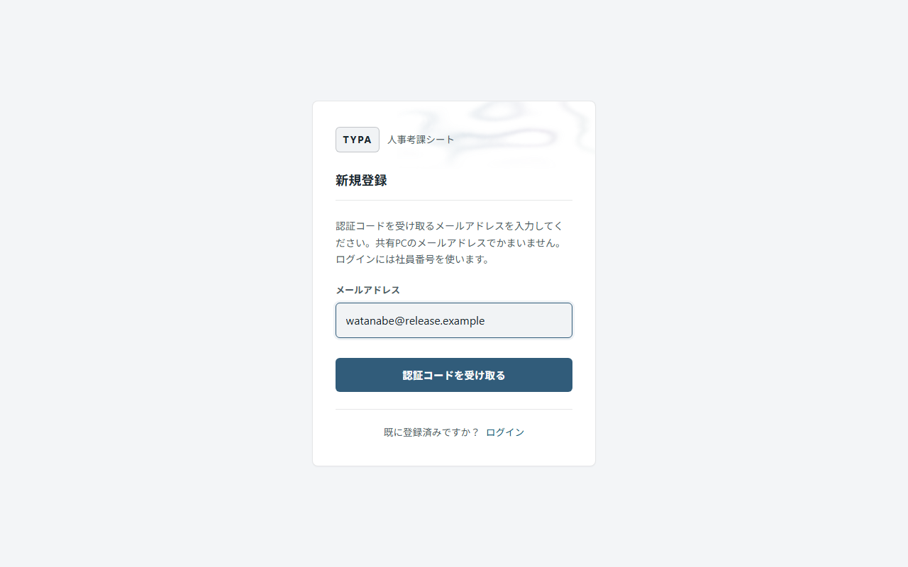

3. メールに届いた認証コード、社員番号、招待コード、パスワード、パスワード（確認）を入力します。
4. 「登録する」を押します。
5. 社員番号の確認画面で番号を控え、「覚えました」を押します。評価シート一覧が開きます。

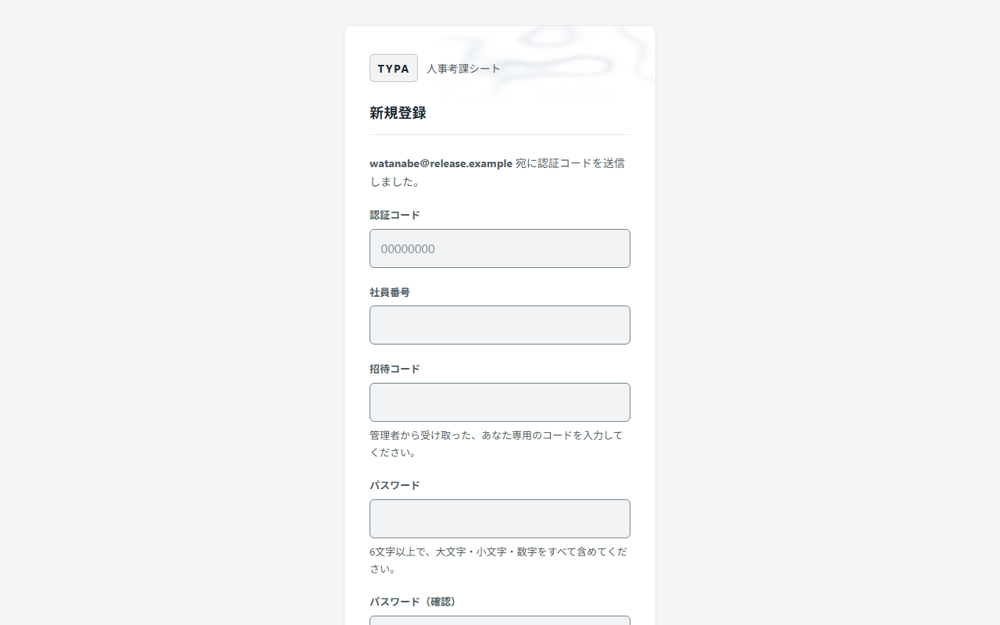

認証コードはメールで受信するコード、招待コードは管理者から受け取るコードです。登録には両方が必要です。

| エラー表示 | 対処 |
| --- | --- |
| 社員番号または招待コードが正しくないか、招待の期限が切れています | 社員番号と招待コードを確認します。使用できない場合は管理者に再発行を依頼してください |
| 認証コードが正しくないか、有効期限が切れています | 「認証コードを再送する」で新しいコードを受け取ります |
| この社員番号は既に登録されています | 社員番号とパスワードでログインします。登録した覚えがない場合は管理者に連絡してください |
| この社員番号は登録の途中で止まっています | 登録時と同じパスワードを入力します。登録できない場合は管理者に連絡してください |

## 2. ログイン・ログアウト

社員番号とパスワードを入力し、「ログイン」を押します。メールアドレスは使用しません。

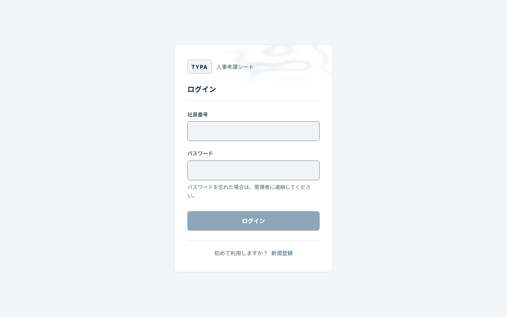

終了時は、右上のユーザーメニュー（自分の名前）から「ログアウト」を押します。共有PCでは必ずログアウトしてください。アプリを閉じた後もログインを保持するかどうかは、管理者が社員ごとに設定します。

| 状況 | 対処 |
| --- | --- |
| パスワードを忘れた | 管理者に登録の取り消しと招待コードの発行を依頼し、新規登録をやり直します。評価シートは引き継がれます |
| 「利用が停止されています」と表示される | 管理者に利用の再開を依頼します |
| 社員番号が分からない | 管理者に確認します |

## 3. 画面の構成

| メニュー | 内容 |
| --- | --- |
| 評価シート | 自分の評価シートの作成・閲覧、評価期間の切り替え、PDF出力 |
| 部下の評価 | 担当する社員の評価。評価者向けの画面です |
| 社員マスタ | 自分の等級・一次評価者・二次評価者の確認 |
| ユーザーメニュー | テーマ切り替え、ヘルプ、ログアウト |

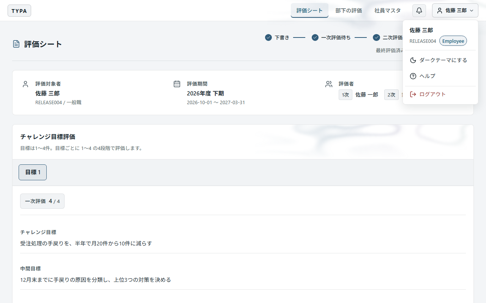

## 4. 評価シートの作成

1. 「評価シート」を開き、「新規作成」を押します。

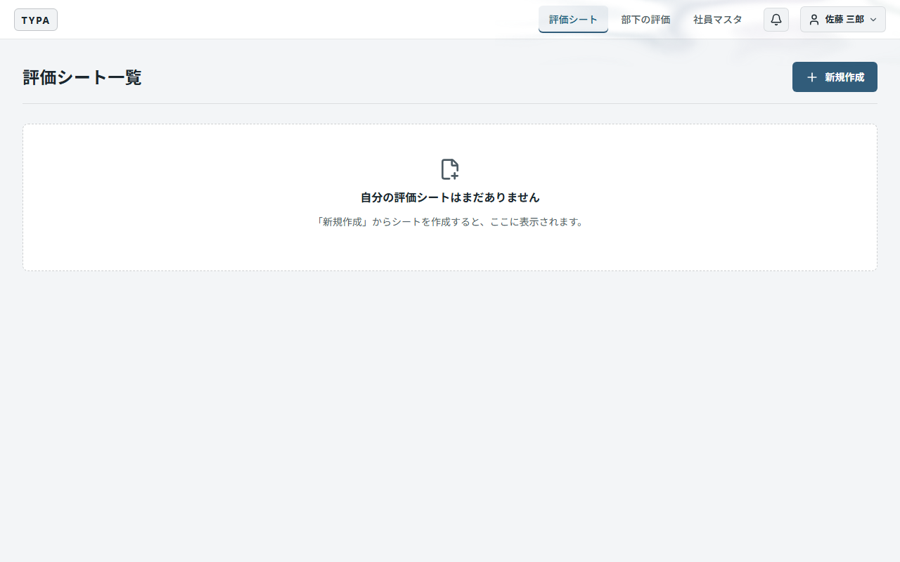

2. 「評価対象期間」を選び、「評価シートを作成」を押します。

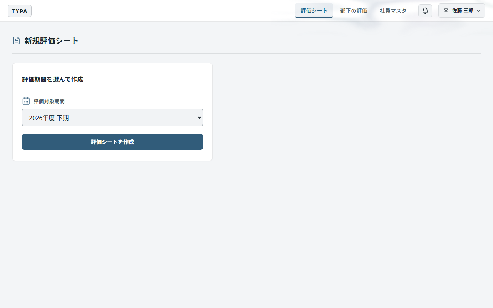

作成できるのは、実施中の評価期間だけです。作成済みの場合は同じシートが開きます。

シートの等級・評価項目は作成時に決まります。等級の変更が必要な場合は、作成前に管理者に依頼してください。

## 5. 目標の記入・保存

シートは「下書き」で作成されます。上部で評価期間と評価者を確認してください。

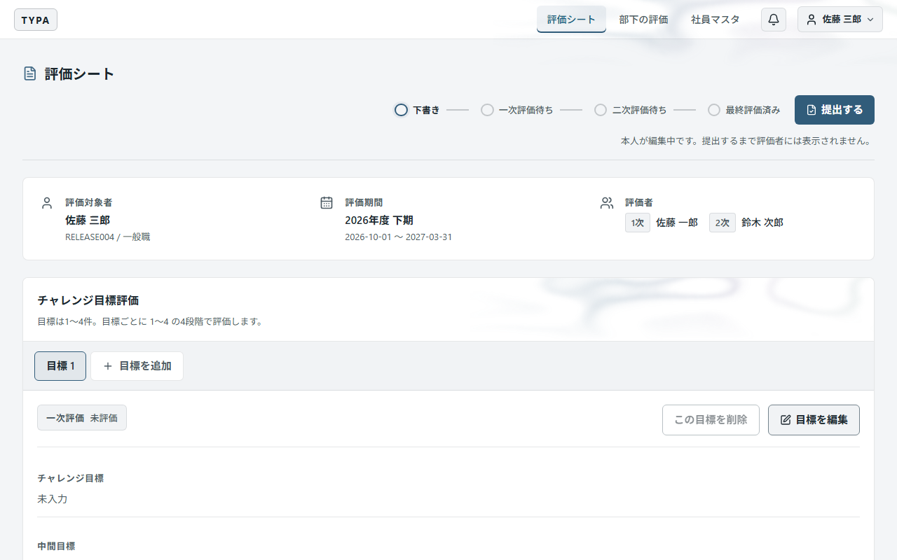

1. 「目標を編集」を押します。
2. 各欄を入力します。
3. 「目標を保存」を押します。

| 欄 | 入力内容 | 必須・任意 |
| --- | --- | --- |
| チャレンジ目標 | 評価期間内に達成する内容。数値や期限を含めて記入します | 必須 |
| 中間目標 | 期間の途中で達成する内容や進捗の目安 | 任意 |
| 達成状況 | 目標に対する実績や結果 | 任意 |

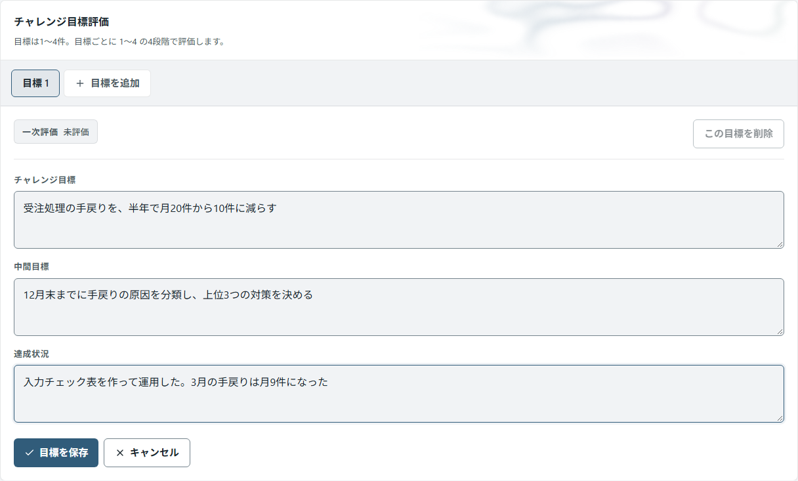

期初に目標を記入し、期末に達成状況を追記できます。保存は目標ごとに行います。保存した内容は、同じシートで再編集できます。

### 目標の追加・削除

- 「目標を追加」でタブを追加します。件数の上限は、画面の「目標は1〜〇件」で確認できます。
- 不要なタブは「この目標を削除」で削除します。目標は最低1件必要です。
- すべてのタブにチャレンジ目標が必要です。空欄のタブがある場合は、入力して保存するか、タブを削除してください。
- 未保存の入力がある状態で別の画面へ移動すると、確認画面が表示されます。

### 前の評価期間からの引き継ぎ

前の評価期間にシートがある場合は、「前の評価期間の目標」に目標と達成状況が表示されます。

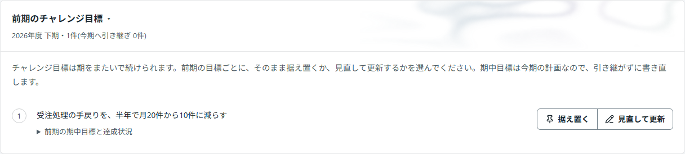

「続ける」を押すと、チャレンジ目標を現在の下書きに追加できます。中間目標と達成状況は引き継がれません。現在の期間の内容を入力してください。

引き継いだ目標は「継続中」、引き継がない目標は「済み」と表示されます。引き継いだ目標を現在のシートから削除すると、「済み」に戻ります。引き継ぎができるのは下書きの間だけです。

## 6. 提出・修正

### 提出

1. 各目標の入力を保存します。
2. シート上部の「提出する」を押します。
3. 確認画面で「提出する」を押します。

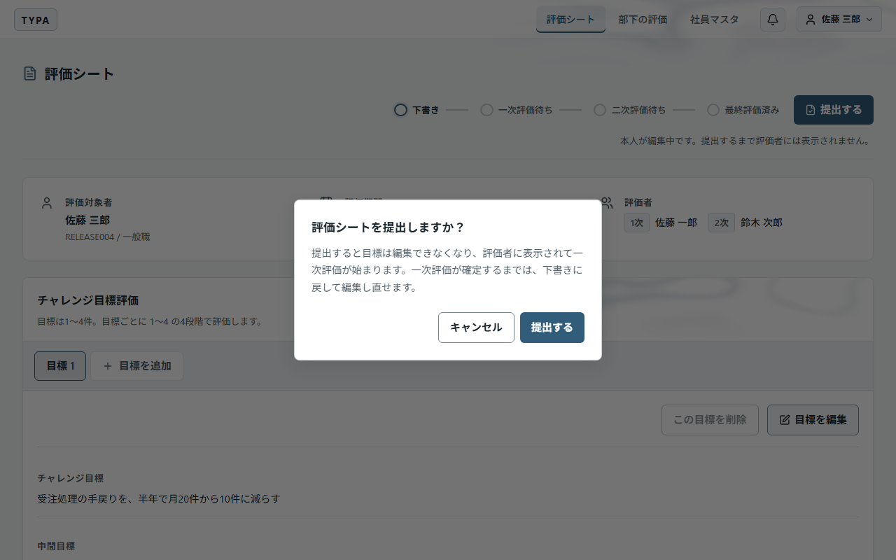

提出すると「一次評価待ち」になり、評価者に内容が表示されます。一次評価者には評価の依頼が届きます（[9. 通知](#9-通知)）。通知の方法がメールのときは、確認画面の「一次評価者（〇〇）に通知メールを送る」で送るかどうかを選べます。

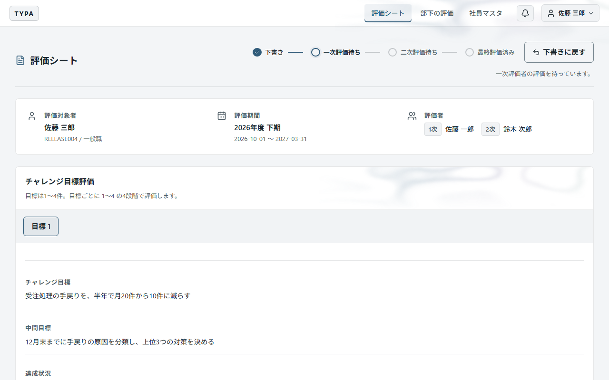

保存だけでは提出されません。提出後は目標を編集できません。

### 提出後の修正

実施中の評価期間で、一次評価が確定する前は修正できます。

1. シート上部の「下書きに戻す」を押し、確認画面で確定します。
2. 目標を修正し、「目標を保存」を押します。
3. 再度「提出する」を押します。

下書きの間は評価者に表示されません。一次評価の確定後に訂正が必要な場合は、管理者に相談してください。

## 7. 評価結果の確認・PDF出力

「評価シート一覧」でシートの状態を確認できます。最終評価済みになるまで、本人には評価の点数が表示されません。

最終評価済みになると、シート画面に目標ごとの一次評価の点数（1〜4）が表示されます。共通評価・総評・評価点・評価ランクはPDFで確認します。

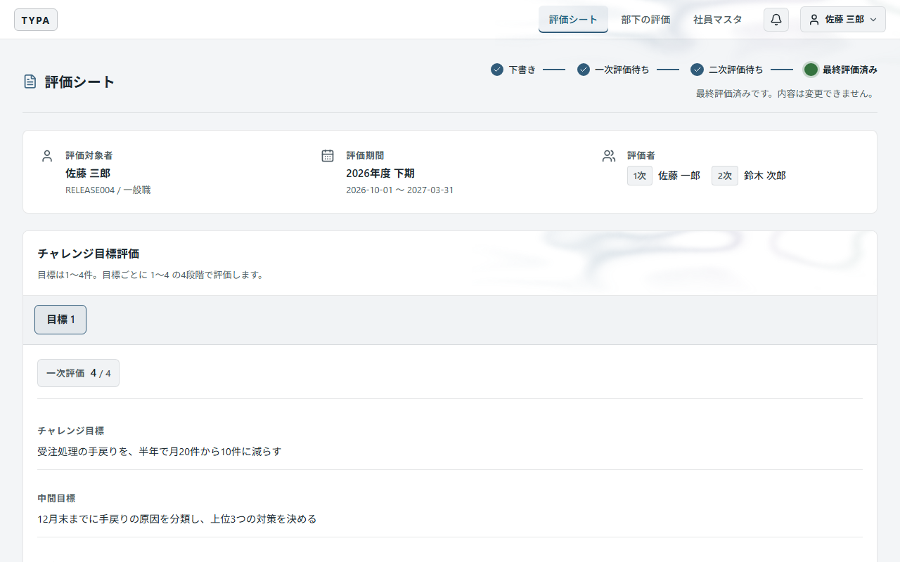

1. 「評価シート一覧」で評価期間を選びます。
2. 「自分の評価シート」の「PDF出力」を押します。
3. 保存先を選びます。

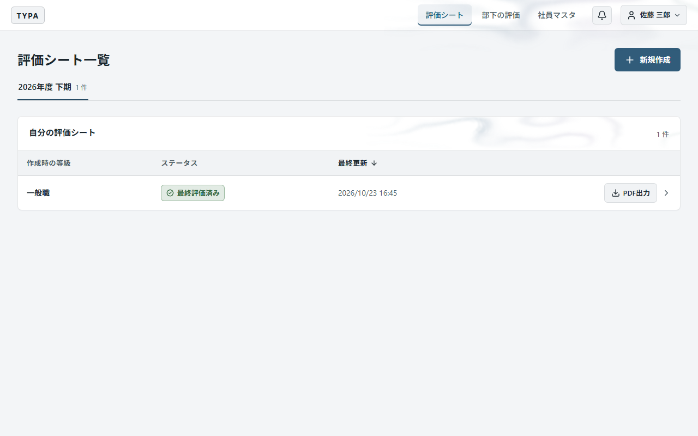

PDFには、目標・共通評価・総評・評価点・評価ランクが載ります。最終評価の確定前は「確定後に PDF 出力」と表示されます。

評価ランクは、100点満点の評価点から自動で決まります。

| 評価点 | ランク |
| --- | --- |
| 95点以上 | S |
| 90点以上95点未満 | A |
| 80点以上90点未満 | B+ |
| 60点以上80点未満 | B |
| 50点以上60点未満 | B- |
| 40点以上50点未満 | C |
| 40点未満 | D |

### 締め済みの評価期間

一覧上部のタブで評価期間を切り替えます。締め済みのシートは閲覧用です。

未確定のまま締める設定の期間では、未確定のシートもPDF出力できます。この場合、点数・ランク・評価コメントは `***` と表示されます。

### 締め後修正の確認

シート上部の「締め後修正があります」に、管理者が修正した項目・変更前後の内容・日時・理由が表示されます。PDFにも修正の記録が載ります。表示されるのは、本人が閲覧できる項目の修正です。

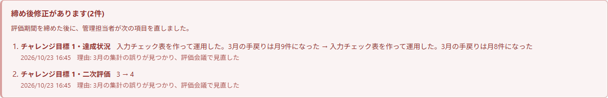

## 8. 社員情報・評価者の確認

「社員マスタ」で、自分の等級・一次評価者・二次評価者を確認します。未設定や誤りがある場合は、管理者に設定・修正を依頼してください。

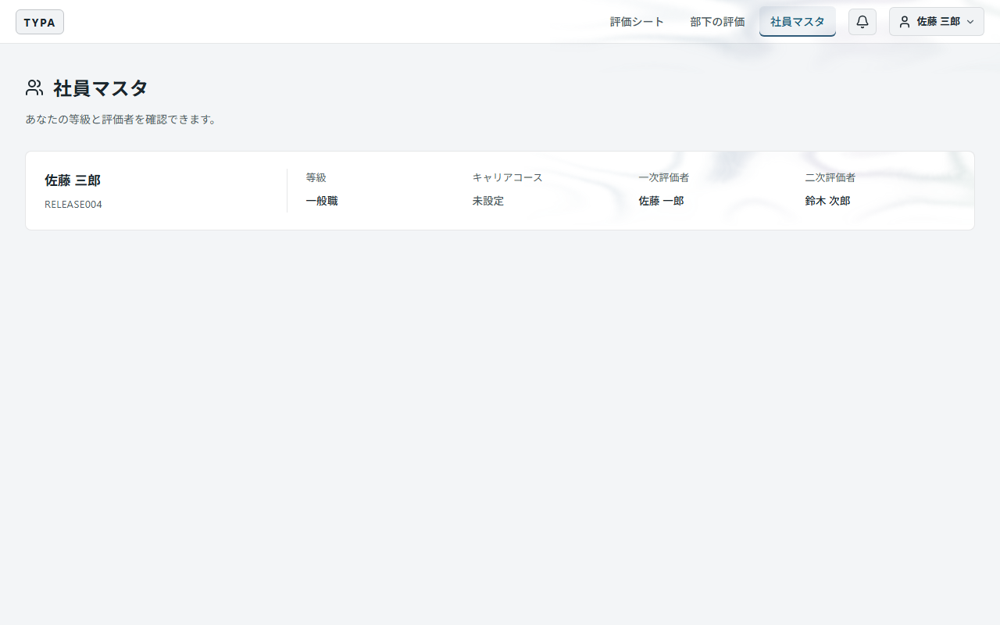

二次評価者の「なし」は、一次評価者が最終評価を行う設定です。「未設定」は、評価者がまだ決まっていない状態です。

## 9. 通知

| いつ | 誰に届くか |
| --- | --- |
| 本人の提出時 | 一次評価者 |
| 一次評価の確定時 | 二次評価者 |

最終評価の確定時には通知しません。知らせ方は、管理者が設定で選んだ一方です。

- **アプリ内通知（既定）**: 評価者の画面上部のベルに届きます。提出と同時に届くので、送信の失敗や再送はありません。下書きに戻すと、届いた依頼は取り下げられます。
- **メール**: 評価者が新規登録のときに確認したメールアドレスに届きます。送信に失敗しても、提出・確定は完了しています。一次評価待ちの間は、本人がシート上部の「通知を再送」を使えます。待機時間や回数制限が表示された場合は、画面の案内に従ってください。上限に達した場合は管理者に相談してください。送信済みの通知は再送されません。届かない場合は迷惑メールフォルダーと共有メールの受信箱を確認し、管理者に宛先と配送状況の確認を依頼してください。

## 10. アプリの更新・ヘルプ

更新通知が表示されたら、入力を保存して「更新して再起動」を押します。作業を続ける場合は「あとで」を選びます。未保存の入力がある場合は、インストール前に確認画面が表示されます。

操作手順は、ユーザーメニューの「ヘルプ」でも確認できます。ヘルプ内の画像は、押すと拡大できます。「閉じる」またはEscキーで閉じます。

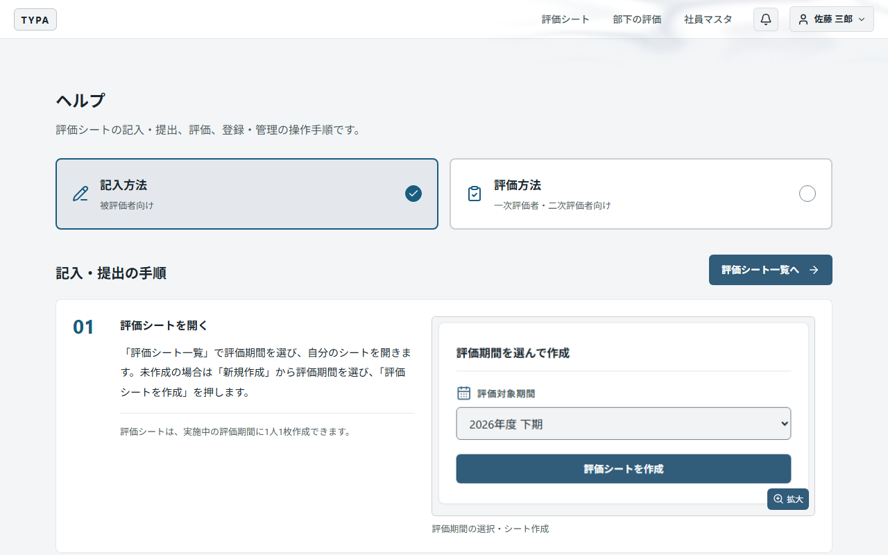
