# TYPA 利用者マニュアル

本マニュアルは、評価を受ける社員の方を対象としています。評価シートの作成、目標の記入、評価の依頼、結果の確認について、操作の順に説明します。評価を担当する方は[評価者マニュアル](evaluator.md)、管理者の方は[管理者マニュアル](admin.md)を参照してください。

> 初めて利用する場合は、「1. 全体の流れ」と「2. 新規登録」からお読みください。評価期間の初めに行う操作は5〜7章、期間中と期間の終わりに行う操作は7章、評価結果の確認方法は8章で説明しています。操作で困った場合は、「11. 困ったとき」を確認してください。

## 1. 全体の流れ

評価シートは、評価期間ごとに1人1枚作成します。上期・下期に分かれている場合は、それぞれの期間で作成します。現在の進み具合は、シート上部の「状態」で確認できます。

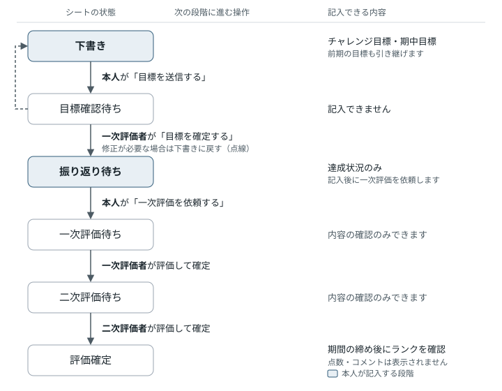

| 時期 | 行うこと | 説明する章 |
| --- | --- | --- |
| 評価期間の初め（期初） | シートを作成し、目標を記入して送信します | 5・6・7 |
| 評価期間中（期中） | 達成状況を記入します | 7 |
| 評価期間の終わり（期末） | 達成状況を確認し、一次評価を依頼します | 7 |
| 評価期間の締め後 | 一覧で最終評価ランクを確認します | 8 |

- 保存は、入力した内容を記録する操作です。評価者に確認や評価を依頼するには、「目標を送信する」または「一次評価を依頼する」を押してください。
- 下書きの間は、評価者にシートの内容は表示されません。
- 二次評価者が「なし」の場合は、一次評価者が評価を確定すると、状態が「評価確定」に変わります。

## 2. 新規登録（初回のみ）

初めて利用するときに、利用登録を行います。2回目以降は、社員番号とパスワードでログインします（[3. ログイン・ログアウト](#3-ログインログアウト)）。

### 用意するもの

| 項目 | 内容 |
| --- | --- |
| 社員番号 | 管理者から案内された番号です。ログインするときに使用します |
| 招待コード | 管理者から受け取る、本人専用のコードです。`ABCD-EFGH-JKLM` のような12文字で、有効期限は7日間です。1回の登録に限り使用できます |
| メールアドレス | 認証コードを受け取るために使用します。会社以外のアドレスや、共有PCで確認できるメールアドレスも使用できます。同じアドレスで複数の方が登録する場合は、1人ずつ認証コードを受け取って登録してください。通知方法がメールに設定されている場合は、評価に関する通知もこのアドレスに届きます |
| パスワード | 自分で設定します。6文字以上で、大文字・小文字・数字をすべて含めてください |

> 「招待コード」は管理者から受け取るコードです。「認証コード」は登録の途中でメールに届くコードです。登録には、両方のコードが必要です。

### 手順

1. ログイン画面の「新規登録」を押します。
2. 認証コードを受け取るメールアドレスを入力し、「認証コードを受け取る」を押します。

   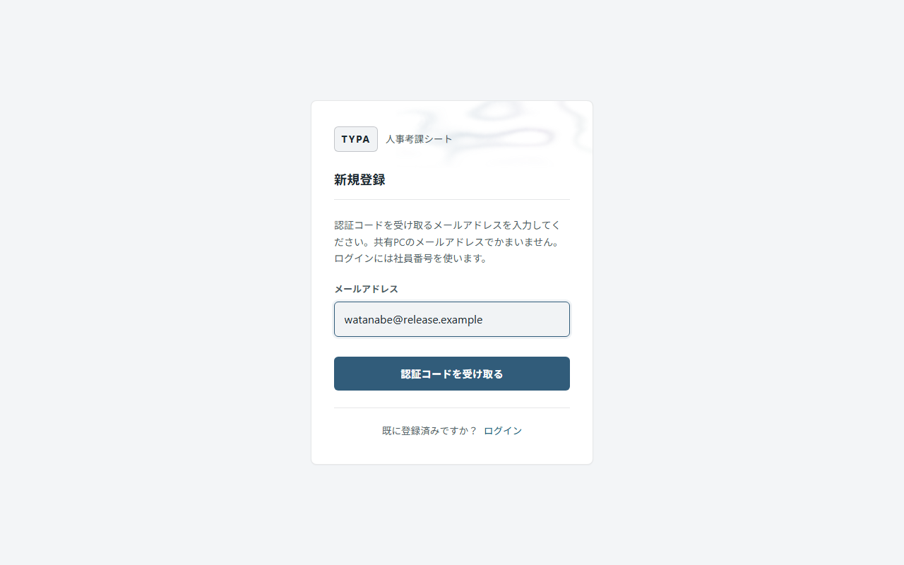

3. 入力したメールアドレスに届いたメールを開き、認証コードの数字を確認します。届かない場合は、迷惑メールフォルダーも確認してください。数分待っても届かない場合は、次の画面の「認証コードを再送する」を押します。メールアドレスを間違えた場合は、「メールアドレスの入力に戻る」から入力し直します。
4. 次の画面で、上から順に入力します。
   - 認証コード：メールで受け取った数字を入力します。
   - 社員番号：管理者から案内された番号を入力します。
   - 招待コード：管理者から受け取ったコードを入力します。ハイフンは省略できます。小文字で入力することもできます。
   - パスワード・パスワード（確認）：自分で決めたパスワードを、両方の欄に同じように入力します。

   すべての項目を入力すると、「登録する」を押せるようになります。

   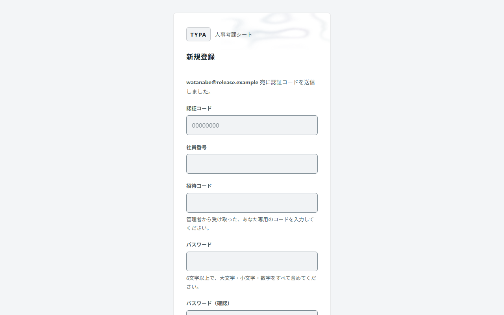

5. 「登録する」を押すと、社員番号が表示されます。ログインに必要なため、番号を控えてから「覚えました」を押します。評価シート一覧が開くと、登録は完了です。

   

招待コードは、登録が完了すると使用できなくなります。登録の途中で画面を閉じた場合は、もう一度「新規登録」から操作してください。登録が完了していなければ、有効期限内の同じ招待コードを使用できます。

### 登録でエラーが表示された場合

| 表示されるメッセージ | 対応方法 |
| --- | --- |
| 社員番号または招待コードが正しくないか、招待の期限が切れています | 社員番号と招待コードを確認してください。解決しない場合は、管理者に招待コードの再発行を依頼してください |
| 認証コードが正しくないか、有効期限が切れています | 「認証コードを再送する」を押し、新しいコードを受け取ってください |
| パスワードが一致しません | 「パスワード」と「パスワード（確認）」に、同じパスワードを入力してください |
| 認証コードを送信できませんでした | 少し待ってから、もう一度「認証コードを受け取る」を押してください |
| この社員番号は既に登録されています | 登録は完了しています。社員番号とパスワードでログインしてください。登録した覚えがない場合は、管理者に連絡してください |
| この社員番号は登録の途中で止まっています | 登録時と同じパスワードを入力してください。登録できない場合は、管理者に連絡してください |

## 3. ログイン・ログアウト

社員番号とパスワードを入力し、「ログイン」を押します。ログインには、メールアドレスではなく社員番号を使用します。

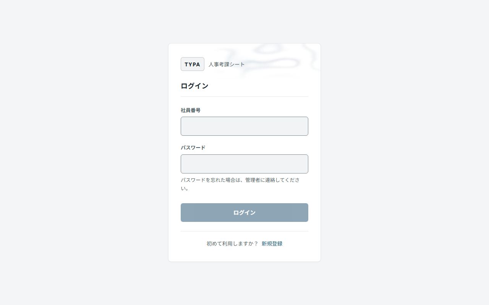

利用を終えるときは、画面右上の自分の名前を押してユーザーメニューを開き、「ログアウト」を押します。共有PCでは、必ずログアウトしてください。アプリを閉じた後もログインしたままにするかどうかは、管理者が社員ごとに設定しています。

## 4. 画面の見方

| 画面上部のメニュー | 内容 |
| --- | --- |
| 評価シート | 自分の評価シートを作成・確認します。表示する評価期間も切り替えられます |
| 部下の評価 | 評価を担当する方が使用します |
| 社員マスタ | 自分の等級・一次評価者・二次評価者を確認します |
| ユーザーメニュー（自分の名前） | 画面の明るさの切り替え、ヘルプの確認、ログアウトを行います |

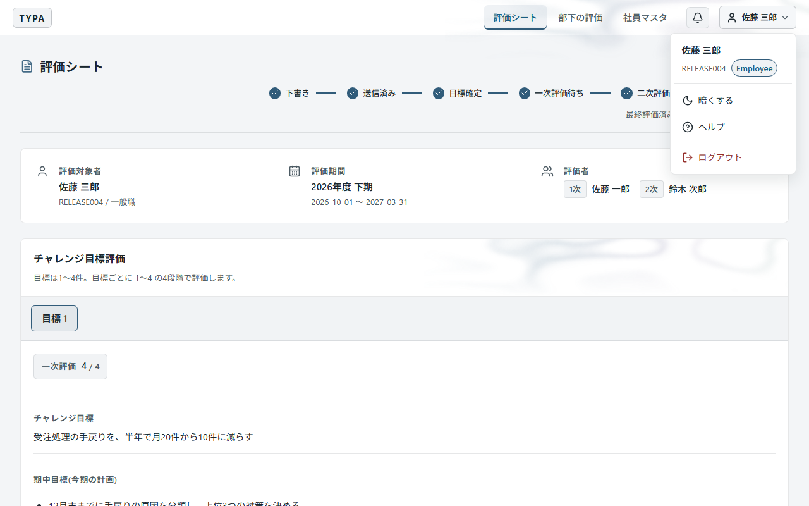

## 5. 評価シートを作成する

1. 「評価シート」を開き、「新規作成」を押します。
2. 「評価対象期間」を選び、「評価シートを作成」を押します。

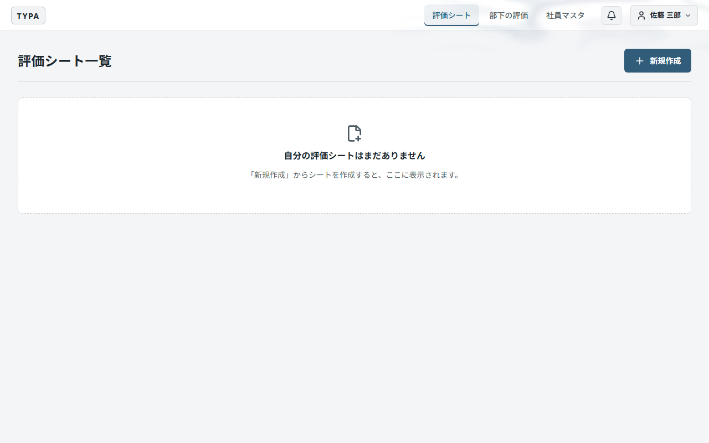

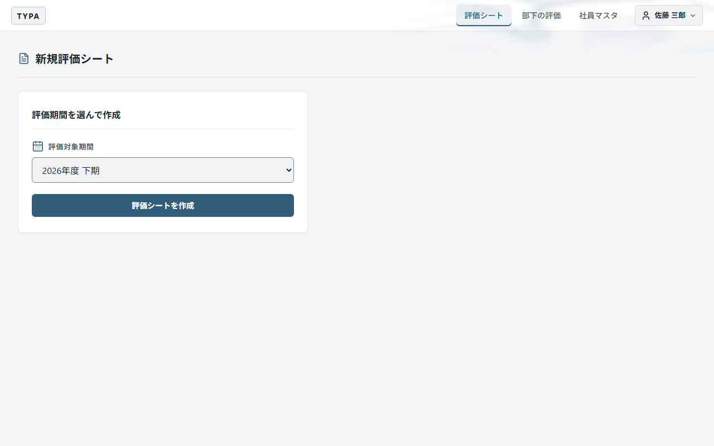

- 作成できるのは、現在実施中の評価期間のシートです。
- すでに作成済みの場合は「新規作成」を押せず、横に「今期の評価シートは作成済みです」と表示されます。一覧から作成済みのシートを開いてください。
- シートに使用する等級と評価項目は、作成時に決まります。等級の変更が必要な場合は、シートを作成する前に管理者に依頼してください。

## 6. 目標を記入する

1つの目標には、「チャレンジ目標」「期中目標」「達成状況」の記入欄があります。それぞれ、次の内容を記入します。

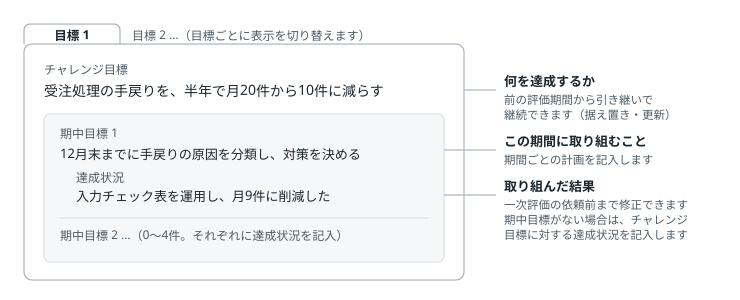

| 記入欄 | 記入する内容 | 必須・任意 |
| --- | --- | --- |
| チャレンジ目標 | この評価期間に達成したいことを、数値や期限を含めて記入します | 必須 |
| 期中目標 | チャレンジ目標の達成に向けて、この期間に取り組むことを記入します。1つのチャレンジ目標につき、0〜4件設定できます | 任意 |
| 達成状況 | 期中目標ごとの実績や結果を記入します。期中目標がない場合は、チャレンジ目標に対する実績や結果を記入します | 任意 |

### 記入の手順

1. シートの「目標を編集」を押します。
2. 各欄に入力します。期中目標を追加する場合は、「期中目標を追加」を押します。
3. 「目標を保存」を押します。目標が複数ある場合は、目標ごとに保存してください。

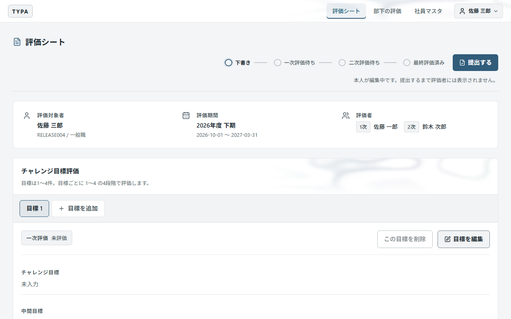

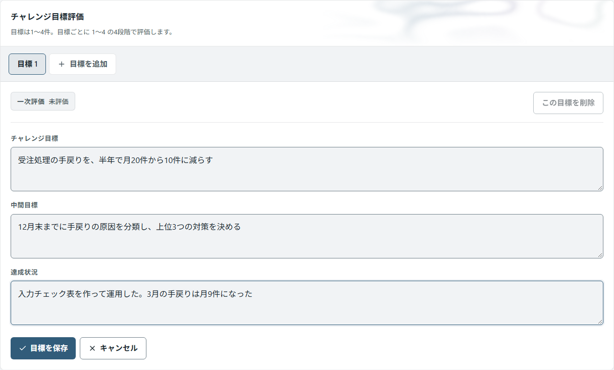

> チャレンジ目標と期中目標を修正できるのは、下書きの間です。達成状況は、一次評価者が目標を確定した後、一次評価を依頼するまでの間に記入します。

### 目標を追加・削除する

目標は、目標ごとのタブを押して切り替えます。

- 「目標を追加」を押すと、新しい目標のタブが追加されます。目標数の上限は、画面の「目標は1〜〇件」で確認できます。
- 不要な目標は、対象のタブを開いて「この目標を削除」を押します。目標は最低1件必要です。
- すべてのタブにチャレンジ目標を記入してください。空欄のタブが残っていると、目標を送信できません。
- 入力内容を保存せずに別の画面へ移ろうとすると、確認画面が表示されます。

### 前期のチャレンジ目標を引き継ぐ

前の評価期間のチャレンジ目標を引き継いで、取り組みを続けることができます。前の評価期間にシートがある場合は、下書きのシートに「前期のチャレンジ目標」が表示されます。目標ごとに、次のいずれかを選んでください。

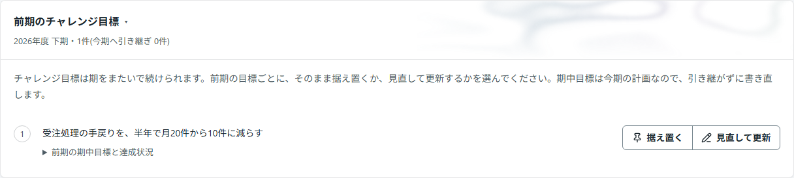

| ボタン | 引き継ぎの内容 | 選択後に行うこと |
| --- | --- | --- |
| 据え置く | 前期と同じ内容で、今期のチャレンジ目標に引き継ぎます | 今期の期中目標を記入します |
| 見直して更新 | 前期の内容を引き継ぎ、編集画面を開きます | 今期の内容に合わせて修正し、保存します |

- 原則として、前期と同じ目標番号に引き継がれます。たとえば、前期の目標2は今期も目標2になります。その番号を別の目標で使用している場合は、未記入の目標、または空いている番号に引き継がれます。
- 引き継がれるのは、チャレンジ目標の文章です。期中目標は、評価期間ごとに記入してください。前期の期中目標と達成状況は、「前期の期中目標と達成状況」を開くと確認できます。
- 引き継いだ目標には、「前期から据え置き」または「前期から更新」と表示されます。この表示は、評価者も確認できます。前期と同じ文章であれば「据え置き」、修正して保存すると「更新」になります。「見直して更新」を押した場合も、修正して保存するまでは「据え置き」と表示されます。
- 修正後に前期の文章に戻す場合は、「前期のまま据え置く」を押します。
- 引き継ぐ操作をしていない前期の目標は、今期のシートには追加されません。新しい目標は「目標を追加」から記入します。引き継いだ目標を削除した場合は、再度引き継ぐことができます。

## 7. 目標を送信し、評価を依頼する

### 目標を送信する（期初）

1. すべての目標を保存します。
2. シート上部の「目標を送信する」を押します。
3. 確認画面で「目標を送信する」を押します。

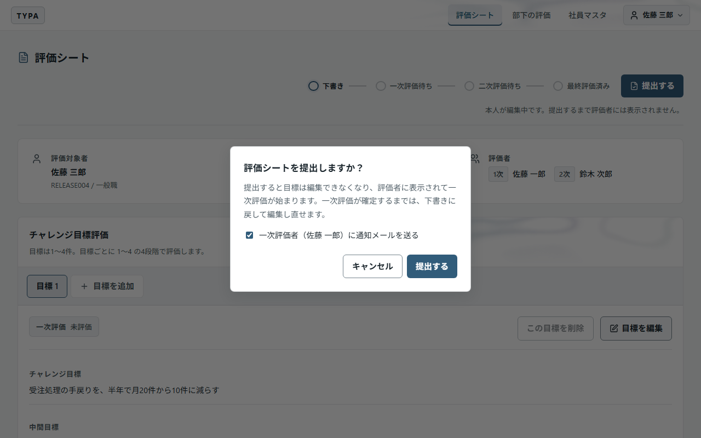

送信すると、状態が「目標確認待ち」に変わり、一次評価者が目標の内容を確認します。この段階では、採点は行われません。

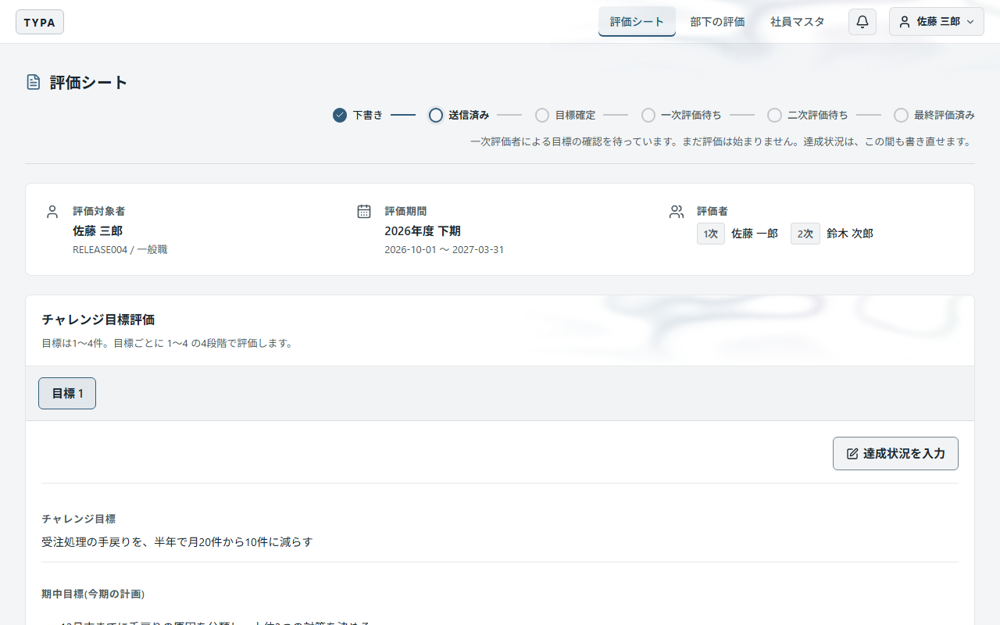

- 修正が必要な場合は、一次評価者がシートを「下書き」に戻します。シート上部に表示される差し戻し理由を確認し、内容を修正・保存して、再度送信してください。再送信すると、差し戻し理由の表示は消えます。
- 一次評価者が「目標を確定する」を押すと、状態が「振り返り待ち」に変わり、達成状況を記入できるようになります。画面の「いまの担当」で、担当者を確認できます。
- 「下書き」「目標確認待ち」の間は、達成状況の欄は表示されず、記入できません。

### 達成状況を記入する（期中・期末）

目標が確定し、状態が「振り返り待ち」になると、達成状況を記入できます。目標の文章や件数は変更できません。

1. 「達成状況を入力」を押します。
2. 期中目標ごとに、実績や結果を記入します。期中目標がない場合は、チャレンジ目標の「達成状況」に記入します。
3. 「達成状況を保存」を押します。

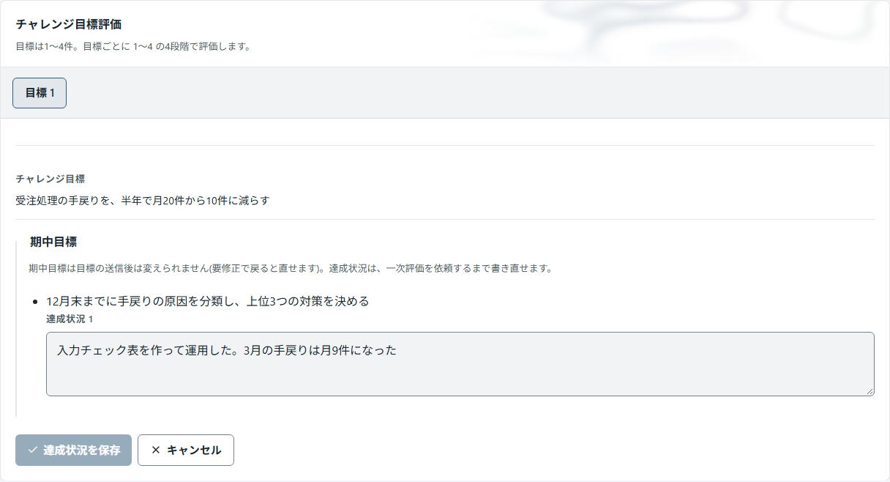

### 一次評価を依頼する（期末）

1. 達成状況の記入と保存を終えたら、シート上部の「一次評価を依頼する」を押します。
2. 確認画面で「一次評価を依頼する」を押します。

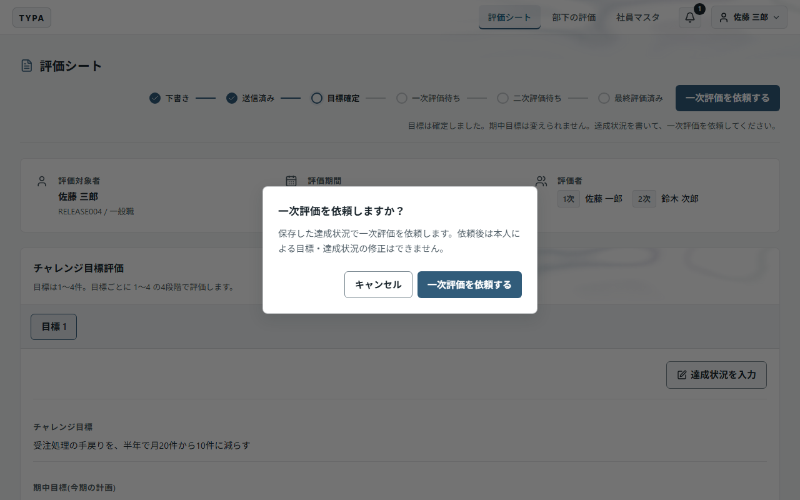

> 依頼すると、状態が「一次評価待ち」に変わります。その後は、自分で目標や達成状況を修正できません。依頼する前に、記入内容を確認してください。

## 8. 評価結果を確認する

評価期間が締められた後、「評価シート」の一覧で、評価確定済みの自分のシートの最終評価ランクを確認できます。評価が確定していても、評価期間が締められるまでは表示されません。

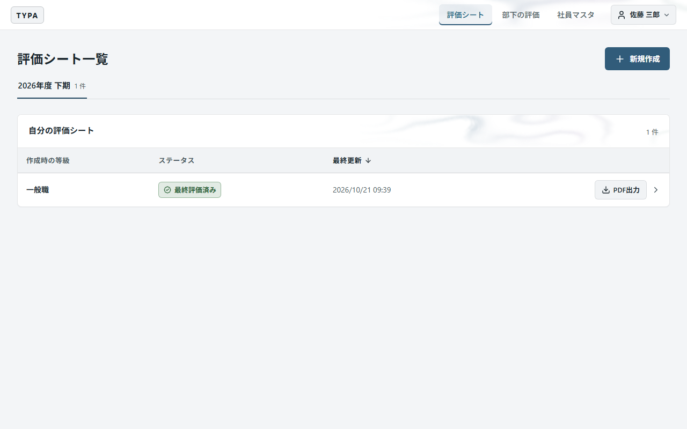

本人に表示されるのは、最終評価ランクのみです。点数や評価コメントは表示されません。また、自分のシートをPDFに保存することはできません。

評価ランクは、100点満点の評価点に応じて自動的に決まります。

| 評価点 | ランク |
| --- | --- |
| 95点以上 | S |
| 90点以上95点未満 | A |
| 80点以上90点未満 | B+ |
| 60点以上80点未満 | B |
| 50点以上60点未満 | B- |
| 40点以上50点未満 | C |
| 40点未満 | D |

### 締め済みの評価期間

一覧上部のタブで、表示する評価期間を切り替えられます。締め済みの自分のシートは開けないため、目標や達成状況も確認できません。評価が確定しないまま締められたシートには、最終評価ランクも表示されません。

## 9. 自分の評価者を確認する

「社員マスタ」で、自分の等級・一次評価者・二次評価者を確認できます。未設定の項目や誤りがある場合は、管理者に設定・修正を依頼してください。

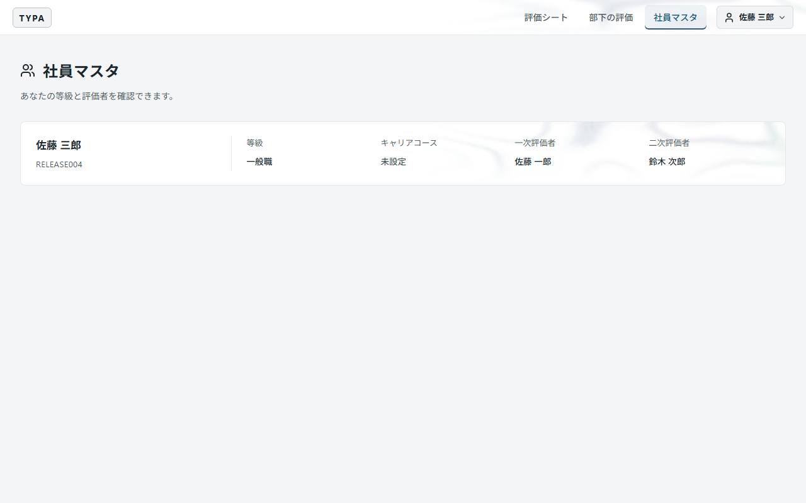

| 二次評価者の表示 | 意味 |
| --- | --- |
| なし | 二次評価は行わず、一次評価者が最終評価を確定します |
| 未設定 | 二次評価者がまだ設定されていません。管理者に連絡してください |

## 10. 通知

目標の確認や評価の依頼など、次の担当者の対応が必要になると、担当者に通知されます。

| 通知されるとき | 通知先 |
| --- | --- |
| 本人が目標を送信したとき | 一次評価者 |
| 一次評価者が目標を確定、または下書きに戻したとき | 本人 |
| 本人が一次評価を依頼したとき | 一次評価者 |
| 一次評価者が評価を確定したとき | 二次評価者 |

最終評価の確定時には、通知は送信されません。通知方法は、管理者が次のいずれかに設定しています。

- **アプリ内通知（標準）**：画面上部のベルで確認します。シートの状態が変わると同時に通知されるため、再送の操作はありません。一次評価者がシートを下書きに戻すと、評価者に届いていた依頼は取り下げられます。
- **メール**：新規登録時に確認したメールアドレスに届きます。目標の送信や評価依頼の確認画面で、相手に通知メールを送るかどうかを選べます。

## 11. 困ったとき

| 困っている内容・表示されるメッセージ | 対応方法 |
| --- | --- |
| パスワードを忘れました | 管理者に登録の取り消しと招待コードの発行を依頼し、新規登録をやり直してください。評価シートはそのまま残ります |
| 「利用が停止されています」と表示されます | 管理者に利用の再開を依頼してください |
| 「ログインできるかを確かめられませんでした」と表示されます | ネットワークの接続を確認してから、再度ログインしてください。新規登録をやり直す必要はありません |
| 社員番号が分かりません | 管理者に確認してください |
| 「新規作成」を押せません | 今期のシートは作成済みです。一覧からシートを開いてください |
| 「チャレンジ目標が空欄の目標は送信・確定できません」と表示されます | 空欄のタブにチャレンジ目標を記入して保存するか、不要なタブを削除してください |
| 送信後に目標を修正したい場合 | 一次評価者に、シートを下書きに戻すよう依頼してください |
| 一次評価の依頼後に修正したい場合 | 本人・評価者の操作では元の状態に戻せません。修正が必要な場合は、管理者に相談してください |
| 前期の目標が別の番号に引き継がれました | 同じ番号を今期の別の目標で使用していたためです。番号が変わっても、どの目標を引き継いだかは記録されます |
| 自分の点数が表示されません | 点数は本人には表示されません。評価が確定し、評価期間が締められた後に、一覧で最終評価ランクのみ確認できます |
| 通知メールが届きません | 迷惑メールフォルダーと共有メールの受信箱を確認してください。「目標確認待ち」「一次評価待ち」の間は、シート上部の「通知を再送」から再送できます。待ち時間や回数の上限が表示された場合は、画面の案内に従ってください。それでも届かない場合は、管理者に宛先の確認を依頼してください |

## 12. アプリの更新とヘルプ

更新のお知らせが表示されたら、入力内容を保存してから「今すぐ更新」を押します。更新が完了すると、アプリが自動で起動し直します。PCは再起動しません。作業を続ける場合は、「あとで」を選んでください。未保存の入力内容がある場合は、更新前に確認画面が表示されます。

ブラウザで利用する場合（[https://typa.tyco.co.jp](https://typa.tyco.co.jp)）は、更新のお知らせは表示されません。開くたびに最新の内容が表示されます。入力内容を保存せずにタブを閉じようとすると、ブラウザに確認メッセージが表示されます。

ユーザーメニューの「ヘルプ」では、評価の仕組み、シートの流れ、記入と評価の手順、評価点とランク、通知、評価期間の終了までの操作を確認できます。評価点の説明には、管理者が設定した現在の配点が使われます。画像を押すと拡大表示されます。「閉じる」を押すか、Escキーを押すと元の表示に戻ります。

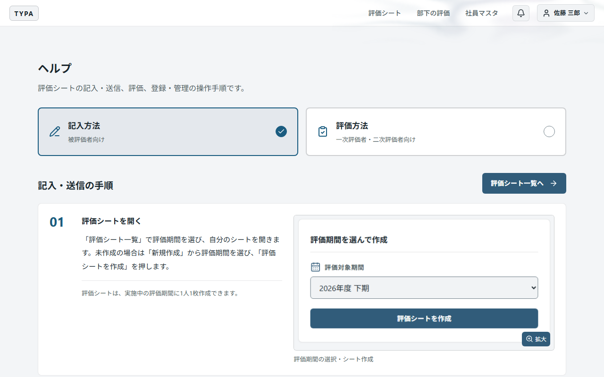
