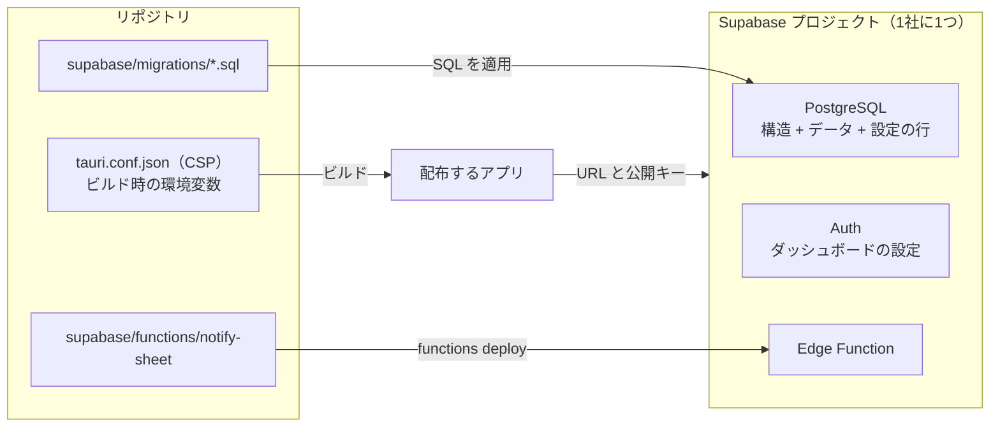

# TYPA Supabase 環境の構築手順と設定一覧

TYPA が使う Supabase の設定を、ひとつ残らず書き出した資料です。次の2つの場面で使います。

- **新しい環境を作る。** 客先向けに Supabase プロジェクトを新しく用意して、TYPA が動く状態にする（[2 章](#2-新しい環境を作る手順)）。
- **いまの環境を確かめる。** どこに何を設定しているか、設定が欠けたりずれたりしていないかを確かめる（[3 章](#3-設定一覧)、[4 章](#4-環境を点検する)）。

設計の理由（なぜその権限なのか、なぜその手順なのか）は [基本設計書](basic-design.md) にあります。この資料は「何を・どこに・どう設定するか」だけを扱います。

| 項目 | 内容 |
| --- | --- |
| 対象 | `supabase/migrations/` の `202610160003` まで、Edge Function `notify-sheet` |
| 確認日 | 2026-10-16 |
| 確認した範囲 | [2.2](#22-データベースを作る)・[2.3](#23-初期データを入れる)・[2.4](#24-auth-を設定する) のフック・新規登録から評価の確定までを、ローカルに空から作った Supabase で実行して確認した |
| 確認していない範囲 | クラウドのダッシュボードでの操作（[2.4](#24-auth-を設定する) のフック以外、[2.5](#25-edge-function-を配置する)）と、本番のメールサーバーへの送信。手順は実装と Supabase の仕様から書いたもので、新しい環境で最初に通すときに [2.8](#28-動作を確かめる) で確かめる |

---

## 目次

1. [全体像](#1-全体像)
2. [新しい環境を作る手順](#2-新しい環境を作る手順)
3. [設定一覧](#3-設定一覧)
4. [環境を点検する](#4-環境を点検する)
5. [運用で触るところ](#5-運用で触るところ)
6. [本番環境で確かめておくこと](#6-本番環境で確かめておくこと)

---

## 1. 全体像

**1社につき、Supabase プロジェクト1つと、その接続先を埋め込んだアプリ1つ**です。データベースに「会社」の区別はなく、設定の表（会社ドメイン、配点、SMTP）は1行だけです。複数の会社を1つのプロジェクトに入れることはできません。

設定は5か所に分かれています。リポジトリから再現できるのは、このうち2か所だけです。

| 置き場所 | 入っているもの | リポジトリにあるか | 反映のしかた |
| --- | --- | :-: | --- |
| データベース（構造） | テーブル、行ポリシー、権限、DB 関数、トリガー | ○ `supabase/migrations/` | SQL を順に適用する |
| Edge Function | 通知メールを送る・SMTP 設定を送信テストして保存する `notify-sheet` | ○ `supabase/functions/` | CLI で配置する |
| データベース（データ） | 権限・等級・評価項目・社員、会社ドメイン | × | SQL で入れる（ひな形は [2.3](#23-初期データを入れる)） |
| データベース（アプリの設定画面から） | 通知の方法、SMTP、配点、目標数の上限、評価期間、評価者 | × | Admin がアプリで設定する |
| Supabase のダッシュボード | Auth の設定（確認メール、テンプレート、パスワード、フック、メール送信） | × | 手で設定する（[2.4](#24-auth-を設定する)） |

これとは別に、アプリの側に接続先を埋め込みます（[2.6](#26-アプリを接続する)）。



---

## 2. 新しい環境を作る手順

上から順に行います。所要は、初期データの準備を除いて1時間ほどです。

### 2.1 プロジェクトを作る

1. Supabase でプロジェクトを作る。リージョンは利用者に近いもの（国内なら Tokyo）。
2. 次の値を控える。

| 値 | 場所 | 使いみち |
| --- | --- | --- |
| プロジェクトの URL（`https://<ref>.supabase.co`） | Project Settings > API | アプリのビルド、CSP |
| 公開キー（publishable。`sb_publishable_...`） | Project Settings > API Keys | アプリのビルド |
| DB の接続文字列 | Connect | マイグレーションを `psql` で適用するとき |

**シークレットキー（`sb_secret_...`、service_role）はアプリに入れません。** ビルドの検査が拒否します。Edge Function は、Supabase が実行時に渡すものを使うので、こちらで設定する必要もありません。

### 2.2 データベースを作る

`supabase/migrations/` の SQL を、**ファイル名の順に、すべて**適用します。先頭の `202610040000_baseline.sql` がテーブルを作り、以降がそれを現在の形にします。新しい環境では、途中の `202610120010_after_app_update.sql` も、止めずに続けて適用してかまいません（古いアプリが存在しないため）。

`psql` がある場合（PowerShell）:

```powershell
$env:DB_URL = "postgresql://postgres.<ref>:<パスワード>@<ホスト>:5432/postgres"
Get-ChildItem supabase/migrations/*.sql | Sort-Object Name | ForEach-Object {
  psql $env:DB_URL -v ON_ERROR_STOP=1 -q -f $_.FullName
  if ($LASTEXITCODE -ne 0) { throw "$($_.Name) で失敗しました" }
}
```

`psql` がない場合は、ダッシュボードの SQL Editor に、ファイルを1つずつ、名前の順に貼って実行します。

- 途中で失敗したら、そこで止めて原因を直します。`202610050001` 以降のファイルは、もう一度流しても同じ結果になるように書いてあります。`202610040000_baseline.sql` だけは、テーブルがすでにある環境には流しません。
- 適用が終わったら、[4 章](#4-環境を点検する) の点検で、構造が期待どおりかを確かめます。

### 2.3 初期データを入れる

マイグレーションが作るのは構造と、設定の行（`evaluation_settings`、`workspace_settings`）だけです。次のデータは SQL で入れます。値は会社ごとに書き換えてください。

```sql
-- 会社のメールドメイン(@ なし)。内部用アドレスのドメインを兼ねるので、運用開始後は変えられない
update public.workspace_settings set required_domain = 'example.co.jp';

-- 権限。名前はアプリが参照するので、この3つをこの綴りで入れる
insert into public.roles (role_name) values ('Admin'), ('Reviewer'), ('Employee');

-- 共通評価の項目セットと、等級。同じ項目で評価する等級は同じセットを指す
insert into public.common_evaluation_item_sets (id, name) values (1, '一般職');
insert into public.employee_grades (grade_name, item_set_id) values ('一般1級', 1), ('一般2級', 1);

-- 共通評価の項目。weight は配点(係数)。item_set_id が null の項目は全等級に共通
insert into public.common_evaluation_items (title, description, weight, item_set_id) values
  ('協調性', '周囲と協力して業務を進めている', 1, null),
  ('専門性', '担当業務に必要な知識・技能を発揮している', 2, 1);

-- 社員。社員番号は半角英数字・ハイフン・アンダースコア。最初の1人は Admin にする
insert into public.employees (name, employee_no, role_id, career_course, grade_id)
select '管理 太郎', 'A0001', (select id from public.roles where role_name = 'Admin'), '総合職',
       (select id from public.employee_grades where grade_name = '一般1級');
```

| データ | 決めること | 注意 |
| --- | --- | --- |
| `workspace_settings.required_domain` | 会社のメールドメイン | 認証コードを受け取れるのは、このドメインのメールアドレスだけ。ログイン用の内部アドレス（`typa-<社員番号>@<ドメイン>`）にも使うため、**登録が始まった後に変えると全員がログインできなくなる** |
| `roles` | なし（固定） | `Admin`・`Reviewer`・`Employee` の3つ。綴りを変えると、その権限は Employee として扱われる |
| `common_evaluation_item_sets`、`employee_grades`、`common_evaluation_items` | 等級の一覧、等級ごとの評価項目と配点 | 等級は項目セットを1つ指す。セットのない等級と、等級が未設定の社員は、全等級に共通の項目だけで評価される。評価項目を変える画面はないので、SQL で管理する |
| `employees` | 社員番号、氏名、権限、コース区分、等級 | 最初の Admin は SQL で入れる。2人目からは Admin がアプリの導入処理「初期ユーザ」で仮登録できる。氏名や社員番号の変更は SQL でしかできない。コース区分が `役員` の社員は、社員マスタで等級・評価者の管理対象から外れる。評価者（`primary_evaluator_id` など）は、登録後に Admin がアプリの社員マスタで設定できる |

`evaluation_periods`（評価期間）は入れなくてかまいません。Admin がアプリの設定画面で追加し、「この期間を開始する」で実施中にします。

### 2.4 Auth を設定する

ダッシュボードの Authentication で設定します。リポジトリにはないので、**新しい環境では必ずこの表を上から確かめます**。

| 設定 | 値 | 理由 |
| --- | --- | --- |
| 新規ユーザーの登録（Allow new users to sign up） | 有効 | 新規登録でアカウントを作るため。誰のアカウントを作れるかは、下のフックが絞る |
| メールでのログイン（Email プロバイダー） | 有効 | 社員番号とパスワードのログインは、内部用アドレスとパスワードで行う |
| メールアドレスの確認（Confirm email） | **無効** | 内部用アドレスにはメールが届かないので、確認を求めると登録が完了しない |
| メールテンプレート（Magic Link、Confirm signup） | 本文に `{{ .Token }}` を入れる | 利用者は、メールに書かれた認証コードをアプリに入力する。リンクだけのテンプレートでは登録できない |
| 認証コードの桁数（Email OTP Length） | 6〜8 | アプリの入力欄は8桁まで |
| パスワードの条件 | 6文字以上、英小文字・英大文字・数字を必須 | アプリの案内文がこの条件。弱いパスワードを Auth が拒否する |
| Auth フック「Before User Created」 | Postgres 関数 `public.hook_before_user_created` | 会社ドメインのメールアドレスと、登録の途中にある社員の内部用アドレス以外では、アカウントを作らせない |
| メールの送信（SMTP Settings） | 独自の SMTP を設定する | 認証コードのメールを送る。Supabase 標準の送信は、宛先と通数に強い制限があり、運用には使えない |
| メールの送信数の上限（Rate Limits） | 登録が集中する初日に足りる数 | 上限に達すると、認証コードが届かなくなる |

- **メールの送信設定は2つあります。** ここで設定するのは、Supabase Auth が認証コードを送るためのものです。評価の通知メールを送る設定は別で、アプリの設定画面から登録します（[2.7](#27-最初の-admin-が設定する)）。同じメールサーバーを使ってもかまいません。
- フックを設定しなくても、社員に紐付かないアカウントは何も読み書きできません。設定する理由は、外部からアカウントを大量に作られることと、内部用アドレスを先に取られることを防ぐためです。
- フックの設定後は、会社ドメイン以外のメールアドレスに認証コードを送ろうとしても、Auth が拒否します（アプリの画面では、その前にボタンが押せません）。

### 2.5 Edge Function を配置する

```powershell
npx supabase login
npx supabase functions deploy notify-sheet --project-ref <ref>
```

- 追加で設定する値（シークレット）はありません。関数は、Supabase が実行時に渡す URL とキーで DB を読みます。
- JWT の検証（Verify JWT）は有効のままにします（既定）。
- CLI は、インストールしていなくても `npx supabase` で実行できます。

### 2.6 アプリを接続する

アプリは、接続先の Supabase を1つだけ知っています。客先ごとに、次の3か所を合わせてビルドします。

| 場所 | 内容 |
| --- | --- |
| ビルド時の環境変数 `VITE_SUPABASE_URL`、`VITE_SUPABASE_PUBLISHABLE_KEY` | [2.1](#21-プロジェクトを作る) で控えた URL と公開キー。GitHub Actions では Secrets に置く |
| [src-tauri/tauri.conf.json](../src-tauri/tauri.conf.json) の `app.security.csp` と `devCsp` | `connect-src` に、その環境の `https://<ref>.supabase.co` と `wss://<ref>.supabase.co` を書く。いまは本番のプロジェクトの値が直接書いてある |
| 同じファイルの `plugins.updater`（`pubkey`、`endpoints`）、`identifier`、`productName` | 自動更新の配布元と署名の公開鍵。別の配布元から配るなら変える |

URL と CSP が一致していないと、ビルドが「Supabase URL must use HTTPS and match an explicit production CSP connect-src origin.」で止まります（[scripts/releaseEnvironment.ts](../scripts/releaseEnvironment.ts)）。配布のワークフロー（[release.yml](../.github/workflows/release.yml)）が使う Secrets は、`VITE_SUPABASE_URL`、`VITE_SUPABASE_PUBLISHABLE_KEY`、`TAURI_SIGNING_PRIVATE_KEY`、`TAURI_SIGNING_PRIVATE_KEY_PASSWORD`です。手動タグ作成にはワークフローの `github.token` を使います。

### 2.7 最初の Admin が設定する

1. 最初の Admin には管理用 SQL で招待コードを発行する（下の例）。その社員が会社メールの認証コード・社員番号・招待コード・パスワードで登録する。以後の社員の招待は Admin がアプリの社員マスタから発行する。
2. 「設定」で次を登録する。

| 設定 | 内容 |
| --- | --- |
| 通知 | 評価の依頼の知らせ方。初めはアプリ内通知（画面上部のベル）で、設定は要らない。メールにするときは、SMTP のホスト、ポート、送信元メールアドレス、パスワードを入れて「テストメールを送って保存する」を押し、届いてから「メール」を選ぶ。**ポートは 465**。Edge Function からは 25 と 587 に接続できない |
| 評価点の配点 | チャレンジ目標と共通評価の配点（合計 100。初めは 20 / 80） |
| チャレンジ目標の数の上限 | 1〜10（初めは 4） |
| 評価期間 | 期間を追加し、「この期間を開始する」で実施中にする |

3. 「社員マスタ」で、社員の評価者（一次・二次。二次評価者を置かない社員は「なし」）と、Reviewer・Admin の権限を設定する。
4. 自分だけが使う PC の社員は、「社員マスタ」の「ログイン」を「保持する」にする。初めは全員、アプリを閉じるとログアウトする。共有 PC を使う社員は変えない。

最初の Admin 用だけ、SQL Editor で次を実行し、返されたコードを本人に渡します。社員番号を置き換えてください。コードはこの結果でだけ確認でき、7日間有効です。再実行すると古いコードは無効になります。

```sql
with invitation as (
  select e.id, upper(replace(gen_random_uuid()::text, '-', '')) as code
  from public.employees e join public.roles r on r.id=e.role_id
  where e.employee_no='001' and e.user_id is null and e.is_enabled and r.role_name='Admin'
), issued as (
  insert into public.employee_invitations(employee_id,code_hash,expires_at)
  select id, encode(sha256(convert_to(code,'UTF8')),'hex'), now()+interval '7 days' from invitation
  on conflict(employee_id) do update set code_hash=excluded.code_hash, expires_at=excluded.expires_at
  returning employee_id,expires_at
)
select invitation.code,issued.expires_at from invitation join issued on employee_id=invitation.id;
```

### 2.8 動作を確かめる

| 確かめること | 方法 | 期待する結果 |
| --- | --- | --- |
| ログインなしでは何も読めない | 下のコマンド | `permission denied for table employees`（HTTP 401） |
| 構造が期待どおり | [4 章](#4-環境を点検する) の点検 | 期待値と一致 |
| 会社ドメイン以外では登録できない | アプリの新規登録で、別ドメインのメールアドレスを入れる | ボタンが押せない。API を直接呼んでも、フックが拒否する |
| 新規登録 | 社員がアプリで登録する | 認証コードのメールが届き、登録後にログインできる |
| 評価の流れ | テスト用の社員で、作成 → 目標の送信 → 目標の確定 → 一次評価の依頼 → 一次評価の確定 → 評価の確定 | 各段階で次の人に進む。確定後に PDF を出力できる |
| 通知 | 上の各段階 | アプリ内通知のときは、次の評価者のベルに未読が付く。メールのときは「通知メールを送る」を選ぶと次の評価者にメールが届き、アプリに「送信しました」と出る（評価の確定ではどちらも知らせない） |

```powershell
curl.exe -s "$env:VITE_SUPABASE_URL/rest/v1/employees?select=id&limit=1" -H "apikey: $env:VITE_SUPABASE_PUBLISHABLE_KEY"
```

1行目の応答には「`GRANT SELECT ON public.employees TO anon` を実行せよ」というヒントが付きますが、**従わないでください**。ログイン前に読めないのが正しい状態です。

送信テストが失敗したときは、画面に出る SMTP の応答（「詳細: …」）を見ます。`HandshakeFailure` は、メールサーバーが古い暗号化方式（RSA 鍵交換など）しか受け付けず、Edge Function（Deno）とつながらないことを表します。メールサーバーに ECDHE 系の暗号化方式を有効にしてもらうか、別のメールサービスに切り替えます。ポートは 465 を使います（25 と 587 には接続できません）。それまではアプリ内通知で運用できます。

---

## 3. 設定一覧

### 3.1 データベースの構造

すべてマイグレーションが作ります。手で作ったものはありません。内容は [基本設計書の 8 章](basic-design.md#8-データ設計) に、1行ずつの一覧は [security/schema-inventory.expected.txt](../security/schema-inventory.expected.txt) にあります。

| 種類 | 数 | 要点 |
| --- | --: | --- |
| テーブル | 13 | すべて行レベルセキュリティが有効 |
| 行ポリシー | 23 | ログイン前（anon）向けのものはない |
| DB 関数 | 36 | アプリが呼ぶもの、トリガーが使うもの、Auth と Edge Function だけが呼ぶもの |
| トリガー | 13 | 期間締め後の固定、段階ごとに書ける列、確定時の検算、等級・評価者の固定 |

誰が何を呼べるか:

| 呼ぶ人 | できること |
| --- | --- |
| ログイン前（anon） | DB 関数 `get_required_domain` だけ。テーブルは何も読み書きできない |
| ログイン済み（authenticated） | 行ポリシーと列権限の範囲で、テーブルの読み書きと DB 関数の呼び出し |
| Edge Function（service_role） | `get_sheet_notification`、`workspace_settings` の通知の方法と SMTP 設定の読み取り、送信テストに成功した SMTP 設定の保存 |
| Supabase Auth（supabase_auth_admin） | `hook_before_user_created` |

### 3.2 データベースにある設定値

| テーブル | 行 | 列 | 誰が変えるか |
| --- | --- | --- | --- |
| `workspace_settings` | 1行 | `required_domain`（会社ドメイン） | SQL。運用開始後は変えない |
| | | `notification_channel`（通知の方法。初めは `in_app`） | Admin がアプリの設定画面で。`email` は送信テスト済みの SMTP 設定があるときだけ |
| | | `smtp_host`、`smtp_port`、`smtp_user`、`smtp_password`、`smtp_verified_at`（通知メールの送信） | Admin がアプリの設定画面で送信テストに成功したとき、Edge Function が保存する。クライアントからは書けず、パスワードは読めない |
| `notifications` | 依頼ごと | アプリ内通知（宛先、シート、種類、既読） | 状態の変更のトリガーが作る。本人が既読にする |
| `evaluation_settings` | 1行 | `objective_allocation`、`common_allocation`（配点。合計 100）、`max_challenge_goals`（目標数の上限） | Admin がアプリの設定画面で |
| `evaluation_periods` | 期間ごと | 期間名、開始日、終了日、実施中かどうか | Admin がアプリの設定画面で。実施中は常に1つ |
| `roles` | 3行 | 権限の名前 | 変えない |
| `employee_grades`、`common_evaluation_item_sets`、`common_evaluation_items` | 会社ごと | 等級、評価項目、配点 | SQL |
| `employees` | 社員ごと | 社員番号、氏名、コース区分 | SQL |
| | | 評価者、等級 | Admin（評価者は Reviewer も）がアプリの社員マスタで |
| | | 権限 | Admin がアプリの社員マスタで（DB 関数 `set_employee_role`） |
| | | アプリを閉じた後もログインを残すか（`keep_signed_in`。初めは残さない） | Admin がアプリの社員マスタで |
| | | アカウントの紐付け（`user_id`） | 新規登録と登録の取り消しだけが変える |
| `employee_contacts` | 登録済みの社員ごと | 通知メールの宛先 | 新規登録のときに DB が控える |

### 3.3 Supabase のダッシュボードで設定するもの

[2.4](#24-auth-を設定する) の表のとおりです。Auth 以外（Storage、Realtime、Database Webhooks、Cron）は使っていません。Data API は既定のままで、公開するスキーマは `public` です。

### 3.4 Edge Function

| 関数 | 呼ぶ人 | すること | 設定 |
| --- | --- | --- | --- |
| `notify-sheet` | アプリ（ログイン済みの利用者） | 通知の方法がメールのとき、シートのいまの状態に応じて、評価者に通知メールを送る。誰に送るか、呼んだ人がその操作をした本人かは、DB 関数 `get_sheet_notification` が決める。アプリ内通知のときは何もしない。Admin が送る `mode: "save"` では、入力された SMTP 設定で送信テストを行い、届いたときだけ保存する | JWT の検証は有効。シークレットの追加はなし |

### 3.5 アプリに埋め込むもの

[2.6](#26-アプリを接続する) の表のとおりです。埋め込むのは URL と公開キーだけで、どちらも配布物から取り出せる前提の値です。

---

## 4. 環境を点検する

[security/schema-inventory.sql](../security/schema-inventory.sql) は、その環境のテーブル・列・行ポリシー・権限・DB 関数（本体のハッシュ付き）・トリガー・制約・索引を、1行に1つずつ書き出します。読み取りだけで、社員や評価のデータは出しません。正しく作られた環境では、[security/schema-inventory.expected.txt](../security/schema-inventory.expected.txt) と同じ結果になります。

1. SQL Editor に `schema-inventory.sql` を貼って実行する（1つの文なので、結果がすべて表示される）。
2. 結果を CSV などで保存し、期待値と比べる。

`psql` がある場合:

```powershell
psql $env:DB_URL -At -f security/schema-inventory.sql | Out-File actual.txt -Encoding utf8
Compare-Object (Get-Content security/schema-inventory.expected.txt) (Get-Content actual.txt)
```

| 差の出方 | 意味 |
| --- | --- |
| 差がない | マイグレーションがすべて当たっていて、手で変えたところもない |
| `FUNCTION` の行の `md5` が違う | その関数が古い（マイグレーションが当たっていない）か、手で書き換えられている |
| `POLICY`・`GRANT` の行が多い・少ない | 権限がずれている。多い場合は、開いてはいけないものが開いているおそれがある |
| `TRIGGER ON auth.users` の行がある | マイグレーションにないトリガーが、手で付けられている（[6 章](#6-本番環境で確かめておくこと)） |

期待値は、ローカルの Supabase で作ったものです。クラウドの環境では、Supabase 自身が管理する行（`DEFAULT PRIVILEGES supabase_admin` など）が違うことがありえます。新しい環境で初めて比べたときに差が出たら、その行が TYPA のマイグレーションに由来するものかを見て判断してください。

マイグレーションを追加したら、ローカルに適用したうえで期待値を作り直します（コマンドは `schema-inventory.sql` の先頭にあります）。

---

## 5. 運用で触るところ

| やりたいこと | 方法 |
| --- | --- |
| 社員を追加する | SQL で `employees` に行を足す（[2.3](#23-初期データを入れる) の最後の文）。Admin が招待コードを発行し、本人がアプリで新規登録する |
| 社員の氏名・社員番号・コース区分を直す | SQL。登録済みの社員の社員番号は変えない（ログイン用の内部アドレスが社員番号から決まっているため。変えるなら、先にアプリで登録を取り消す） |
| 評価者・等級・権限を変える | アプリの社員マスタ |
| 毎回のログインを省く（自分の PC の社員だけ） | アプリの社員マスタで「ログイン」を「保持する」にする。本人の次のログインから反映される |
| パスワードを忘れた、別人が登録した | Admin がアプリの社員マスタで登録を取り消し、新しい招待コードを発行して本人が新規登録をやり直す |
| 登録が途中で止まり、パスワードも分からない | Admin が招待コードを再発行する（未紐付けの内部アカウントも整理される） |
| 評価項目・等級を変える | SQL。確定済みのシートは、確定時の集計を持っているので影響を受けない。進行中のシートは、変えた後の項目で評価される |
| 評価期間を締める | アプリの設定画面で、次の期間を開始する |
| 通知の方法・通知メールの送信元・パスワードを変える | アプリの設定画面（メールの設定は送信テストに成功したときだけ保存される）。アプリの再配布は要らない |
| 構造を変える | マイグレーションを追加し、すべての環境に同じ順で適用する。期待値（[4 章](#4-環境を点検する)）を作り直す |

- 退職した社員の行は消しません（評価シートが連鎖して消える定義のため）。Admin が社員マスタで「利用停止」してください。既存セッションの API 権限と再登録を止め、履歴を残します。登録の取り消しだけでは再登録できるため、退職時には使いません。
- 1回の問い合わせで返る行は 1,000 行までです（Supabase の既定）。社員が 1,000 人を超える会社では、社員マスタの一覧が欠けます。
- 新しいテーブルや関数は、マイグレーションで権限を与えるまで API に出ません（`postgres` ロールで作ったものに限る。既定の権限を外してあるため）。

---

## 6. 本番環境で確かめておくこと

この資料を書いた時点で、ダッシュボードの設定は見ていません。本番（`typa-base`）について、次の点を一度確かめて、結果をこの章に書き足してください。

| 確かめること | 方法 | なぜ |
| --- | --- | --- |
| [2.4](#24-auth-を設定する) の表のとおりか | ダッシュボードで1行ずつ見る | Auth の設定はリポジトリになく、ずれていても気付けない |
| 構造が期待値と一致するか | [4 章](#4-環境を点検する) | 過去にダッシュボードから直接変えたものが残っていないかを見る |
| `auth.users` にトリガーが付いていないか | 4 章の結果に `TRIGGER ON auth.users` の行があるか | DB 関数 `check_user_limit`（アカウントを 150 件までに制限する）が、どこにも付いていないはず。付いている場合、社員1人が最大2件（確認用のメールアドレスと、ログイン用）使うので、およそ 75〜150 人で登録できなくなる |
| 通知が届くか | [2.8](#28-動作を確かめる) の最後の行 | メールにするときは、設定画面の送信テストで本番のメールサーバーに届くことを確かめる |
| 配布済みのアプリがすべて新しいか | 利用者に確かめる | `202610120010` の適用後は、0.9.8 以前のアプリは評価シートを開けない |

ベースラインにある DB 関数のうち、`check_user_limit` と `rls_auto_enable` は、マイグレーションのどこからも使っていません（新しい環境では、作られるだけで何にも付きません）。
