# TYPA 利用者ガイド

目標の記入から一次・二次評価、確定までの流れを、画面に沿って説明します。
細かい疑問はアプリ内の「ヘルプ」（右上のユーザーメニュー）を参照してください。

```
本人：記入 → 提出  →  一次評価者：評価 → 確定  →  二次評価者：評価 → 確定（完了）
```

## 1. ログイン

社員番号とパスワードでログインします。初めての場合は下の「新規登録」へ。


### 初めて使うとき（新規登録）

1. 会社のメールアドレスを入力し、「認証コードを受け取る」を押します。
2. メールに届いた**認証コード**、社員番号、管理者から受け取った**招待コード**、パスワードを入力して「登録する」を押します。

招待コードは7日間有効・1回限りです。なくした・期限が切れた場合は管理者に再発行を依頼してください。


## 2. 本人：評価シートを書いて提出する

「評価シート一覧」の「新規作成」から、今回の評価期間のシートを作ります。

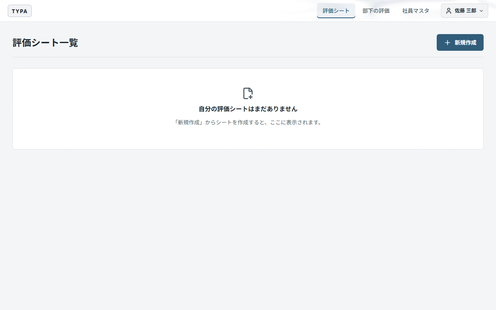

「目標を編集」でチャレンジ目標などを入力し、「目標を保存」を押します。保存すれば途中でやめても続きから書けます。

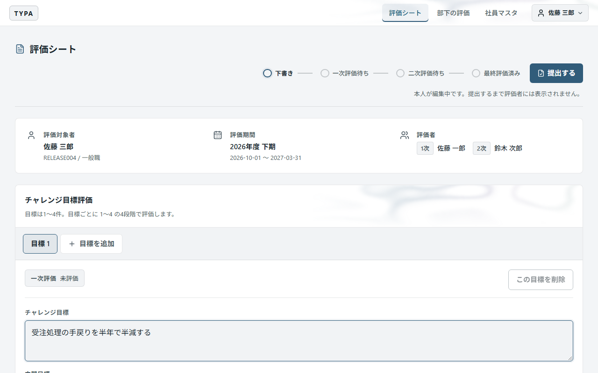

書き終えたら上部の「提出する」を押します。一次評価者へ通知メールを送るか選べます。

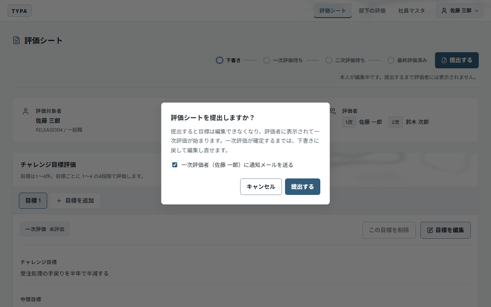

提出すると状態が「一次評価待ち」になり、目標は編集できなくなります。一次評価が確定する前なら「下書きに戻す」で直せます。

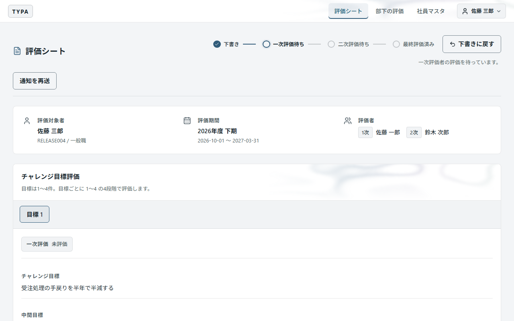

## 3. 評価者：評価して確定する

「部下の評価」に担当する社員が並びます。「一次評価する」「二次評価する」の件数が、自分の番のシートです。行を押すとシートが開きます。

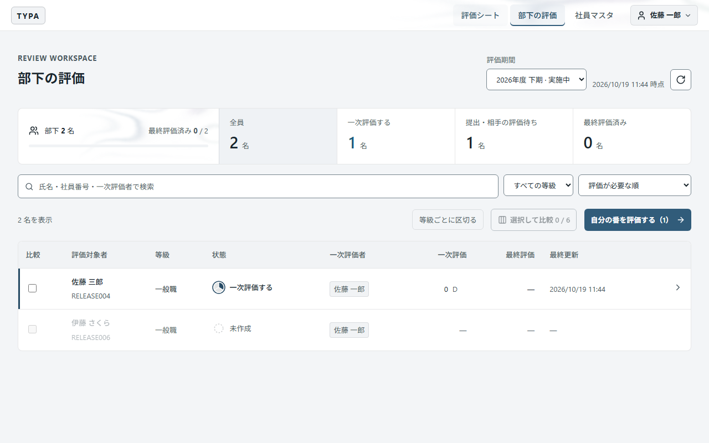

チャレンジ目標と共通評価のそれぞれで「評価を入力」を押し、1〜4で採点して「評価を保存」を押します。右下に評価ランクと点数の見込みが出ます。

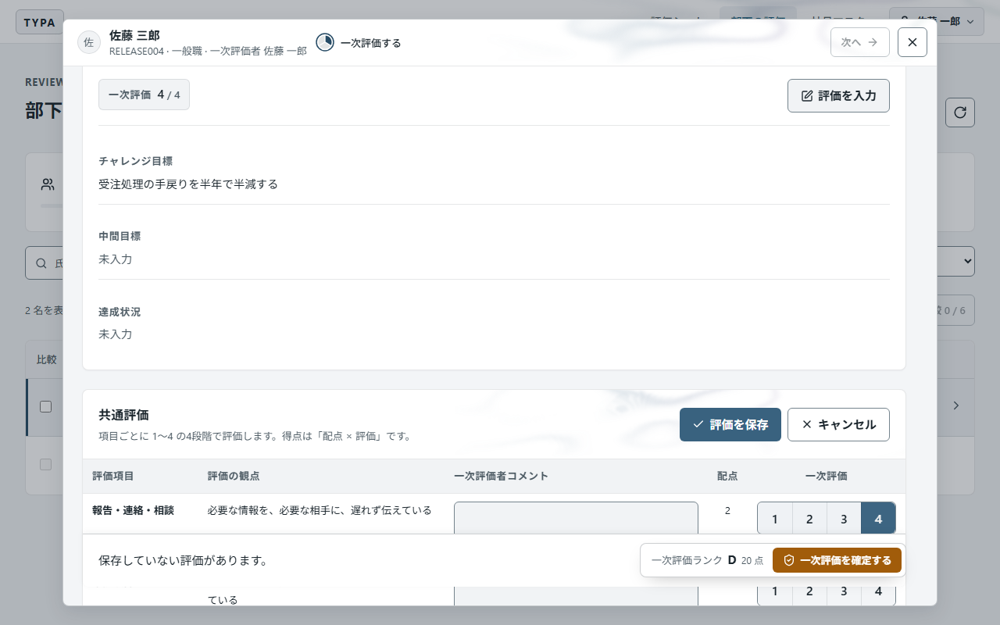

すべて採点したら右下の「一次評価を確定する」を押します。確定すると変更できません。二次評価者へ通知メールを送るか選べます。

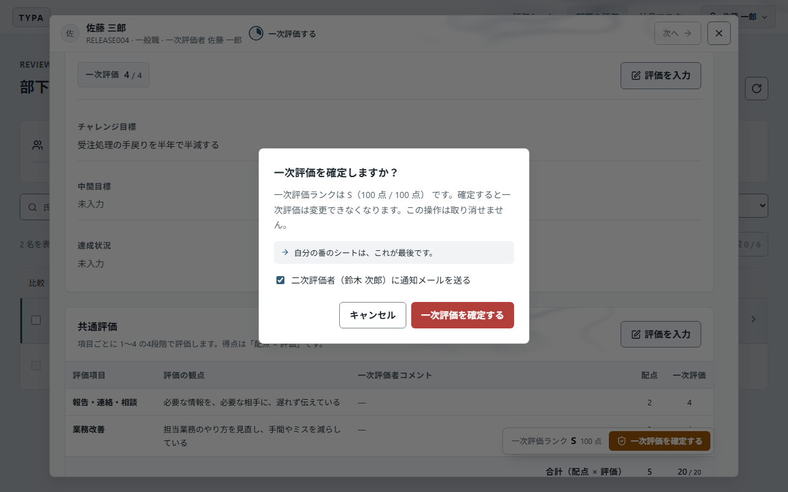

二次評価者も同じ手順で採点し、「評価を確定する」で最終評価が決まります。二次評価者が「なし」の社員は、一次評価の確定で完了します。

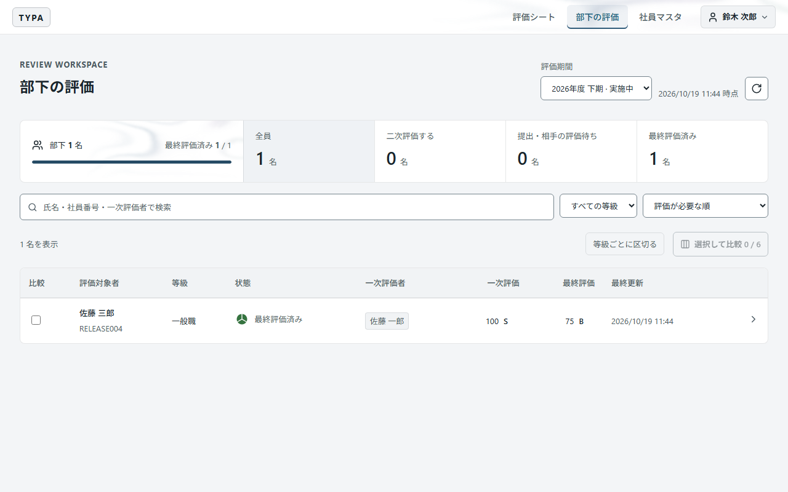

確定したシートは「評価シート一覧」から PDF に出力できます。

## 4. 管理者

### 社員マスタ

社員ごとの権限・等級・一次評価者・二次評価者を設定します。選ぶと自動で保存されます。
未登録の社員には「招待コードを一括発行」でコードを発行し、本人に個別に渡します。

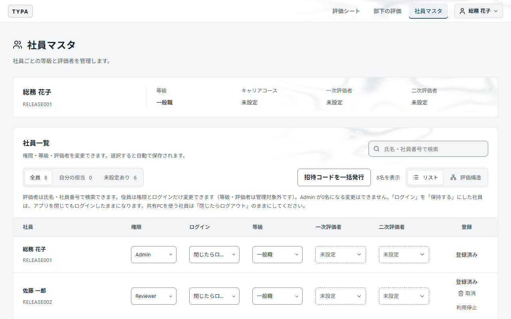

| やりたいこと | 操作 |
| --- | --- |
| パスワードを忘れた社員がいる | 「取消」→ 招待コードを発行 → 本人が再登録（評価データは残ります） |
| 退職・休職で利用を止めたい | 「利用停止」。再開は「利用再開」 |
| 共有PCで使う | 「ログイン」を「閉じたらログアウト」にしておく |

### 設定

右上のユーザーメニュー →「設定」で、評価期間・配点・目標の数・通知メールの送信元を設定します。
シートを作成・記入・評価できるのは「実施中」の期間だけです。

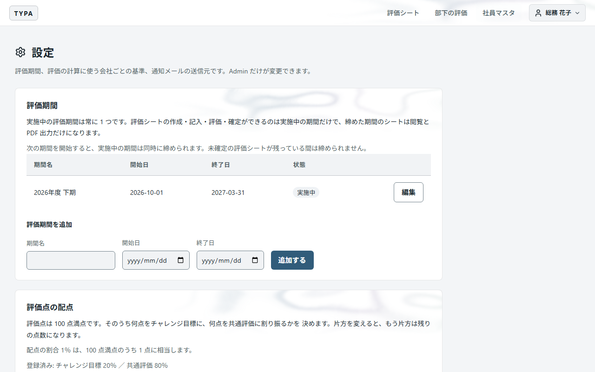

## 困ったとき

ユーザーメニュー →「ヘルプ」に、記入方法・評価方法とよくある質問があります。

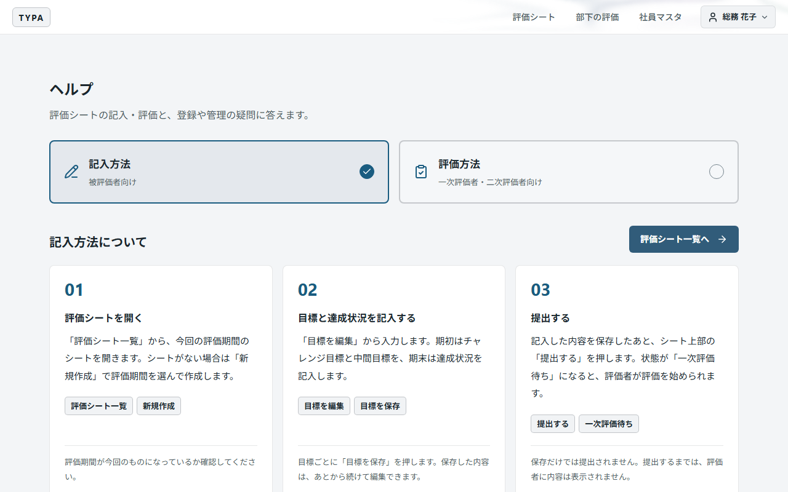
